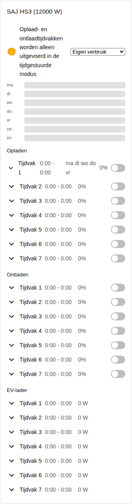
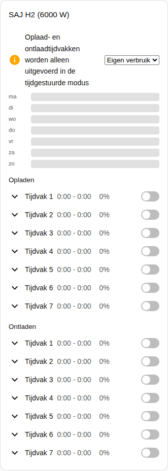

[en](../../../en-gb/user/cards/schedule-card.md) | [de](../../../de/user/cards/schedule-card.md) | nl | [fr](../../../fr/user/cards/schedule-card.md) | [zh](../../../zh-hans/user/cards/schedule-card.md) | [es](../../../es/user/cards/schedule-card.md) | [it](../../../it/user/cards/schedule-card.md) | [pl](../../../pl/user/cards/schedule-card.md) | [sv](../../../sv/user/cards/schedule-card.md)

# Schemakaart

De pagina Schemakaart legt de schemakaart uit, die de oplaad-, ontlaad- en EV-laadtijdvakken toont en bewerkt. De volledige lijst staat in de sectie [Schemakaart](../../../../frontend/docs/features.md#schedule-card) van de functielijst van de kaarten. [Een element toevoegen](README.md#een-element-toevoegen) legt uit hoe u de kaart toevoegt en een systeem kiest.

## Wat de kaart toont

- De oplaad-, ontlaad- en EV-laadtijdvakken, elk met de tijden, het vermogen, de dagen en of het tijdvak aan staat. De optie Soorten tijdvakken kiest welke soorten de kaart toont.
- Met Weektijdlijn tonen aan, wat de standaard is, tekent een weektijdlijn elk tijdvak als een balk. Tik op een balk om het tijdvak te openen.
- Een geopend tijdvak heeft een editor voor het begin, het einde, het vermogen, de dagen en de andere instellingen van het tijdvak.
- Een tijdvak verschijnt alleen wanneer elke entiteit van het tijdvak is ingeschakeld, en de kaart telt de tijdvakken die de kaart weglaat. [Bediening toestaan](../changing-settings.md#de-bedieningsset) inschakelen schakelt de entiteiten van de tijdvakken in.
- Oplaad- en ontlaadtijdvakken worden alleen uitgevoerd in een tijdgestuurde toepassingsmodus. Wanneer de toepassingsmodus een andere modus is, zegt een melding dat en toont de melding de modelijst ernaast. Tijdgestuurd en Tijdgestuurd (BMS) tellen beide.
- Zolang bediening niet is toegestaan voor het systeem, is elke bediening op de kaart uitgeschakeld en verwijst een slot naar de instellingen van de integratie. Zie [Bediening toestaan](../changing-settings.md#bediening-toestaan).

## Verschillen tussen de modellen

- **Alleen HS3:** de EV-laadtijdvakken.
- **H2:** alleen oplaad- en ontlaadtijdvakken, zoals de schermafbeelding hieronder toont.

De dagknoppen van een tijdvak zijn de knoppen van de [weekdagen-tegelkaartfunctie](weekdays-feature.md).

## Opties

| Optie in de editor | YAML-sleutel | Standaard |
| --- | --- | --- |
| Systeem | `device` | Het eerste systeem |
| Soorten tijdvakken | `slot_kinds`, een lijst van `charge`, `discharge` en `ev_charger` | Alle soorten |
| Weektijdlijn tonen | `show_timeline` | Aan |

## Nog niet ondersteund

- Schema's voor vermogensregeling. Een schema voor vermogensregeling volgt een Home Assistant-schemahelper, zie [vermogensregeling](../power-control.md#een-schema-volgen).
