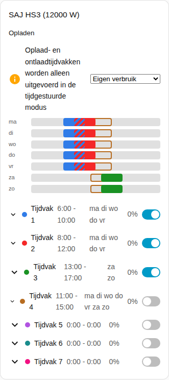
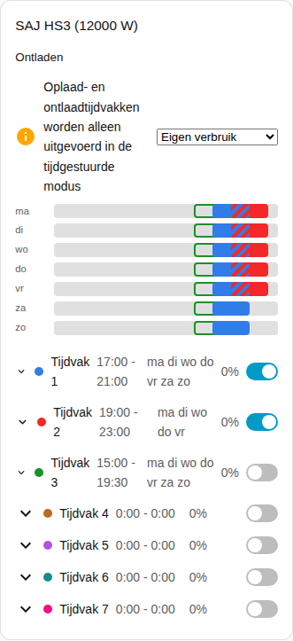
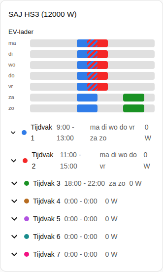

[en](../../../en-gb/user/cards/schedule-cards.md) | [de](../../../de/user/cards/schedule-cards.md) | nl | [fr](../../../fr/user/cards/schedule-cards.md) | [zh](../../../zh-hans/user/cards/schedule-cards.md) | [es](../../../es/user/cards/schedule-cards.md) | [it](../../../it/user/cards/schedule-cards.md) | [pl](../../../pl/user/cards/schedule-cards.md) | [sv](../../../sv/user/cards/schedule-cards.md)

# Schemakaarten

De pagina Schemakaarten legt de drie schemakaarten uit. Elke kaart toont en bewerkt de tijdvakken van één soort: opladen, ontladen of EV-lader. De volledige lijst staat in de sectie [Schedule cards](../../../../frontend/docs/features.md#schedule-cards) van de functielijst van de kaarten. [Een element toevoegen](README.md#een-element-toevoegen) legt uit hoe u een kaart toevoegt en een systeem kiest.

## Wat elke schemakaart toont

- De titel van de kaart en onder de titel een kop met de soort van de kaart.
- De tijdvakken van de soort, elk met de tijden, het vermogen, de dagen en of het tijdvak aan staat.
- Een kleur voor elk tijdvaknummer. Tijdvak 1 heeft op alle drie de kaarten dezelfde kleur. Elke rij van een tijdvak begint met een kleurmarkering in de kleur van het tijdvak.
- Met Weektijdlijn tonen aan, wat de standaard is, tekent een weektijdlijn elk tijdvak als een balk in de kleur van het tijdvak. Tik op een balk om het tijdvak te openen.
- Een tijdvak dat uit staat is een omtrek in de kleur van het tijdvak, zonder vulling. De balk van een tijdvak dat aan staat verbergt het deel van een omtrek dat de balk kruist. Waar twee of meer tijdvakken die aan staan op een dag overlappen, tekent de tijdlijn de overlap als strepen in de kleuren van de overlappende tijdvakken. Een tijdvak dat uit staat maakt geen overlap. Tik op een overlap om het overlappende tijdvak met het laagste nummer te openen.
- Een geopend tijdvak heeft een editor voor het begin, het einde, het vermogen, de dagen en de andere instellingen van het tijdvak.
- Een tijdvak verschijnt alleen wanneer elke entiteit van het tijdvak is ingeschakeld, en de kaart telt de tijdvakken die de kaart weglaat. [Bediening toestaan](../changing-settings.md#de-bedieningsset) inschakelen schakelt de entiteiten van de tijdvakken in.
- Zolang bediening niet is toegestaan voor het systeem, is elke bediening op de kaart uitgeschakeld en verwijst een slot naar de instellingen van de integratie. Zie [Bediening toestaan](../changing-settings.md#bediening-toestaan).

De dagknoppen van een tijdvak zijn de knoppen van de [weekdagen-tegelkaartfunctie](weekdays-feature.md).

## Opties

Alle drie de kaarten hebben dezelfde opties.

| Optie in de editor | YAML-sleutel | Standaard |
| --- | --- | --- |
| Systeem | `device` | Het eerste systeem |
| Weektijdlijn tonen | `show_timeline` | Aan |

## Schemakaart opladen

De Schemakaart opladen toont de oplaadtijdvakken.

Oplaadtijdvakken worden alleen uitgevoerd in een tijdgestuurde toepassingsmodus. Wanneer de toepassingsmodus een andere modus is, zegt een melding dat en toont de melding de modelijst ernaast. Tijdgestuurd en Tijdgestuurd (BMS) tellen beide.

## Schemakaart ontladen

De Schemakaart ontladen toont de ontlaadtijdvakken.

Ontlaadtijdvakken worden alleen uitgevoerd in een tijdgestuurde toepassingsmodus, dus de kaart toont dezelfde melding als de Schemakaart opladen.

## Schemakaart EV-lader

De Schemakaart EV-lader toont de EV-laadtijdvakken. De kaart toont geen melding over de tijdgestuurde modus.

## Verschillen tussen de modellen

- **Alleen HS3:** de EV-laadtijdvakken. Bij een H2 toont de Schemakaart EV-lader de lege toestand, die zegt welke soort entiteit moet worden ingeschakeld.
- **H2:** alleen oplaad- en ontlaadtijdvakken.

## Nog niet ondersteund

- Schema's voor vermogensregeling. Een schema voor vermogensregeling volgt een Home Assistant-schemahelper, zie [vermogensregeling](../power-control.md#een-schema-volgen).
