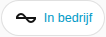

[en](../../../en-gb/user/cards/status-badge.md) | [de](../../../de/user/cards/status-badge.md) | nl | [fr](../../../fr/user/cards/status-badge.md) | [zh](../../../zh-hans/user/cards/status-badge.md) | [es](../../../es/user/cards/status-badge.md) | [it](../../../it/user/cards/status-badge.md) | [pl](../../../pl/user/cards/status-badge.md) | [sv](../../../sv/user/cards/status-badge.md)

# Statusbadge

De pagina Statusbadge legt de statusbadge uit, die de toestand van een systeem toont in de badgerij van een dashboard. De volledige lijst staat in de sectie [Statusbadge](../../../../frontend/docs/features.md#status-badge) van de functielijst van de kaarten. [Een element toevoegen](README.md#een-element-toevoegen) legt uit hoe u de badge toevoegt en een systeem kiest.



## Wat de badge toont

- De bedrijfstoestand, gekleurd naar hoe gezond de toestand is, en het aantal onderdelen van de apparatuur met een actieve storing. De badge toont het aantal alleen wanneer een storing actief is, dus de schermafbeelding toont alleen de toestand.
- De badge zegt Antwoordt niet wanneer het systeem niet antwoordt.
- Tikken op de badge opent de details van de bedrijfstoestand.

## Opties

| Optie in de editor | YAML-sleutel | Standaard |
| --- | --- | --- |
| Systeem | `device` | Het eerste systeem |

```yaml
type: custom:saj-local-status-badge
device: 0123456789abcdef0123456789abcdef
```

De waarde `device` is de ID van het apparaat in Home Assistant. De visuele editor vult de waarde voor u in.

## Nog niet ondersteund

- Andere opties dan het systeem.
