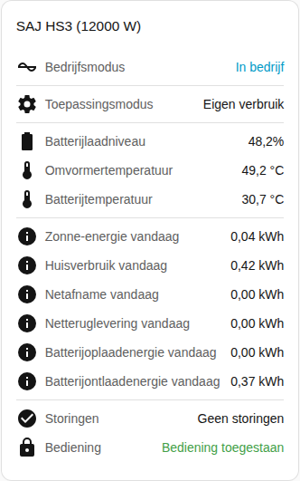

[en](../../../en-gb/user/cards/status-card.md) | [de](../../../de/user/cards/status-card.md) | nl | [fr](../../../fr/user/cards/status-card.md) | [zh](../../../zh-hans/user/cards/status-card.md) | [es](../../../es/user/cards/status-card.md) | [it](../../../it/user/cards/status-card.md) | [pl](../../../pl/user/cards/status-card.md) | [sv](../../../sv/user/cards/status-card.md)

# Statuskaart

De pagina Statuskaart legt de statuskaart uit, die een systeem op één plek samenvat. De volledige lijst staat in de sectie [Statuskaart](../../../../frontend/docs/features.md#status-card) van de functielijst van de kaarten. [Een element toevoegen](README.md#een-element-toevoegen) legt uit hoe u de kaart toevoegt en een systeem kiest.

## Wat de kaart toont

- De bedrijfstoestand, gekleurd naar hoe gezond de toestand is, en de toepassingsmodus.
- Het laadniveau van de batterij, de temperaturen van de omvormer en de batterij en de modus buiten het net.
- Met Energie van vandaag tonen aan, wat de standaard is, toont de kaart de zonne-, huis-, netafname-, netteruglevering-, batterijoplaad- en batterijontlaadenergie van vandaag.
- Het aantal onderdelen van de apparatuur met een actieve storing, of dat er geen storingen zijn. Zie [apparaatstoringen](../faults-and-repairs.md#apparaatstoringen).
- Of bediening is toegestaan voor het systeem. Zie [Bediening toestaan](../changing-settings.md#bediening-toestaan).

## Verschillen tussen de modellen

- **Alleen H2:** wanneer de toepassingsmodus die de omvormer draait afwijkt van de modus die u koos, toont de kaart ook de modus die nu draait. De rij verschijnt alleen wanneer de entiteit Toepassingsmodus (van kracht) is ingeschakeld. Die entiteit wordt uitgeschakeld aangemaakt. Zie het [entiteitenoverzicht](../entities/README.md).

## Opties

| Optie in de editor | YAML-sleutel | Standaard |
| --- | --- | --- |
| Systeem | `device` | Het eerste systeem |
| Energie van vandaag tonen | `show_energy` | Aan |

## Nog niet ondersteund

- Een instelling wijzigen vanaf de kaart. De statuskaart toont alleen. Gebruik de [bedieningskaart](controls-card.md) om instellingen te wijzigen.
