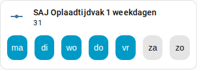

[en](../../../en-gb/user/cards/weekdays-feature.md) | [de](../../../de/user/cards/weekdays-feature.md) | nl | [fr](../../../fr/user/cards/weekdays-feature.md) | [zh](../../../zh-hans/user/cards/weekdays-feature.md) | [es](../../../es/user/cards/weekdays-feature.md) | [it](../../../it/user/cards/weekdays-feature.md) | [pl](../../../pl/user/cards/weekdays-feature.md) | [sv](../../../sv/user/cards/weekdays-feature.md)

# Weekdagen-tegelkaartfunctie

De pagina Weekdagen-tegelkaartfunctie legt de weekdagenfunctie uit, die zeven dagknoppen op een tegelkaart zet om de dagen van een tijdvak in te stellen. De volledige lijst staat in de sectie [Weekdagen-tegelkaartfunctie](../../../../frontend/docs/features.md#weekdays-tile-card-feature) van de functielijst van de kaarten. De dagen van een tijdvak zijn de Weekdagen-entiteiten van de oplaad-, ontlaad- en EV-ladertijdvakken, vermeld in de onderdelen [Batterij](../entities/battery.md) en [EV-lader](../entities/ev-charger.md) van het entiteitenoverzicht.



## De functie toevoegen

1. Voeg een tegelkaart toe aan een dashboard en kies de entiteit Weekdagen van een tijdvak als entiteit van de tegelkaart.
2. Open de functies van de tegelkaart, kies Functie toevoegen en kies SAJ Local-weekdagen.

De functie wordt alleen aangeboden voor een tegelkaart waarvan de entiteit de weekdagenentiteit van een tijdvak is. De functie heeft geen opties.

```yaml
type: tile
entity: number.saj_charge_slot_1_days
features:
  - type: custom:saj-local-weekdays-feature
```

De entiteits-ID in het voorbeeld heeft geen voorvoegsel. Als u een [voorvoegsel](../entities-and-prefix.md#het-voorvoegsel) instelt, heeft de ID van de entiteit het voorvoegsel na `saj_`.

## Hoe de knoppen werken

- Zeven benoemde dagknoppen beginnen op uw eerste dag van de week, die uit de Home Assistant-instellingen of uw taal komt.
- SAJ Local verstuurt de wijziging 1,5 seconde na de laatste druk, zodat u in één wijziging meerdere dagen kunt kiezen.
- De omvormer slaat de dagen op als één getal dat niet meebeweegt met uw eerste dag van de week. Maandag is het laagste bit en zondag het hoogste op elk model, dus maandag tot en met vrijdag is 31, zoals in de schermafbeelding, en maandag, woensdag en vrijdag is 21.
- De knoppen zijn uitgeschakeld zolang [Bediening toestaan](../changing-settings.md#bediening-toestaan) uit staat voor het systeem.

De [schemakaart](schedule-card.md) gebruikt de knoppen in de tijdvakeditor.

## Nog niet ondersteund

- Elke andere entiteit dan de weekdagenentiteit van een tijdvak. SAJ Local biedt de functie niet aan voor andere tegelkaarten.
