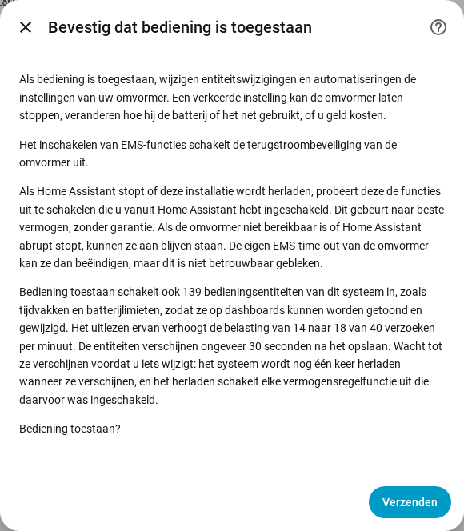

[en](../../en-gb/user/changing-settings.md) | [de](../../de/user/changing-settings.md) | nl | [fr](../../fr/user/changing-settings.md) | [zh](../../zh-hans/user/changing-settings.md) | [es](../../es/user/changing-settings.md) | [it](../../it/user/changing-settings.md) | [pl](../../pl/user/changing-settings.md) | [sv](../../sv/user/changing-settings.md)

# Instellingen wijzigen

De pagina Instellingen wijzigen legt uit hoe u SAJ Local toestaat de instellingen van uw omvormer te wijzigen, wat er met een wijziging gebeurt en welke wijzigingen altijd worden geweigerd. De volledige lijsten staan in de secties [Instellingen wijzigen](../../../custom_components/saj_local/docs/features.md#changing-settings) en [EMS](../../../custom_components/saj_local/docs/features.md#ems) van de functielijst van de integratie. De instellingen en opdrachten zijn verdeeld over de onderdelen van het [entiteitenoverzicht](entities/README.md), vooral [Instellingen](entities/settings.md) en [Batterij](entities/battery.md).

Schrijven naar de omvormer staat uit totdat u bediening voor een systeem toestaat. Zolang Bediening toestaan uit staat, tonen instellingen de huidige waarde maar weigeren ze elke wijziging, met een melding die zegt waar u de bediening inschakelt. Er wordt niets naar de omvormer gestuurd.

## Bediening toestaan

1. Open Configureren, het tandwiel op de rij van het systeem op de integratiepagina van SAJ Local. U kunt Bediening toestaan ook inschakelen terwijl u het systeem toevoegt.
2. Schakel Bediening toestaan in en kies Verzenden.
3. Lees de bevestiging en kies dan opnieuw Verzenden.

De bevestiging waarschuwt dat een verkeerde instelling de omvormer kan laten stoppen, kan veranderen hoe de omvormer de batterij of het net gebruikt, of u geld kan kosten. De bevestiging zegt ook:

- Het inschakelen van EMS-functies schakelt de terugstroombeveiliging van de omvormer uit.
- Wanneer Home Assistant stopt of het systeem wordt herladen, probeert SAJ Local de functies uit te schakelen die u vanuit Home Assistant hebt ingeschakeld. Het uitschakelen gebeurt naar beste vermogen en is geen garantie.
- Bediening toestaan schakelt bedieningsentiteiten in, en het uitlezen van de entiteiten verhoogt de verzoekbelasting. Het dialoogvenster toont het aantal entiteiten en de belasting ervoor en erna.

Alleen HS3: de bevestiging bij de installatie vraagt ook om de EMS-hartslag. In Configureren is de hartslag een veld op het hoofdformulier. Zie [EMS](#ems).

Bediening toestaan uitschakelen vraagt geen bevestiging. Elk systeem heeft een binaire sensor Bediening toegestaan, in de categorie diagnose, die aan staat zolang het systeem wijzigingen accepteert. De [dashboardkaarten](cards/README.md) lezen de sensor en vergrendelen de bediening zolang de sensor uit staat. De sensor is alleen-lezen, omdat een schakelaar op een dashboard het schrijven zou inschakelen zonder de waarschuwing.

## De bedieningsset

De meeste tijdvakken en veel instellingen worden uitgeschakeld aangemaakt, zodat een dashboardkaart niets zou hebben om te tonen of te wijzigen. Bediening toestaan inschakelen schakelt daarom ook de bedieningsset van het systeem in:

- de oplaad-, ontlaad- en EV-ladertijdvakken (de EV-ladertijdvakken zijn alleen HS3);
- de toepassingsmodus en de tijdgestuurde instellingen;
- de batterijlimieten en de netlimieten;
- de EV-laderinstellingen (alleen HS3);
- de schakelaars en doelen van vermogensregeling, zie [vermogensregeling](power-control.md);
- de LED-modus, de zoemer (alleen H2) en de knoppen Klok synchroniseren en Huidige storing wissen.

Metingen van batterijpacks en andere alleen-lezen entiteiten maken geen deel uit van de set.

- **De entiteiten verschijnen na ongeveer 30 seconden.** Home Assistant herlaadt een systeem 30 seconden nadat een entiteit van het systeem is ingeschakeld. Wacht tot de entiteiten verschijnen voordat u iets wijzigt, omdat het herladen elke vermogensregelfunctie uitschakelt die u tussendoor hebt ingeschakeld. Er volgt nog een herlading wanneer later een nieuw lid van de set verschijnt, zoals de EV-ladertijdvakken nadat een EV-lader is gedetecteerd.
- **Bediening toestaan uitschakelen** schakelt de entiteiten uit die SAJ Local heeft ingeschakeld, en er volgt geen herlading.
- **Uw keuze wint.** Een entiteit die u uitschakelde voordat u de bediening inschakelde, blijft uitgeschakeld, en een entiteit die u zelf inschakelde, blijft ingeschakeld. Een kaart telt een tijdvak met een uitgeschakelde entiteit als weggelaten.

## Wat er met een wijziging gebeurt

SAJ Local controleert een wijziging voordat SAJ Local iets verstuurt. SAJ Local weigert de wijziging, met een afzonderlijke melding voor elk geval, wanneer:

- Bediening toestaan uit staat;
- het model niet is geverifieerd. Een systeem met een model dat niet kon worden geverifieerd, wordt nooit beschreven, zie [aan de slag](getting-started.md#wanneer-de-omvormer-niet-wordt-herkend);
- de instelling een instelling voor ingebruikname is;
- de waarde ongeldig is;
- de omvormer niet bereikbaar is;
- de schrijflimiet is bereikt. Er gaan niet meer dan 20 wijzigingen naar een omvormeradres in 60 seconden, en een wijziging boven de limiet wordt geweigerd en niet in de wachtrij gezet.

Elke melding zegt dat de omvormer niet is gewijzigd. Anders schrijft SAJ Local de wijziging één keer en leest de waarde terug, en de entiteit toont de waarde die de omvormer bevat.

| Wat er gebeurde | Wat u ziet |
| --- | --- |
| De omvormer weigerde de wijziging | De melding geeft de uitzonderingscode. |
| De omvormer antwoordde niet | De melding zegt dat de wijziging wel of niet kan zijn toegepast. SAJ Local verstuurt niets opnieuw en leest de omvormer opnieuw uit na het herverbinden. |
| De omvormer bevat een andere waarde | De entiteit toont de waarde die de omvormer bevat, en de wijziging mislukt. |

Een wijziging van één instelling van een register dat meerdere instellingen bevat, laat de andere instellingen van het register ongewijzigd.

## Wat u kunt wijzigen

- De toepassingsmodus, zeven oplaadtijdvakken en zeven ontlaadtijdvakken (elk met begin, einde, vermogen, dagen en aan of uit), de tijdgestuurde inactieve modus en netontlading, en de back-upreserve.
- De oplaad- en ontlaadlimieten van de batterij, het automatisch ontwaken van de batterij, de terugleveringslimiet, de limieten voor afname- en terugleveringsvermogen van het net en de vermogens van de passieve modus.
- Alleen HS3: de EV-laderinstellingen en zeven EV-ladertijdvakken.
- Alleen H2: de zoemer en de limiet van het gedwongen oplaadvermogen van de batterij. Beide modellen hebben de LED-modus.
- Opdrachten, als knoppen die uitgeschakeld worden aangemaakt: Huidige storing wissen, Omvormer herstarten en Klok synchroniseren, die de lokale tijd van Home Assistant verstuurt. Alleen HS3: EMS-limiet zonnevermogen verwijderen.

De [dashboardkaarten](cards/controls-card.md) bieden de gedeelde instellingen op één plek aan. De bedieningskaart heeft geen herstartknop, zodat een tik op een dashboard de omvormer niet kan herstarten.

## Instellingen voor ingebruikname

Instellingen voor ingebruikname worden getoond en kunnen niet vanuit Home Assistant worden gewijzigd: de meter, RS485, het batterijprotocol, het netwerk en de EV-laderkoppeling, en op de H2 ook het nettype, de parallelle opstelling, de ingangsmodi, de beveiligingslimieten en andere installateurinstellingen. Een verkeerde waarde kan de omvormer afsnijden van de meter, de batterij, de lader of Home Assistant. Instellingen voor ingebruikname zijn alleen-lezen sensoren in de categorie diagnose. Maak zulke wijzigingen in de SAJ elekeeper-app, zie de [vereiste](../../../custom_components/saj_local/docs/requirements.md#changing-settings).

## Nog niet ondersteund

- Fabrieksreset en het wissen van de energiegeschiedenis. SAJ Local biedt geen van beide.
- Instellingen voor ingebruikname wijzigen.
- Instellingen wijzigen op een systeem waarvan het model niet is geverifieerd.

## EMS

Alleen HS3: EMS plaatst de omvormer onder externe bediening. De H2 heeft geen EMS-entiteiten. SAJ Local biedt de EMS-time-out en vijf limieten aan als entiteiten: de oplaad- en ontlaadstroom van de batterij, het afname- en terugleveringsvermogen van de omvormer en het zonnevermogen. De limieten kunnen worden ingesteld, en SAJ Local pollt de limieten niet. Tussen hartslagen tonen de limieten de laatste waarde die SAJ Local heeft verstuurd, en de limieten zijn onbekend vóór de eerste wijziging. [Vermogensregeling](power-control.md) schakelt de EMS-functies in en uit.

- **De hartslag houdt een functie actief.** SAJ Local leest bij elk hartslaginterval het doel van elke EMS-functie die u vanuit Home Assistant hebt ingeschakeld, en de limieten, uit. Uitlezen telt als EMS-activiteit, dus de hartslag schrijft niets.
- **Het interval is standaard 60 seconden.** U kunt 30 tot 3600 seconden instellen, in de bevestiging van Bediening toestaan bij de installatie en in Configureren.
- **De time-out moet langer zijn dan de hartslag.** Een functie kan niet worden ingeschakeld zolang de EMS-time-out van de omvormer niet langer is dan de hartslag, en de time-out kan niet zo laag worden ingesteld.
- **Uitschakelen bij stoppen.** Wanneer SAJ Local wordt uitgeladen of Home Assistant stopt, schakelt SAJ Local de EMS-functies uit die u hebt ingeschakeld. Een functie die al aan stond toen SAJ Local laadde, blijft ongemoeid.
- **Het uitschakelen gebeurt naar beste vermogen.** Wanneer de omvormer niet bereikbaar is, of Home Assistant abrupt stopt, blijven de functies aan staan. De EMS-time-out van de omvormer kan de functies beëindigen, maar SAJ Local rekent niet op de time-out, zie [getest op hardware](#getest-op-hardware).

## Getest op hardware

De opmerkingen hieronder zeggen welke instellingen op een echte omvormer zijn geprobeerd en welke alleen op praktijkmeldingen of op de SAJ-protocoldocumenten berusten.

HS3, register voor register geschreven op een echte HS3 en teruggelezen:

- De Toepassingsmodus, het Laadniveau back-upreserve, het Passief batterijoplaadvermogen, de EMS-time-out, de vier EMS-inschakelbits die [vermogensregeling](power-control.md) schrijft, en de drie EMS-doelen en vijf EMS-limieten.
- Op de HS3 stelt het Passief batterij-oplaadvermogen het vermogen van de modus Back-up in.
- Toepassingsmodus EMS alleen laat de omvormer stilstaan, met het huis dat op het net draait, en de omvormer verlaat EMS niet uit zichzelf.
- De EMS-time-out beëindigde EMS na 5 seconden, maar beëindigde EMS niet na 20 of 60 seconden terwijl een andere client de omvormer pollde. SAJ Local rekent niet op de time-out.
- De EMS-limiet zonnevermogen heeft alleen effect terwijl een EMS-functie aan staat.
- Wanneer een EMS-functie stopt, gaat de omvormer terug naar de toepassingsmodus die de omvormer daarvoor draaide.
- Tijdgestuurd (BMS) is de modus die de HS3 meldt wanneer de SAJ-app de TOU (BMS)-modus van de app kiest, wat niet de tijdgestuurde modus van de app is. SAJ Local heeft Tijdgestuurd (BMS) nooit naar een omvormer geschreven.

H2, opgebouwd uit praktijkmeldingen van H2-eenheden en het H2-protocoldocument, en niet door dit project geprobeerd:

- Vermogensregeling, die de passieve modus, de tijdvakken, de toepassingsmodus, de vermogens van de passieve modus, de batterijlimieten, de netvermogenslimieten en de terugleveringslimiet gebruikt.
- Piekafvlakking: praktijkmeldingen tonen dat Piekafvlakking in de SAJ-app is gekozen, via Modbus is teruggelezen en geschreven. Het H2-protocoldocument vermeldt Piekafvlakking niet.
- AI-besparing is de modus die de H2 meldt wanneer de SAJ-app AI-besparing kiest. SAJ Local heeft AI-besparing nooit naar een omvormer geschreven.

Nooit op een echte omvormer geprobeerd:

- de LED-modus, de H2-zoemer en de limiet van het gedwongen oplaadvermogen van de H2-batterij;
- elke andere instelling die in deze sectie niet wordt genoemd;
- elke wijziging die meer dan één register schrijft;
- elke opdracht.
