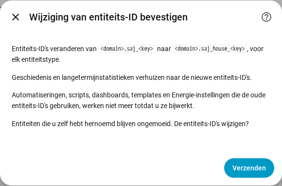

[en](../../en-gb/user/entities-and-prefix.md) | [de](../../de/user/entities-and-prefix.md) | nl | [fr](../../fr/user/entities-and-prefix.md) | [zh](../../zh-hans/user/entities-and-prefix.md) | [es](../../es/user/entities-and-prefix.md) | [it](../../it/user/entities-and-prefix.md) | [pl](../../pl/user/entities-and-prefix.md) | [sv](../../sv/user/entities-and-prefix.md)

# Entiteiten en het voorvoegsel

De pagina Entiteiten en het voorvoegsel legt uit wat de entiteiten van een systeem zijn, hoe de entiteits-ID's worden opgebouwd en hoe u een voorvoegsel aan de entiteits-ID's toevoegt. De volledige lijsten staan in de secties [Apparaten en entiteiten](../../../custom_components/saj_local/docs/features.md#devices-and-entities) en [Entiteits-ID's en voorvoegsel](../../../custom_components/saj_local/docs/features.md#entity-ids-and-prefix) van de functielijst van de integratie. Elke entiteitsnaam, -ID, elk model en elke standaardinstelling staat in het [entiteitenoverzicht](entities/README.md).

## De entiteiten van een systeem

Elke meting, instelling en opdracht die SAJ Local voor uw model kent, is een entiteit van het apparaat van het systeem. Elke entiteit heeft het type dat Home Assistant-gebruikers voor de meting of de instelling verwachten: een sensor, een binaire sensor, een nummer, een selectie, een schakelaar, een tijd of een knop. Een instelling verschijnt als het echte besturingstype van de instelling, dus een limiet is een nummer en een instelling die aan of uit staat is een schakelaar.

- **Alleen een kernset is ingeschakeld.** Metingen van vermogen, spanning, temperatuur en laadniveau, de energietellers, de belangrijkste batterijlimieten en elke storing zijn ingeschakeld. Al het andere wordt uitgeschakeld aangemaakt.
- **Een uitgeschakelde entiteit wordt niet uitgelezen.** Een entiteit inschakelen voegt de entiteit toe aan de volgende uitlezing. Een entiteit uitschakelen stopt het uitlezen van het register. [Polling](polling.md) laat zien wat een keuze de omvormer kost.
- **Een systeem krijgt alleen de entiteiten die passen.** Een H2 met één zonnestring heeft geen entiteiten voor een tweede string. Apparatuur die niet is geïnstalleerd maakt geen entiteiten aan, zie [optionele apparatuur](optional-equipment.md).
- **Instellingen en diagnose zijn gegroepeerd.** Instellingen staan in de categorie configuratie. Versies, instellingen voor ingebruikname en netwerkinstellingen staan in de categorie diagnose.
- **Een onbekende optie verschijnt als onbekend.** De code van de optie staat in de [diagnosedownload](troubleshooting.md#diagnose-downloaden), zodat de optie kan worden gemeld.

Wanneer u het model met de hand instelt voor een omvormer die niet wordt herkend, krijgt het systeem elke entiteit van het gekozen model, waarbij de entiteiten voorbij één fase en twee zonnestrings zijn uitgeschakeld. Zie [aan de slag](getting-started.md#wanneer-de-omvormer-niet-wordt-herkend).

## Teken van het vermogen

Batterijvermogen en netvermogen gebruiken op elk model één teken, zodat een meting op een HS3 en op een H2 dezelfde betekenis heeft.

- **Batterijvermogen** is positief terwijl de batterij ontlaadt en negatief terwijl de batterij oplaadt.
- **Netvermogen** is positief terwijl het systeem teruglevert en negatief terwijl het systeem afneemt. Meter A volgt het tekenstelsel van het net.
- **Meter B** is positief terwijl de zonne-omvormer die Meter B meet, opwekt.

Op de HS3 is het netvermogen het totaal van Meter A, en het netfasevermogen, het schijnbaar vermogen, de stroom en de arbeidsfactor komen van de bijbehorende fase van Meter A, omdat de netregisters van de HS3 waarden van de omvormer bevatten. Een HS3 zonder Meter A heeft deze entiteiten niet. Het vermogen van de huishoudelijke belasting is de som van de drie netgekoppelde uitgangsfasevermogens.

De doelen van [vermogensregeling](power-control.md) volgen de tekens van de metingen.

## Berekende sensoren

Acht sensoren worden berekend uit de metingen van het systeem zelf. Ze bestaan op elk model.

- **Tijd tot batterij vol** en **tijd tot batterij leeg** zijn duren in minuten. Elke waarde deelt de resterende batterij-energie door het batterijvermogen, gemiddeld over de laatste 10 minuten. Een korte verandering van de huishoudbelasting laat de waarde dus niet springen. De tijd tot vol heeft alleen een waarde zolang het gemiddelde vermogen de batterij oplaadt, en de tijd tot leeg alleen zolang het gemiddelde vermogen de batterij ontlaadt. De waarde is onbekend bij een gemiddeld vermogen van nul en als het resultaat langer is dan 48 uur. Het gemiddelde begint opnieuw na een herlaadactie of een herstart.
- **Opgeslagen batterij-energie** en **beschikbare batterij-energie** zijn in kWh. De opgeslagen energie is het laadniveau maal de batterij-energie. De beschikbare energie is de energie boven de limiet voor leeg, en nooit lager dan 0.
- **Vol en leeg.** Vol is de oplaadlimiet. Leeg is de back-upreserve in de back-upmodus en de ontlaadlimiet aan het net in de andere toepassingsmodi. Zonder net is leeg de ontlaadlimiet zonder net, bij een model dat die heeft.
- **Batterij-energie.** De H2 meldt een bruikbare capaciteit, en SAJ Local vermenigvuldigt die met de batterijspanning. De HS3 meldt geen bruikbare capaciteit, dus SAJ Local leert de capaciteit uit het batterijvermogen en de verandering van het laadniveau. Op een HS3 blijven de vier sensoren voor batterij-energie onbekend tot het laadniveau tussen twee uitlezingen is veranderd. De geleerde capaciteit wordt nauwkeuriger naarmate de batterij meer oplaadt en ontlaadt. SAJ Local bewaart de geleerde capaciteit over herstarts heen.
- **Zelfvoorziening vandaag** is het aandeel van de energie van de belasting van vandaag dat niet van het net kwam. **Eigen verbruik vandaag** is het aandeel van de zonne-energie van vandaag dat niet is teruggeleverd. **Round-trip-rendement van de batterij** is de totale ontlaadenergie van de batterij gedeeld door de totale oplaadenergie van de batterij. Elke waarde is een percentage van 0 tot 100 en is onbekend als de deler 0 is.
- **Zonne-overschotvermogen** is het zonnevermogen min de huishoudbelasting, in watt. De waarde is negatief als de belasting groter is dan het zonnevermogen.
- **Standaard.** De vier batterijsensoren hierboven zijn standaard ingeschakeld. De andere vier worden uitgeschakeld aangemaakt. De sensoren voor tijd, energie en round-trip-rendement bestaan alleen als een batterij is geplaatst.
- **Uitlezingen.** Een berekende sensor inschakelen leest elke meting die de sensor nodig heeft, ook als de entiteiten van die metingen zijn uitgeschakeld. [Polling](polling.md) telt deze uitlezingen mee in de belasting.

## Het voorvoegsel

Elke entiteits-ID heeft de vorm `<type>.saj_<key>`, bijvoorbeeld `sensor.saj_pv_power`. Een entiteit een andere weergavenaam geven wijzigt de ID niet.

Een voorvoegsel voegt een woord toe na `saj_` in elke entiteits-ID van één systeem, bijvoorbeeld `sensor.saj_house_pv_power`. Gebruik een voorvoegsel wanneer u meer dan één SAJ-systeem hebt, zodat aan geen enkele entiteits-ID een nummer wordt toegevoegd.

- Gebruik alleen kleine letters en cijfers, maximaal 32 tekens.
- Twee systemen kunnen geen voorvoegsel delen, en slechts één systeem kan er geen hebben.
- Een voorvoegsel dat zou botsen met een entiteitsnaam, zoals `battery`, wordt geweigerd.
- De installatie wordt geweigerd wanneer een entiteits-ID die het systeem zou aanmaken al is vergeven.

### Een voorvoegsel toevoegen, wijzigen of verwijderen

1. Open Configureren, het tandwiel op de rij van het systeem op de integratiepagina van SAJ Local.
2. Wijzig het veld Voorvoegsel en kies Verzenden.
3. Lees de bevestiging en kies dan opnieuw Verzenden.

De bevestiging toont het oude en het nieuwe patroon. Automatiseringen, scripts, dashboards, templates en Energie-instellingen die de oude entiteits-ID's gebruiken, werken niet meer totdat u de verwijzingen bijwerkt.

Nadat u bevestigt:

- hernoemt SAJ Local elke entiteit van het systeem, ingeschakeld of uitgeschakeld, en verhuist Home Assistant de geschiedenis en de langetermijnstatistieken naar de nieuwe ID's.
- blijft een entiteit die u zelf hebt hernoemd ongemoeid.
- blijven de [dashboardkaarten](cards/README.md) werken, omdat de kaarten entiteiten vinden via het entiteitenregister en niet via de ID.

SAJ Local weigert de wijziging en hernoemt niets wanneer een nieuwe ID al is vergeven, of wanneer Home Assistant al langetermijnstatistieken onder een nieuwe ID bevat, bijvoorbeeld van een systeem dat u hebt verwijderd en dat het voorvoegsel had.

Als een latere versie een entiteit toevoegt en de ID van de entiteit al is vergeven, voegt Home Assistant een nummer aan de ID toe, en een waarschuwing in het logboek noemt het soort en de sleutel van de entiteit.

## Nog niet ondersteund

- Het sleuteldeel van een entiteits-ID kiezen. SAJ Local legt de sleutel vast, zodat dashboards en automatiseringen op elk model identiek werken.
