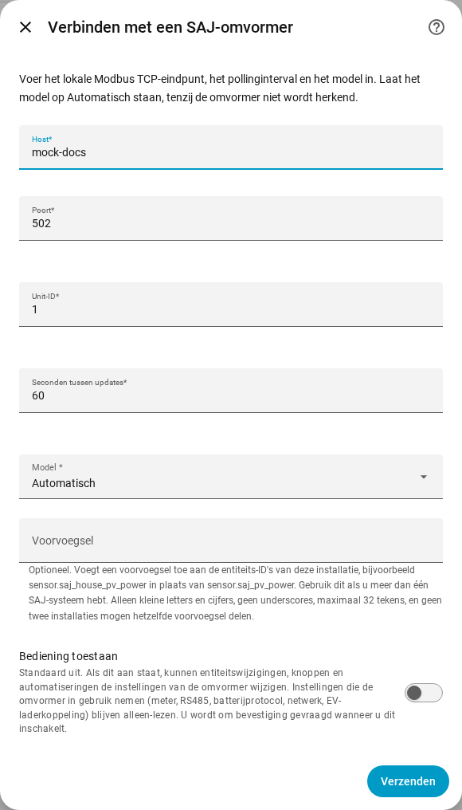
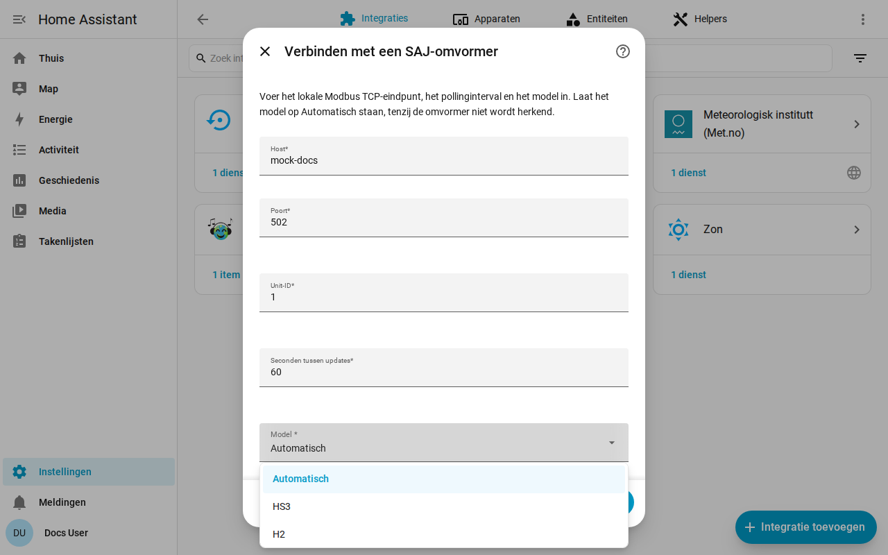

[en](../../en-gb/user/getting-started.md) | [de](../../de/user/getting-started.md) | nl | [fr](../../fr/user/getting-started.md) | [zh](../../zh-hans/user/getting-started.md) | [es](../../es/user/getting-started.md) | [it](../../it/user/getting-started.md) | [pl](../../pl/user/getting-started.md) | [sv](../../sv/user/getting-started.md)

# Aan de slag

De pagina Aan de slag voegt uw SAJ-systeem toe aan Home Assistant en zegt wat u daarna krijgt. De volledige lijst van wat de installatie doet staat in de sectie [Installatie en detectie](../../../custom_components/saj_local/docs/features.md#setup-and-detection) van de functielijst van de integratie. [Installeer SAJ Local](installation.md) eerst en controleer of uw omvormer in de [ondersteunde apparatuur](supported-equipment.md) staat.

## Een systeem toevoegen

1. Open in Home Assistant Instellingen en dan Apparaten & services.
2. Kies Integratie toevoegen en zoek naar SAJ Local.
3. Vul het formulier in en kies Verzenden.

| Veld | Wat u invult |
| --- | --- |
| Host | De hostnaam of het IP-adres van de omvormer. |
| Poort | De Modbus TCP-poort. De standaard is 502. |
| Unit-ID | Het Modbus-unit-ID, van 1 tot 247. De standaard is 1. |
| Seconden tussen updates | Hoe vaak elke ingeschakelde entiteit wordt uitgelezen. De standaard is 60 en het minimum is 10. Zie [polling](polling.md). |
| Model | Laat op Automatisch staan. SAJ Local herkent de HS3 en de eenfasige H2 aan het apparaattype dat de omvormer meldt. |
| Voorvoegsel | Optioneel. Laat leeg voor het eerste systeem. Zie [entiteiten en het voorvoegsel](entities-and-prefix.md#het-voorvoegsel). |
| Bediening toestaan | Standaard uit, zodat niets een instelling kan wijzigen. Zie [instellingen wijzigen](changing-settings.md). |

SAJ Local maakt verbinding met de omvormer, leest de identiteit van de omvormer en zes kernmetingen (bedrijfsmodus, laadniveau van de batterij, huisvermogen, zonnevermogen, batterijvermogen en netvermogen) en maakt het systeem aan. Een register dat één eenheid mist, stopt de installatie niet. Het systeem krijgt als titel SAJ gevolgd door het serienummer van de omvormer.

Als de installatie mislukt, zegt het formulier wat er misging: geen verbinding, geen antwoord op tijd, een geweigerde uitlezing, ongeldige gegevens, een apparaat dat niet wordt herkend of een model dat niet bij de omvormer past. Er wordt niets opgeslagen voordat de controle slaagt.

## Wat u krijgt

- Eén Home Assistant-apparaat met de naam SAJ. Het model van het apparaat toont het model en het nominale vermogen, bijvoorbeeld HS3 (12000 W).
- De entiteiten die bij uw model en apparatuur passen. SAJ Local detecteert de batterij, de meters en de andere apparatuur voor u, zie [optionele apparatuur](optional-equipment.md).
- Alleen een kernset van entiteiten is ingeschakeld. Al het andere wordt uitgeschakeld aangemaakt, zodat de omvormer niet wordt uitgelezen voor waarden waar u niet om vroeg. Schakel een entiteit in Home Assistant in en de volgende uitlezing neemt de entiteit mee. Zie [entiteiten en het voorvoegsel](entities-and-prefix.md).
- De [dashboardkaarten](cards/README.md), zonder iets te installeren.

## Een tweede systeem toevoegen

Voeg SAJ Local opnieuw toe vanuit Apparaten & services. SAJ Local weigert een eindpunt of een serienummer van een omvormer dat al is ingesteld. Geef elk systeem een eigen [voorvoegsel](entities-and-prefix.md#het-voorvoegsel), zodat aan geen enkele entiteits-ID een nummer wordt toegevoegd.

## Wanneer de omvormer niet wordt herkend

Wanneer de omvormer een apparaattype meldt dat SAJ Local niet herkent, mislukt Automatisch met een foutmelding die u vraagt het model met de hand te kiezen. Kies HS3 of H2 in het veld Model.

- Een keuze die een herkende omvormer tegenspreekt, wordt geweigerd. Kies het model dat de foutmelding noemt, of Automatisch.
- Voor een niet-herkende omvormer leest SAJ Local de vereiste registers en vraagt u het model te bevestigen. De registers moeten eerst antwoorden.
- Het apparaat toont het model daarna als niet geverifieerd. Metingen kunnen onjuist zijn, omdat SAJ Local de metingen niet aan het apparaattype kan toetsen, en elke poging om een instelling te wijzigen wordt geweigerd.

## Een systeem later wijzigen

Open Configureren, het tandwiel op de rij van het systeem op de integratiepagina van SAJ Local. U kunt de host, de poort, het unit-ID, het update-interval, het model, het voorvoegsel en Bediening toestaan wijzigen, en elk onderdeel van de apparatuur instellen. SAJ Local slaat de wijziging pas op nadat de omvormer op het nieuwe eindpunt antwoordt. [De omvormer vervangen](replacing-the-inverter.md) behandelt een nieuwe omvormer.

## Nog niet ondersteund

- Andere producten dan de HS3 en de eenfasige H2. Zie [ondersteunde apparatuur](supported-equipment.md).
- De omvormer op het netwerk vinden. U voert het adres van de omvormer zelf in.
