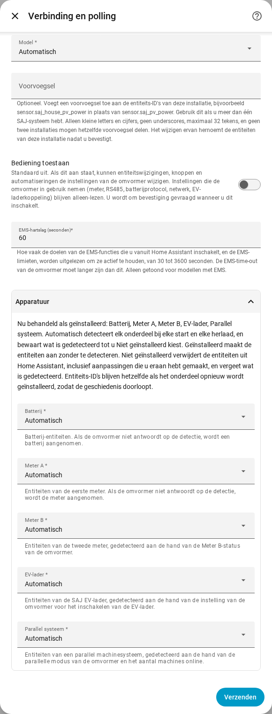

[en](../../en-gb/user/optional-equipment.md) | [de](../../de/user/optional-equipment.md) | nl | [fr](../../fr/user/optional-equipment.md) | [zh](../../zh-hans/user/optional-equipment.md) | [es](../../es/user/optional-equipment.md) | [it](../../it/user/optional-equipment.md) | [pl](../../pl/user/optional-equipment.md) | [sv](../../sv/user/optional-equipment.md)

# Optionele apparatuur

De pagina Optionele apparatuur legt uit hoe SAJ Local ontdekt welke optionele apparatuur uw omvormer heeft en hoe u het resultaat overschrijft. De volledige lijst staat in de sectie [Optionele apparatuur](../../../custom_components/saj_local/docs/features.md#optional-equipment) van de functielijst van de integratie. De pagina [ondersteunde apparatuur](supported-equipment.md) zegt welk model wat kan hebben, en het [entiteitenoverzicht](entities/README.md) zegt welke entiteiten elk onderdeel van de apparatuur toevoegt.

## Wat SAJ Local detecteert

De installatie vraagt niets over apparatuur. Elke keer dat SAJ Local laadt, wat elke start van Home Assistant en elke herlading omvat, vraagt SAJ Local de omvormer wat is geïnstalleerd en maakt alleen entiteiten voor die apparatuur aan.

| Apparatuur | Modellen |
| --- | --- |
| Batterij | HS3 en H2 |
| Meter A, de netmeter | HS3 en H2 |
| Meter B, de tweede meter | HS3 en H2 |
| Parallel systeem | HS3 en H2 |
| EV-lader | Alleen HS3 |

- **De omvormer antwoordt niet op de controle:** SAJ Local gaat uit van een batterij en Meter A, en gaat niet uit van de andere apparatuur.
- **Een meter is offline tijdens een herstart:** gedetecteerde apparatuur wordt onthouden, dus de apparatuur behoudt de entiteiten van de apparatuur.
- **Later geïnstalleerde apparatuur:** SAJ Local pikt de apparatuur op bij de volgende herstart of herlading.

## Wanneer onthouden apparatuur niet meer wordt gedetecteerd

SAJ Local behoudt de entiteiten van de apparatuur, zodat geschiedenis en dashboards ongewijzigd blijven, en maakt een reparatie aan in Home Assistant. De reparatie noemt de apparatuur en het systeem. Controleer de apparatuur, of stel de apparatuur in op Niet geïnstalleerd zoals hieronder beschreven. De reparatie verdwijnt bij de volgende lading die de apparatuur weer detecteert, of wanneer u de instelling wijzigt.

## De detectie overschrijven

1. Open Configureren, het tandwiel op de rij van het systeem op de integratiepagina van SAJ Local.
2. Klap de sectie Apparatuur uit.
3. Stel elk onderdeel van de apparatuur in op Automatisch, Geïnstalleerd of Niet geïnstalleerd en kies Verzenden.

De sectie vermeldt ook wat SAJ Local nu als geïnstalleerd behandelt.

| Instelling | Wat de instelling doet |
| --- | --- |
| Automatisch | Detecteert de apparatuur bij elke start en elke herlading, en bewaart wat is gedetecteerd tot u Niet geïnstalleerd kiest. Automatisch is de standaard. |
| Geïnstalleerd | Maakt de entiteiten van de apparatuur aan zonder de apparatuur te detecteren. |
| Niet geïnstalleerd | Verwijdert de entiteiten van de apparatuur uit Home Assistant, inclusief wijzigingen die u aan de entiteiten hebt gemaakt, zoals een nieuwe naam. SAJ Local vergeet wat is gedetecteerd. |

Entiteits-ID's blijven ongewijzigd, zodat de geschiedenis doorloopt als u de apparatuur terugzet op Geïnstalleerd of Automatisch. Entiteiten van apparatuur die niet is geïnstalleerd kunnen niet worden gelezen, gepolld of beschreven.

De sectie vermeldt alleen de apparatuur die uw model kan hebben. Alleen HS3: de EV-lader.

## Batterijpacks

- **H2:** een H2 meldt hoeveel batterijpacks de H2 heeft, maximaal vijf. SAJ Local maakt de packentiteiten voor zoveel packs aan. Een aantal van 0 behoudt de entiteiten van elk pack. SAJ Local onthoudt het hoogste aantal dat SAJ Local heeft gezien. Elk pack heeft identiteitsentiteiten, uitgeschakeld aangemaakt.
- **HS3:** een HS3 heeft entiteiten voor één batterijpack.

## EV-lader

Alleen HS3: een HS3 met een EV-lader krijgt ook de metingen, instellingen, laadtijdvakken en EMS-laadbediening van de lader. De meeste worden uitgeschakeld aangemaakt. Bediening toestaan inschakelen schakelt de instellingen en tijdvakken in, zie [instellingen wijzigen](changing-settings.md#de-bedieningsset).

## Nog niet ondersteund

- Apparatuur die SAJ Local niet detecteert. De apparatuur in de tabel is de volledige lijst.
- Een EV-lader op een H2 detecteren.
