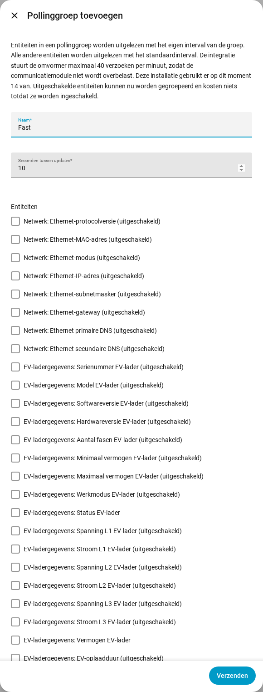

[en](../../en-gb/user/polling.md) | [de](../../de/user/polling.md) | nl | [fr](../../fr/user/polling.md) | [zh](../../zh-hans/user/polling.md) | [es](../../es/user/polling.md) | [it](../../it/user/polling.md) | [pl](../../pl/user/polling.md) | [sv](../../sv/user/polling.md)

# Polling

De pagina Polling legt uit hoe vaak SAJ Local de omvormer uitleest en hoe u sommige entiteiten sneller of langzamer uitleest. De volledige lijst staat in de sectie [Polling](../../../custom_components/saj_local/docs/features.md#polling) van de functielijst van de integratie. De limieten die voor elk verzoek gelden staan op [de omvormer beschermen](protecting-the-inverter.md).

SAJ Local leest de omvormer uit via Modbus TCP op uw lokale netwerk, volgens een schema dat u bepaalt. Er verlaat niets uw netwerk.

## Het standaardinterval

Elke ingeschakelde entiteit wordt standaard elke 60 seconden uitgelezen. Wijzig het veld Seconden tussen updates in Configureren, het tandwiel op de rij van het systeem op de integratiepagina van SAJ Local. Het interval is nooit korter dan 10 seconden.

Alleen ingeschakelde entiteiten worden uitgelezen. Schakel een entiteit in Home Assistant uit en het register van de entiteit wordt niet meer uitgelezen.

## Pollinggroepen

Een pollinggroep leest gekozen entiteiten sneller of langzamer uit dan de standaard. Gebruik een groep bijvoorbeeld om het huis-, zonne-, batterij- en netvermogen elke 10 seconden uit te lezen terwijl al het andere op 60 blijft.

1. Open het menu op de rij van het systeem op de integratiepagina van SAJ Local en kies Pollinggroep toevoegen. De knop Pollinggroep toevoegen boven aan de pagina opent ook het formulier Pollinggroep toevoegen.
2. Voer een naam in, de seconden tussen updates (minstens 10) en de entiteiten van de groep.
3. Kies Verzenden, lees het overzicht en kies dan De groep opslaan.

- **Elke entiteit:** een groep kan entiteiten van elk type bevatten. Ook een uitgeschakelde entiteit kan worden gekozen en kost niets totdat u de entiteit inschakelt.
- **Hooguit één groep:** een entiteit hoort bij hooguit één groep. Elke entiteit in geen enkele groep blijft op het standaardinterval.
- **Registervolgorde:** het formulier vermeldt entiteiten in registervolgorde, elk met het blok registers waaruit de entiteit wordt uitgelezen, zodat entiteiten die een verzoek kunnen delen bij elkaar staan.
- **Bewerken of verwijderen:** open de pollinggroep vanaf de integratiepagina. Een groep wijzigen of verwijderen laat de entiteiten, de namen van de entiteiten en de geschiedenis van de entiteiten ongemoeid.

Alle intervallen van een systeem delen één klok, zodat entiteiten die tegelijk aan de beurt zijn, samen worden uitgelezen. Een uitlezing die te lang duurt wordt niet ingehaald. De gemiste ticks vervallen en de polling gaat verder vanaf de volgende tick.

## De verzoekbelasting

SAJ Local stuurt een omvormer hooguit 40 verzoeken in elke 60 seconden. Het formulier toont wat uw keuze kost, als verzoeken per minuut ten opzichte van die limiet. Het formulier hierboven toont als voorbeeld een huidige belasting van 14 verzoeken per minuut.

- **Voordat u een groep opslaat:** de controlestap toont hoeveel verzoeken één uitlezing van de groep kost, en de belasting voor en na het opslaan.
- **Boven de limiet:** u kunt de groep nog steeds opslaan. Het overzicht waarschuwt dat uitlezingen langzamer verlopen dan u hebt ingesteld, omdat SAJ Local nooit meer dan de limiet verstuurt.
- **Een nieuw standaardinterval:** Configureren vraagt u te bevestigen wanneer het nieuwe interval de belasting boven de limiet brengt.
- **Minder verzoeken:** entiteiten die samen in één blok registers staan, kosten één verzoek. Entiteiten in verschillende blokken kosten elk één verzoek.

Een entiteit inschakelen in Home Assistant kan niet door een formulier worden onderschept. De [diagnosedownload](troubleshooting.md#diagnose-downloaden) vermeldt in dat geval de geplande belasting ten opzichte van de limiet.

## Nog niet ondersteund

- Een pollinggroep met een interval onder 10 seconden.
