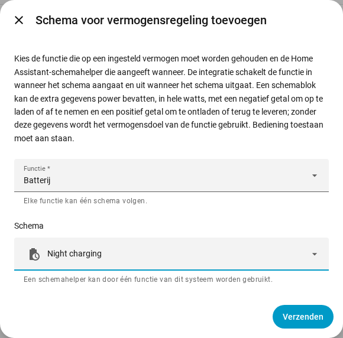

[en](../../en-gb/user/power-control.md) | [de](../../de/user/power-control.md) | nl | [fr](../../fr/user/power-control.md) | [zh](../../zh-hans/user/power-control.md) | [es](../../es/user/power-control.md) | [it](../../it/user/power-control.md) | [pl](../../pl/user/power-control.md) | [sv](../../sv/user/power-control.md)

# Vermogensregeling

De pagina Vermogensregeling legt uit hoe u de batterij, het aansluitpunt op het net of de omvormer op een ingesteld vermogen houdt, met de hand of met een Home Assistant-schema. De volledige lijst staat in de sectie [Vermogensregeling](../../../custom_components/saj_local/docs/features.md#power-control) van de functielijst van de integratie. De schakelaars en doelen staan in de [entiteiten die de integratie toevoegt](entities/added-by-the-integration.md) in het entiteitenoverzicht.

Vermogensregeling werkt op elk model dat een functie aanbiedt op dezelfde manier. Vermogensregeling doet niets zolang [Bediening toestaan](changing-settings.md#bediening-toestaan) uit staat of het model niet is geverifieerd.

| Functie | Wat de functie op het ingestelde vermogen houdt | HS3 | H2 |
| --- | --- | --- | --- |
| Batterij | De batterij laadt op of ontlaadt. | Ja | Ja |
| Net | Het aansluitpunt op het net neemt af of levert terug. Heeft Meter A nodig. | Ja | Nee |
| Omvormer | De omvormer neemt vermogen op of geeft vermogen af. | Ja | Nee |

Een positief vermogen ontlaadt, levert terug of geeft af. Een negatief vermogen laadt op, neemt af of neemt op. De tekens volgen het [teken van het vermogen](entities-and-prefix.md#teken-van-het-vermogen) van de metingen.

## Een functie op een vermogen houden

Elke functie heeft een schakelaar en een vermogensdoel in hele watts. Beide worden uitgeschakeld aangemaakt en staan in de categorie configuratie. Bediening toestaan inschakelen schakelt de schakelaars en de doelen in, zie [de bedieningsset](changing-settings.md#de-bedieningsset).

1. Stel het vermogensdoel van de functie in. Het doel wordt afgerond op de dichtstbijzijnde stap die de omvormer ondersteunt, en toont het vermogen dat de omvormer aanhoudt.
2. Schakel de functie in. Een functie heeft een vermogensdoel nodig voordat de functie kan worden ingeschakeld.
3. Schakel de functie uit om te stoppen.

- Het doel blijft bewaard over herstarts en wordt verstuurd wanneer de functie start. Het doel wijzigen terwijl de functie draait, verstuurt het nieuwe vermogen meteen.
- Er draait maar één functie tegelijk. Een functie inschakelen terwijl een andere draait wordt geweigerd, en de melding noemt de draaiende functie.
- De schakelaar staat aan zolang de omvormer meldt dat de functie draait, ook wanneer de functie buiten Home Assistant is gestart.
- Een start die mislukt wordt teruggedraaid. Een stop die mislukt wordt elk hartslaginterval opnieuw verstuurd, tot de omvormer meldt dat de functie is gestopt.
- De [bedieningskaart op het dashboard](cards/controls-card.md) toont elke functie met een schakelaar, een doel en een aanwijzing over het teken.

### Wanneer Home Assistant stopt

Een functie die u vanuit Home Assistant hebt ingeschakeld, wordt uitgeschakeld wanneer SAJ Local wordt uitgeladen en wanneer Home Assistant stopt. Een functie die al draaide toen SAJ Local laadde, blijft draaien.

- Alleen HS3: de EMS-hartslag houdt de functie actief. Na een abrupte stop kan de EMS-time-out van de omvormer de functie beëindigen, maar SAJ Local rekent niet op de time-out. Zie [EMS](changing-settings.md#ems).
- Alleen H2: een functie die na een abrupte stop blijft draaien, blijft draaien totdat u de functie uitschakelt.

## Een schema volgen

Een schema voor vermogensregeling laat een functie een Home Assistant-schemahelper volgen. De functie staat aan zolang het schema aan staat en uit wanneer het schema uitgaat.

1. Maak een schemahelper aan in Home Assistant: Instellingen, Apparaten & services, Helpers, Helper aanmaken, Schema. Stel de tijden en de weekdagen van het schema in.
2. Open het menu op de rij van het systeem op de integratiepagina van SAJ Local en kies Schema voor vermogensregeling toevoegen.
3. Kies de functie en de schemahelper en kies dan Verzenden.

Een blok van de schemahelper kan de extra gegevens `power` bevatten, in hele watts met het teken hierboven, bijvoorbeeld `power: -600` om de batterij met 600 W op te laden. Zonder `power` gebruikt SAJ Local het vermogensdoel van de functie.

- Elke functie volgt één schema, en een schemahelper stuurt één functie van een systeem aan.
- Het schema volgt een hernoeming van de helper. Een helper die niet in het entiteitenregister staat, wordt geweigerd, dus kies een helper die u in de interface hebt aangemaakt.
- SAJ Local weigert een schema zolang Bediening toestaan uit staat.
- Wijzig of verwijder een schema vanaf de integratiepagina. Het systeem wordt daarbij herladen.

### Wat een schema doet

| Situatie | Wat er gebeurt |
| --- | --- |
| Het schema gaat aan en er draait geen functie | SAJ Local stelt het vermogen in uit het blok, of gebruikt het vermogensdoel, en start dan de functie. |
| Het blok heeft geen `power` en de functie heeft geen vermogensdoel | Er start niets. De actie blijft openstaan, met een waarschuwing. |
| De functie draait al | SAJ Local wijzigt het vermogen wanneer het blok er een heeft, en neemt de functie over. |
| Een andere functie draait | Er wordt niets geschreven. De actie blijft openstaan. |
| De start wordt geweigerd of mislukt | De actie blijft openstaan. SAJ Local probeert het elk hartslaginterval opnieuw. |
| De `power` van het blok is geen geheel getal binnen het bereik van het doel | Er start niets. De actie blijft openstaan, met een waarschuwing. |
| Het schema gaat naar een blok met een andere `power` | SAJ Local wijzigt het vermogen. |
| U schakelt de functie met de hand uit terwijl het schema aan staat | De functie blijft uit totdat het schema de volgende keer aangaat. |
| Het schema gaat uit en SAJ Local startte de functie | SAJ Local stopt de functie. |

Als er niets gewenst is en niets openstaat, verstuurt SAJ Local niets. De [diagnosedownload](troubleshooting.md#diagnose-downloaden) vermeldt elke functie, elk schema en de actie die openstaat.

## Nog niet ondersteund

- Vermogensregeling van Net en Omvormer op de H2.
- Meer dan één functie tegelijk.
- Meer dan één schema voor één functie.
