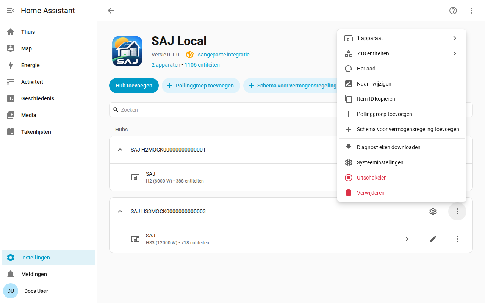

[en](../../en-gb/user/troubleshooting.md) | [de](../../de/user/troubleshooting.md) | nl | [fr](../../fr/user/troubleshooting.md) | [zh](../../zh-hans/user/troubleshooting.md) | [es](../../es/user/troubleshooting.md) | [it](../../it/user/troubleshooting.md) | [pl](../../pl/user/troubleshooting.md) | [sv](../../sv/user/troubleshooting.md)

# Probleemoplossing

De pagina Probleemoplossing laat zien hoe u diagnose downloadt, debuglogging inschakelt en de veelvoorkomende problemen leest. De volledige lijst staat in de sectie [Diagnose en debuglogging](../../../custom_components/saj_local/docs/features.md#diagnostics-and-debug-logging) van de functielijst van de integratie.

De diagnosedownload en het debuglogboek tonen wat de omvormer teruggeeft en wat SAJ Local met de metingen deed, zonder prijs te geven wie of waar u bent. Beide gebruiken de hulpmiddelen van Home Assistant, dus er hoeft niets te worden geïnstalleerd en er wordt nergens iets naartoe gestuurd.

## Begin met de entiteiten en de reparaties

- Controleer [Instellingen en Reparaties](faults-and-repairs.md#reparaties) op een reparatie van het systeem. Elke reparatie zegt wat er mis is en wat u moet doen.
- Controleer de [apparaatstoringen](faults-and-repairs.md#apparaatstoringen) wanneer de omvormer een probleem meldt.
- Entiteiten die na een weigering niet beschikbaar zijn, worden beschreven in [de omvormer beschermen](protecting-the-inverter.md#wanneer-de-omvormer-een-meting-weigert).

## Diagnose downloaden

1. Open Instellingen, dan Apparaten & services, dan SAJ Local.
2. Open het menu op de rij van het systeem en kies Diagnose downloaden.

Het bestand bevat:

- de ingeschakelde entiteiten, de intervallen met de verzoeken die elk kost, en de geplande belasting ten opzichte van de limiet van 40 verzoeken per minuut;
- geweigerde en opgeschorte entiteiten;
- de actieve storingen met de ruwe woorden van de storingen, en de niet-herkende storingsbits als register en bit;
- de openstaande reparaties, en hoe lang de omvormer al faalt;
- de functies van vermogensregeling, welke draait, welke SAJ Local bezit en de actie die voor elk schema openstaat;
- een momentopname van de ruwe woorden van elk register dat SAJ Local heeft gelezen sinds het systeem laadde, met de leeftijd van elk, zodat een onderhouder een meting kan toetsen aan het echte apparaat;
- elk verzoek dat geen bruikbaar antwoord kreeg, met de reden. Een verzoek dat een time-out kreeg ziet er anders uit dan een verzoek dat de omvormer weigerde, en het verschil doet ertoe wanneer een andere client de verbinding van de omvormer vasthoudt. Elke geweigerde entiteit, elk mislukt verzoek en elke regel van het debuglogboek noemt de Modbus-functie van het verzoek.

De momentopname voegt geen verzoek aan de omvormer toe. De momentopname begint leeg elke keer dat het systeem laadt.

## Debuglogging inschakelen

1. Open de integratiepagina van SAJ Local.
2. Open het menu met de drie puntjes van de integratiepagina en kies Debuglogging inschakelen.
3. Wanneer het systeem niet kon worden ingesteld, herlaad het systeem dan via het menu van het systeem, zodat het logboek de installatie omvat.
4. Reproduceer het probleem.
5. Kies Debuglogging uitschakelen. Home Assistant downloadt het logboek.

Debuglogging registreert elke verbinding, poll, elk verzoek, elke schrijfactie, hartslag en schemawijziging, één regel per gebeurtenis. Elke logregel begint met de titel van het systeem en het serienummer afgeschermd tot de laatste drie tekens, zodat regels van twee systemen kunnen worden onderscheiden. Een titel die het serienummer bevat, heeft het serienummer ter plekke afgeschermd, bijvoorbeeld `SAJ xxxxx123`.

## Wat het bestand en het logboek weglaten

Diagnose en logboeken bevatten nooit de host, poort, het unit-ID, het volledige serienummer, MAC-adres, netwerkadressen, serienummer van de EV-lader, voorvoegsel of namen van pollinggroepen. In de registermomentopname worden de woorden van de registers die de netwerkadressen en de serienummers bevatten vervangen door de redactiemarkering van Home Assistant, zodat u kunt zien dat het register antwoordde zonder te zien wat het register zei.

## Veelvoorkomende problemen

| Wat u ziet | Wat u controleert |
| --- | --- |
| De installatie mislukt zonder verbinding of zonder antwoord | De host, de poort en het unit-ID. Zorg dat geen andere Modbus-client de verbinding van de omvormer vasthoudt. |
| De installatie zegt dat het apparaat niet wordt herkend | Kies het model met de hand. Zie [aan de slag](getting-started.md#wanneer-de-omvormer-niet-wordt-herkend). |
| Een instelling weigert een wijziging | Bediening toestaan staat uit, het model is niet geverifieerd of de instelling is een instelling voor ingebruikname. De melding zegt welke. Zie [instellingen wijzigen](changing-settings.md). |
| Uitlezingen verlopen langzamer dan het interval dat u instelde | De belasting ligt boven de limiet van 40 verzoeken per minuut. Zie [polling](polling.md#de-verzoekbelasting). |
| Een entiteit die u hebt ingeschakeld heeft nog geen waarde | Home Assistant herlaadt het systeem ongeveer 30 seconden nadat u een entiteit inschakelt, en de entiteit wordt vanaf de volgende uitlezing gelezen. |
| Entiteits-ID's kregen een nummer | De ID die de entiteit wilde was al vergeven. Zie [entiteiten en het voorvoegsel](entities-and-prefix.md#het-voorvoegsel). |
| Entiteiten ontbreken | De apparatuur wordt niet gedetecteerd of is ingesteld op Niet geïnstalleerd. Zie [optionele apparatuur](optional-equipment.md). |

## Hulp en feedback

Vragen, foutmeldingen en ideeën zijn welkom op de [issue tracker](https://github.com/Counterphase-Labs/ha-saj-local/issues). Open het formulier Bug report voor een probleem met de integratie en het formulier Card bug report voor een probleem met een dashboardkaart. Het formulier Bug report vereist de diagnosedownload. Meld een beveiligingsprobleem privé, zie het [beveiligingsbeleid](../../../SECURITY.md).
