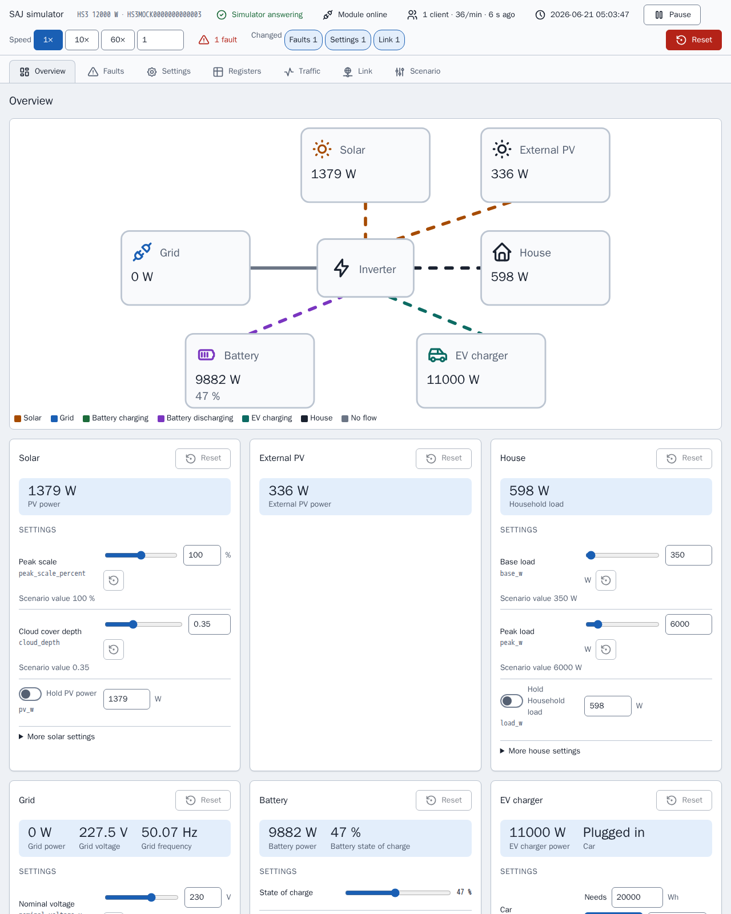

[en](../../en-gb/developer/README.md) | [de](../../de/developer/README.md) | [nl](../../nl/developer/README.md) | [fr](../../fr/developer/README.md) | [zh](../../zh-hans/developer/README.md) | [es](../../es/developer/README.md) | [it](../../it/developer/README.md) | pl | [sv](../../sv/developer/README.md)

# Dokumentacja programisty SAJ Local

Jak SAJ Local jest budowany, sprawdzany i wydawany oraz gdzie leży prawda o każdej części. Dokumentacja wyjaśnia, dlaczego projekt jest zbudowany w ten sposób, i linkuje do pliku, który przechowuje każdy fakt. Wersje, listy poleceń i mapy rejestrów żyją w kodzie i konfiguracji, a nie tutaj.

Aby mieć działającą kopię roboczą i wysłać zmianę, zacznij od [CONTRIBUTING.md](../../../CONTRIBUTING.md). SAJ Local to wyłącznie lokalna integracja Home Assistanta: SAJ Local komunikuje się z falownikiem przez sieć lokalną i nie dodaje żadnej usługi w chmurze ani towarzyszącego SDK.

## Programowanie bez falownika

Symulator to zastępcze urządzenie SAJ, więc większość pracy nie wymaga sprzętu. Każdy symulator udostępnia stronę, która pokazuje, co robi symulowany system, i pozwala programiście zmieniać system podczas odpytywania przez Home Assistanta, bez edycji scenariusza i restartu.

[Symulator Modbus](simulator.md) wyjaśnia, do czego służy symulator i jak uruchomić scenariusz. [Strona symulatora](simulator-page.md) pokazuje każdy widok strony.

## Strony

- [Symulator Modbus](simulator.md): do czego służy symulator, scenariusze i uruchamianie innego systemu.
- [Strona symulatora](simulator-page.md): każdy widok strony, inspektor rejestrów, dziennik ruchu, usterki łącza, ustawienia wstępne i zapisany stan.
- [Środowisko](environment.md): przygotuj kopię roboczą i uruchom deweloperskiego Home Assistanta z symulatorami.
- [Sprawdzenia](checks.md): cele make, bramka pokrycia i jak zawęzić uruchomienie.
- [Architektura](architecture.md): biblioteka SAJ i integracja, profile, katalog, odpytywanie i stabilne nazwy.
- [Frontend](frontend.md): źródło kart, kompilacja i pulpity demonstracyjne.
- [Dokumentacja](documentation.md): jak te strony, generowany opis encji i zrzuty ekranu są tworzone i sprawdzane.
- [Wydawanie](releasing.md): podniesienie wersji Home Assistanta i kroki przed wydaniem.

Dokumentacja użytkownika jest w [dokumentacji użytkownika](../user/README.md).

## Gdzie leży prawda

| Pytanie | Autorytet |
| --- | --- |
| Co musi robić projekt? | [Wymagania globalne](../../../.github/work/requirements.md), [wymagania integracji](../../../custom_components/saj_local/docs/requirements.md), [wymagania kart](../../../frontend/docs/requirements.md), [wymagania symulatora](../../../mock/docs/requirements.md) |
| Co robi każda część dzisiaj? | [Funkcje integracji](../../../custom_components/saj_local/docs/features.md), [funkcje kart](../../../frontend/docs/features.md), [funkcje symulatora](../../../mock/docs/features.md) |
| Jak pisze się kod, testy i dokumentację? | [code-style.md](../../../.github/work/code-style.md) |
| Jakie zasady wiążą wszystkich, którzy tu pracują? | [AGENTS.md](../../../AGENTS.md) |
| Co zbudowano i dlaczego? | [done/index.md](../../../.github/work/done/index.md) |
| Co jest planowane? | [.github/work/future/](../../../.github/work/future/) |
| Jakie polecenia istnieją? | [Makefile](../../../Makefile) |
| Co uruchamia CI? | [ci.yml](../../../.github/workflows/ci.yml) |
| Zależności Pythona i ustawienia narzędzi | [pyproject.toml](../../../pyproject.toml) |
| Zależności frontendu i skrypty | [frontend/package.json](../../../frontend/package.json) |
| Usługi deweloperskie | [compose.yaml](../../../compose.yaml) |

Istniejący kod nie ma autorytetu nad wymaganiami. Gdy się różnią, błędny jest kod albo właściciel zmienia wymaganie.

## Styl kodu

[code-style.md](../../../.github/work/code-style.md) jest autorytetem. Zasada dokumentacji z code-style.md kształtuje te strony: wyjaśniaj dlaczego, a nie jak, i pozwól, by nazwy i typy opisały resztę.
