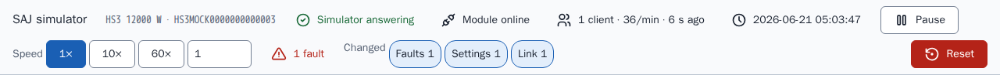
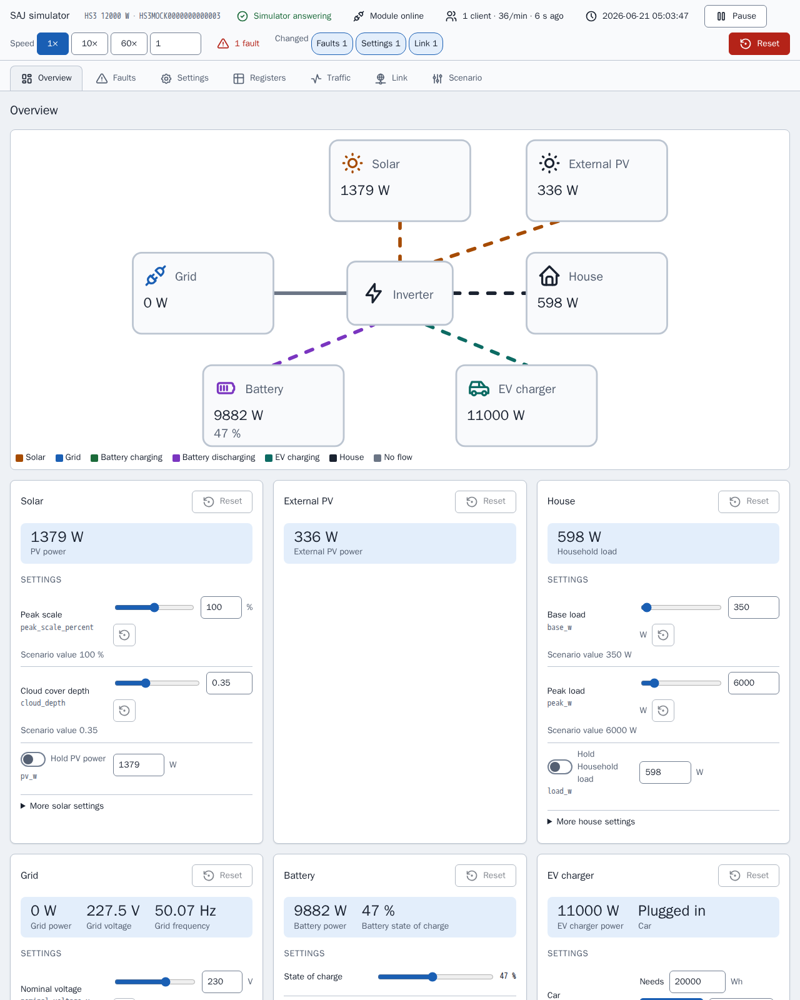
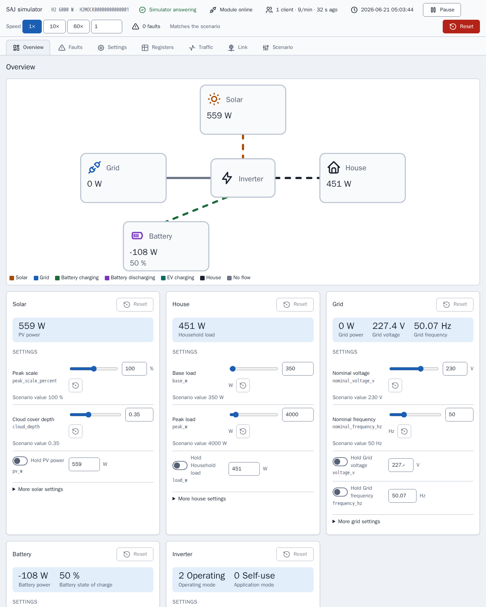
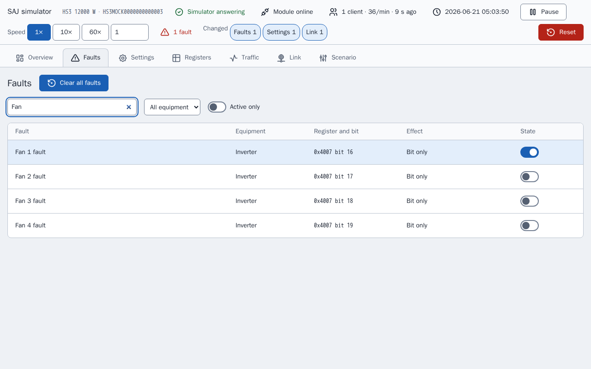
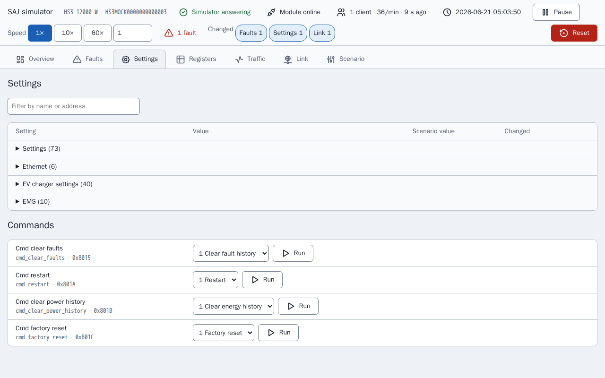
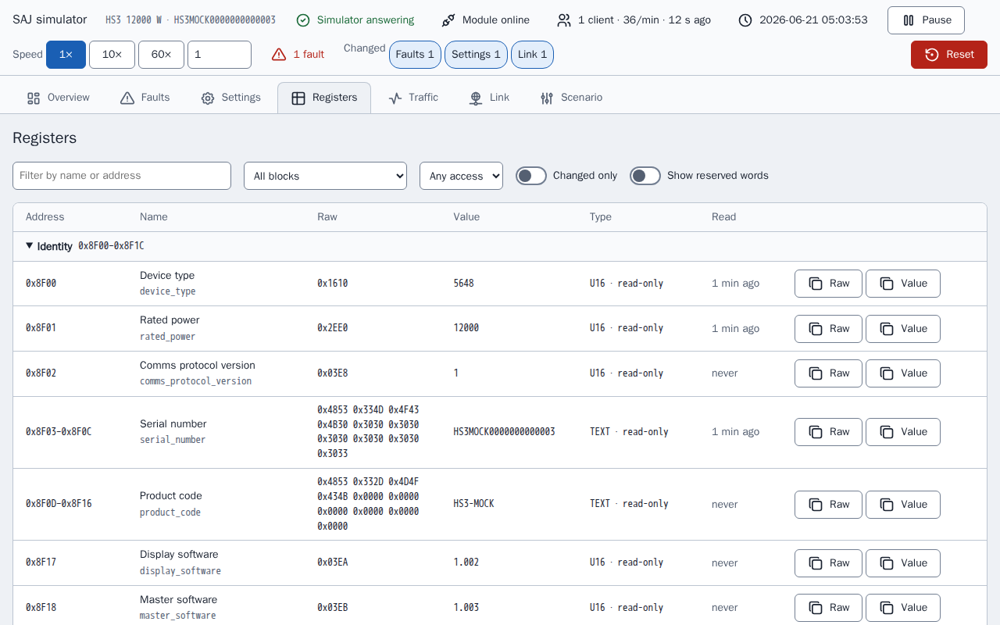
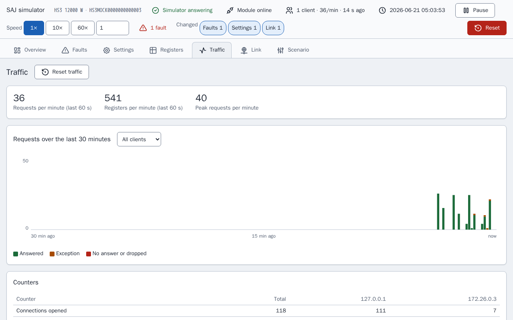
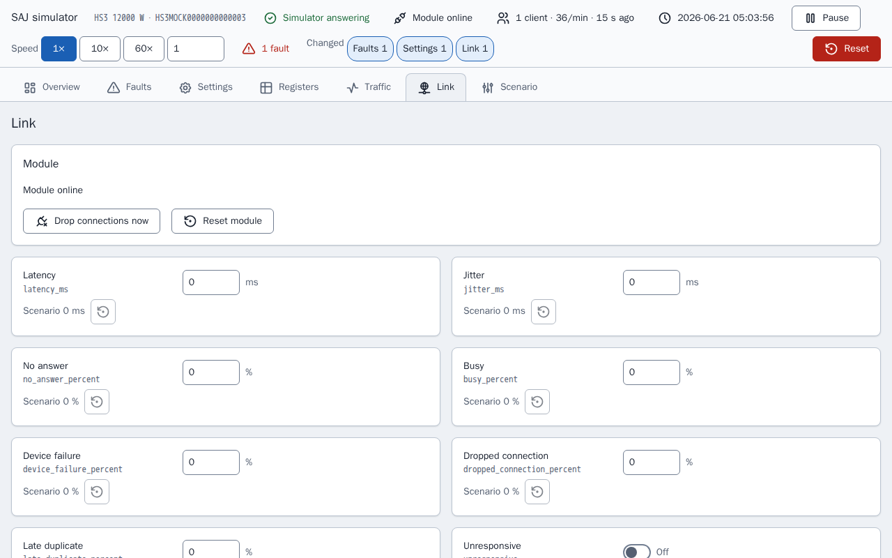
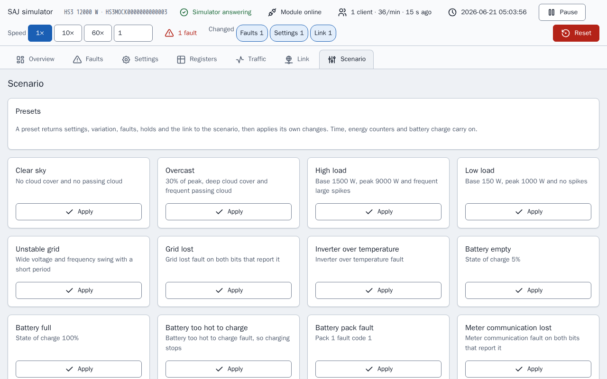
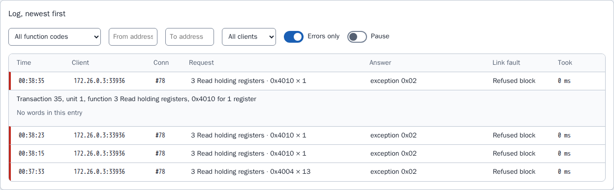

[en](../../en-gb/developer/simulator-page.md) | [de](../../de/developer/simulator-page.md) | [nl](../../nl/developer/simulator-page.md) | [fr](../../fr/developer/simulator-page.md) | [zh](../../zh-hans/developer/simulator-page.md) | [es](../../es/developer/simulator-page.md) | [it](../../it/developer/simulator-page.md) | pl | [sv](../../sv/developer/simulator-page.md)

# Strona symulatora

Strona sterowania symulatora: widoki, inspektor rejestrów, dziennik ruchu, usterki łącza, skutki usterek, ustawienia wstępne i zapisany stan.

Pełna lista tego, co obejmuje strona, jest w sekcjach listy funkcji [Strona sterowania](../../../mock/docs/features.md#control-page), [Stan i ustawienia wstępne](../../../mock/docs/features.md#state-and-presets), [Inspektor rejestrów i dziennik ruchu](../../../mock/docs/features.md#register-inspector-and-traffic-log), [Usterki łącza](../../../mock/docs/features.md#link-faults).

Każdy symulator udostępnia stronę pod adresem `http://localhost:<panel port>/`: `5080` dla HS3 i `5081` dla H2 uruchamianych przez `make up` (`SAJ_MOCK_PANEL_HOST_PORT` i `SAJ_MOCK_H2_PANEL_HOST_PORT` je zmieniają). Wewnątrz kontenera strona nasłuchuje na `server.panel_port`, domyślnie 8080. Nie ma uwierzytelniania: symulator jest narzędziem deweloperskim.

Strona istnieje po to, aby programista mógł zobaczyć, co robi symulowany system, i wprowadzić system w sytuację bez edycji scenariusza i restartu. Strona buduje każdy element sterowania z opisu urządzenia, więc strona wymienia tylko wyposażenie, które jest zainstalowane.
Strona odpytuje stan co 3 sekundy, więc zmiana wykonana z Home Assistanta jest widoczna, a widoki Registers i Traffic odświeżają się dodatkowo co sekundę, gdy są otwarte. Element sterowania, który ma fokus, nie jest nadpisywany. Dwóch klientów może zmieniać rzeczy jednocześnie: wygrywa ostatni zapis, jak na prawdziwym urządzeniu. Każda zmiana pokazuje krótkie potwierdzenie, a każda odmowa swój powód.

Pasek stanu na każdym widoku odpowiada na pytanie, czy symulator działa jako swój scenariusz, czy został zmieniony: czy moduł jest online, połączeni klienci i ich częstotliwość żądań, czas symulowany, uruchomienie i pauza, szybkość, aktywne usterki i jeden znacznik dla każdego rodzaju zmiany względem obowiązującego scenariusza. To samo podsumowanie (`changes` w stanie) oznacza zmienione wiersze i karty. Pauza ustawia szybkość na 0, a odtwarzanie przywraca wcześniejszą szybkość, więc pauza nie gubi szybkości.



Bieżący widok jest we fragmencie URL (`#registers`), więc przeładowanie go zachowuje. Nic nie jest zapisywane w przeglądarce. Zrzuty ekranu widoków poniżej są robione po ustawieniu jednej usterki, „Fan 1 fault”, i po odrzuceniu przez symulator jednego rejestru, więc każdy widok pokazuje zmianę względem scenariusza.

Strona tworzy czytelne nazwy z nazw pól i zaokrągla każdą przeskalowaną wartość do liczby miejsc dziesiętnych jej skali, więc surowe 65535 przy skali 0.0001 czyta się jako 6.5535 zamiast pokazywać szum zmiennoprzecinkowy.

## Widoki

### Przegląd (Overview)

Schemat przepływu mocy zainstalowanego wyposażenia, pokolorowany i animowany według kierunku, nad jedną kartą dla każdego elementu wyposażenia. Karta zawiera bieżący odczyt, elementy sterowania, które ustawiają odczyt, i usterki wyposażenia, z przywróceniem scenariusza dla tej karty.



Strona H2 ma mniej kart niż strona HS3 powyżej, bo scenariusz H2 ma mniej wyposażenia.



Karta oddziela to, co ustawia element sterowania, od odczytu, który element wytwarza, bo oba się różnią, gdy w grę wchodzi wstrzymanie, usterka lub stan naładowania: szczyt skali 100% nie oznacza 100% mocy PV. Przywrócenie karty przywraca zmienność, wstrzymania i bity usterek karty, a stan naładowania, samochód, zegar i liczniki energii zostawia w spokoju, z tego samego powodu co ustawienia wstępne. Karta z aktywną usterką jest oznaczona, jak na karcie poniżej.


### Usterki (Faults)

Każdy bit usterki zainstalowanego wyposażenia, z wyszukiwaniem, i to, co robi symulator, gdy bit jest ustawiony. Bity, których dokument nie nazywa, są wymienione jako zarezerwowane, więc można wypróbować ścieżkę nierozpoznanej usterki w integracji.

Obraz pokazuje wyszukiwanie „Fan”, z czterema usterkami wentylatora i włączonym przełącznikiem ustawionej usterki „Fan 1 fault”.



### Ustawienia (Settings)

Ustawienia i polecenia z możliwością zapisu, z nazwami surowych wartości i wartością scenariusza każdego z nich.



### Rejestry (Registers)

Inspektor rejestrów, opisany poniżej.



### Ruch (Traffic)

Dziennik ruchu, opisany poniżej.



### Łącze (Link)

Usterki łącza i stan modułu, opisane poniżej.



### Scenariusz (Scenario)

Ustawienia wstępne, czas symulowany, liczniki energii, przywrócenie i eksport.



## Inspektor rejestrów

`GET /api/registers` wymienia każdy blok urządzenia i, dla każdego pola bloku, który odpowiada, surowe słowa, zdekodowaną wartość z etykietą, dostęp (tylko do odczytu, z możliwością zapisu lub polecenie) i moment ostatniego odczytu pola przez klienta. Widok Registers pokazuje listę jako tabelę z filtrem, przełącznikiem „changed only” i podświetleniem wartości, która właśnie się zmieniła, więc skutek usterki lub zapisu na rejestrach jest widoczny bez klienta Modbus.

Inspektor tylko pokazuje. Inspektor czyta urządzenie bez obserwatora urządzenia, więc spojrzenie na rejestr nie jest odczytem klienta: spojrzenie nie liczy się jako sygnał życia, nie dotyka pola, którego dotknąłby odczyt, i nie jest zapisywane w ruchu. Rejestr jest zapisywany tylko przez elementy sterowania, które przechodzą przez tę samą walidację co zapis Modbus.

## Dziennik ruchu

Serwer Modbus zgłasza każde zdarzenie połączenia i każde żądanie, wraz z odpowiedzią, do rejestratora (`traffic.py`). `GET /api/traffic?after=<sequence>` zwraca wpisy po numerze kolejnym, więc strona prosi tylko o to, co nowe, razem z licznikami i 30-minutową historią w 10-sekundowych przedziałach; `POST /api/traffic/reset` je czyści. Widok Traffic pokazuje bieżącą częstotliwość żądań, wykres żądań w czasie, liczniki dla każdego klienta i dziennik, który można filtrować i otwierać, aby zobaczyć odczytane lub zapisane słowa. Obraz pokazuje dziennik z wymienionymi tylko błędami i jednym otwartym odrzuconym żądaniem: odrzucone żądanie nie ma słów, więc wpis to mówi i nazywa usterkę łącza, która odrzuciła żądanie.



Liczniki liczą żądania i rejestry, bo tak raporty z terenu opisują obciążenie modułu, a oba są pokazywane, bo nie wiadomo, czy rozmiar żądania też ma znaczenie. Rejestrator trzyma ostatnie 2000 wpisów w pamięci i ich nie zapisuje: dziennik opisuje to, co stało się w bieżącym uruchomieniu symulatora, a restart to nowe uruchomienie.

## Usterki łącza

Widok Link i sekcja `link` scenariusza ustawiają, jak symulowany moduł się źle zachowuje. Każde ustawienie odtwarza awarię, którą raporty z terenu opisują dla modułów komunikacyjnych SAJ, i żadne nie jest ustawione, dopóki nie ustawi go scenariusz lub strona.

| Klucz | Skutek |
| --- | --- |
| `latency_ms`, `jitter_ms` | Każda odpowiedź czeka opóźnienie plus lub minus do wartości jitter, od 0 do 60000 ms |
| `no_answer_percent` | Żądanie jest czytane i nigdy nie dostaje odpowiedzi, a połączenie pozostaje otwarte |
| `busy_percent`, `device_failure_percent` | Odpowiedzią jest wyjątek `0x06` lub `0x04` |
| `dropped_connection_percent` | Moduł zamyka połączenie zamiast odpowiedzieć |
| `late_duplicate_percent` | Po odpowiedzi z wyjątkiem ta sama ramka jest wysyłana ponownie tuż przed następną odpowiedzią na tym połączeniu |
| `refused_blocks` | Lista `start`, `end` i `code` (od 0 do 255). Żądanie, które dotyka bloku, dostaje odpowiedź z tym kodem, więc można obsłużyć urządzenia, które wysyłają niestandardowe kody, łącznie z 0 |
| `unresponsive` | Połączenia są przyjmowane i nigdy nic nie jest odpowiadane |
| `offline` | Moduł przestaje nasłuchiwać i zamyka każde połączenie |
| `offline_seconds`, `offline_period_seconds` | Offline przez pierwsze `offline_seconds` każdego okresu, który musi być co najmniej tak długi |
| `lockout_requests`, `lockout_window_seconds`, `lockout_whole_port` | Klient, który wyśle więcej niż `lockout_requests` żądań w oknie, ma zamknięte połączenie i odrzucany adres, albo każdy klient, gdy ustawiono `lockout_whole_port`, aż do zresetowania modułu. Okno jest wymagane, gdy ustawiono próg |

<!-- jscpd:ignore-start -->
```yaml
link:
  latency_ms: 800
  jitter_ms: 400
  busy_percent: 10
  refused_blocks:
    - {start: 0x4000, end: 0x40FF, code: 0}
```
<!-- jscpd:ignore-end -->

Procenty są od 0 do 100. Błędna wartość lub kombinacja, która nie może działać, zatrzymuje symulator przy starcie i nazywa klucz, na przykład `link.offline_seconds`.

Decyzje zapadają w `link.py`, a wykonuje je transport, który pyta łącze przed przyjęciem połączenia i przed odpowiedzią. Decyduje pierwsze sprawdzenie, które ma zastosowanie, w tej kolejności: offline, unresponsive, lockout, dropped connection, no answer, refused block, device failure, busy. Opóźnienie dotyczy każdej wysyłanej odpowiedzi. To, czy szansa ma zastosowanie, jest losowane z ziarna symulacji i numeru kolejnego żądania, więc to samo ziarno i te same żądania dają te same awarie, a awarię znalezioną podczas debugowania można odtworzyć. Opóźnienie, okres offline i okno blokady działają na czasie rzeczywistym, a nie symulowanym, bo ustawienia opisują łącze tak, jak widzi je klient, a szybkość zegara nie może ich zmieniać.

Ustawienia łącza i blokada są zachowywane między restartami i eksportowane ze scenariuszem. Blokadę czyści tylko „Reset module”, Reset lub ustawienie wstępne, bo raporty z terenu opisują blokadę, która trwała, dopóki moduł nie dostał nowego adresu, a „Reset module” oznacza nowy adres. „Drop connections now” zamyka raz każde otwarte połączenie. Trasy to `POST /api/link`, `/api/link/drop` i `/api/link/reset`.

Rejestrator ruchu pokazuje, jaka usterka została zastosowana do każdego żądania, więc skutek ustawienia na kliencie można odczytać z dziennika.

## Skutki usterek

Niektóre usterki robią więcej niż ustawienie swojego bitu, tam gdzie zrobiłby to prawdziwy system. Usterka, która nazywa warunek sieci, PV, szyny DC, portu baterii, temperatury, przekaźnika, czujnika lub izolacji, zatrzymuje falownik, utrata sieci uruchamia falownik poza siecią, utrata komunikacji z licznikiem wycisza Licznik A, niektóre usterki baterii zatrzymują ładowanie lub rozładowanie, każdy kod usterki modułu inny niż 0 zatrzymuje oba, a usterka ładowarki EV zatrzymuje ładowarkę. Każda inna usterka i każdy zarezerwowany bit tylko ustawia bit. Tabele są w `mock/saj_local_mock/profiles/fault_tables.py`, a skutki stosuje `simulation/faults.py`.

## Ustawienia wstępne, zapisany stan i eksport

**Ustawienia wstępne** najpierw przywracają ustawienia, zmienność, ziarno, usterki i wstrzymania do scenariusza, a potem stosują swoje zmiany, więc każde daje te same warunki bez względu na to, jak symulator został zostawiony. Czas symulowany, szybkość zegara, liczniki energii i stan naładowania baterii biegną dalej, chyba że ustawienie wstępne ustawia te wartości, więc Home Assistant nie widzi cofnięcia zegara ani spadku sum życiowych. **Reset** to ten, który cofa wszystko. Wyposażenie, które nie jest zainstalowane, nie ma ustawień wstępnych, tak samo model, którego tabele nie nazywają usterki. Ustawienie wstępne przywraca też łącze do scenariusza, a potem ustawia własne zmiany łącza, a blokada jest czyszczona. Ustawienia wstępne łącza są oferowane na każdym modelu: Slow link, Flaky link, Busy module, Module offline i Module locked out. Żaden raport z terenu nie podaje obciążenia, przy którym moduł się blokuje, więc próg Module locked out to punkt wyjścia do zmiany na stronie i nie pochodzi z żadnego limitu integracji.

**Zapisany stan.** Zmiany są zachowywane między restartami w `/data/state.json`, w zamontowanym folderze dla każdej usługi w [compose.yaml](../../../compose.yaml): `mock/state/hs3/` i `mock/state/h2/`, resetowanym przez usunięcie zawartości folderu. Ustawienia łącza i blokada są zapisywane ze stanem. Stan zapisany dla innego scenariusza jest ignorowany i raz zapisany w dzienniku, bo zastosowanie go do innego systemu byłoby błędne. Stan, którego nie można odczytać, jest ignorowany tak samo, a plik zostaje. Zapisywane są tylko ustawienia, które klient może zapisać, więc zmiana stałego rejestru w kodzie nigdy nie jest maskowana starym plikiem, a liczniki energii są zapisywane z miejscem, w którym zaczął się każdy dzień, miesiąc i rok, więc restart nie jest resetem licznika. Bez zamontowanego folderu symulator zapisuje w dzienniku jeden wiersz, że zmiany nie będą zachowane, i działa dalej. **Reset** usuwa plik i wraca do scenariusza. Stos Playwright nie montuje żadnego folderu, więc każde uruchomienie zaczyna od scenariusza.

**Eksport** pobiera działające ziarno, zmienność, usterki, łącze i zegar jako scenariusz, więc dostrojony stan można zatwierdzić i uruchomić ponownie w świeżym symulatorze z tą samą zmiennością.

## Ikony

Ikony strony pochodzą z zestawu ikon Tabler w `mock/static/vendor/tabler/`, bo symulator musi być samodzielny i nie ładować niczego z zewnątrz. Zachowano tylko ikony, których używa strona, jako oryginalne pliki SVG, więc zestaw można porównać ze źródłem. Folder zawiera też `LICENSE` zestawu i `README.md` z nazwą wydania ikon. Strona wstawia ikony w treść, aby ikony przejmowały kolor tekstu; nie jest używana czcionka ikon ani emoji. Każdy zestaw na licencji MIT lub ISC może być w ten sposób dołączony, z licencją obok.
