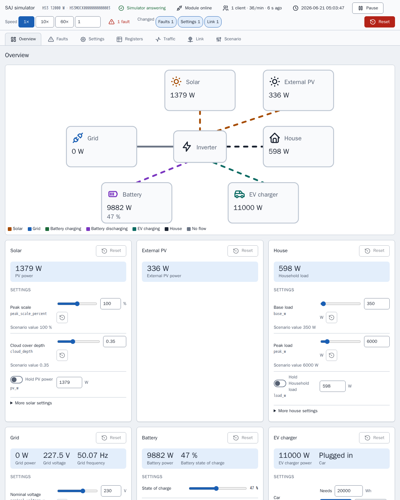

[en](../../en-gb/developer/simulator.md) | [de](../../de/developer/simulator.md) | [nl](../../nl/developer/simulator.md) | [fr](../../fr/developer/simulator.md) | [zh](../../zh-hans/developer/simulator.md) | [es](../../es/developer/simulator.md) | [it](../../it/developer/simulator.md) | pl | [sv](../../sv/developer/simulator.md)

# Symulator Modbus



Do czego służy symulator, jak uruchomić i skonfigurować scenariusz oraz jak rozszerzyć symulator.

Pełna lista tego, co obejmuje symulator, jest w sekcjach listy funkcji [Symulowane modele](../../../mock/docs/features.md#simulated-models), [Scenariusze](../../../mock/docs/features.md#scenarios), [Wariacja](../../../mock/docs/features.md#variation).

Symulator to zastępcze urządzenie SAJ, z którym może połączyć się Home Assistant lub dowolny klient Modbus, więc integrację można rozwijać bez posiadania sprzętu i bez ryzykowania sprzętu. Symulator dąży do wiarygodnych testów smoke, a nie do dokładnej emulacji, i nie jest ogólnym serwerem Modbus. Pakiet to `mock/saj_local_mock/`, a każdy symulator działa we własnym kontenerze.

## Decyzje projektowe

- **Samodzielny.** Symulator nie dzieli kodu z integracją, a kontrakt import-linter zabrania symulatorowi importowania Home Assistanta lub `custom_components`. Gdyby obie strony używały tych samych definicji rejestrów, błąd w definicjach byłby niewidoczny.
- **Własna warstwa Modbus.** Prawdziwe urządzenia SAJ łamią standard: dziwne kody wyjątków, bloki, które odrzucają odczyty przekraczające ich koniec, niski limit klienta. Integracja musi radzić sobie z takimi awariami, więc awarie są wbudowane.
- **Jeden kontener, jedno urządzenie.** Każda instancja trzyma własny stan, we własnym folderze w `mock/state/`, więc instancje nigdy na siebie nie wpływają.
- **Zmienny podczas działania.** Scenariusz jest punktem wyjścia, a nie jedynym wejściem. Strona symulatora i przychodzące żądania zmieniają działający system, a scenariusz pozostaje znanym stanem, do którego można wrócić.
- **Deterministyczny.** Pogoda i obciążenie zależą tylko od ziarna i czasu symulowanego. Ten sam scenariusz, chwila i zapisy dają te same wartości, bez względu na to, jak często klient odpytuje.
- **Jeden bilans energii.** Generowane są tylko nasłonecznienie i obciążenie; wszystko inne jest wyprowadzane, więc rejestry nigdy sobie nie przeczą.
- **Zapisy odnoszą skutek.** Ustawienia są przechowywane, odczytywane z powrotem i uwzględniane. Zapis ze strony przechodzi przez tę samą walidację i obsługę co zapis Modbus, więc integracja nie odróżni jednego od drugiego, a strona nie może wprowadzić urządzenia w stan, w który nie mógłby go wprowadzić klient.
- **Strona nie wie nic o modelach.** Strona buduje się z opisu, który podaje urządzenie, więc nowy model nie wymaga zmiany strony. Strona jest narzędziem deweloperskim, więc to zwykłe pliki HTML, CSS i JavaScript w `mock/static/` serwowane bez zmian, bez bibliotek, bez kroku kompilacji i bez własnych testów strony, podczas gdy Python za stroną jest testowany jak reszta. Zobacz [stronę symulatora](simulator-page.md).
- **Moduł jest częścią symulacji.** Serwer Modbus oznacza moduł komunikacyjny, z którym łączy się klient, więc awarie, które raporty z terenu opisują dla tych modułów (wolne lub brakujące odpowiedzi, dziwne kody wyjątków, zerwane połączenia, blokada), są ustawieniami symulatora, a nie szczególnymi przypadkami rozsianymi po urządzeniu.
- **Zachowanie zapisu pochodzi z dokumentów SAJ.** Zapisy są określone przez dokumenty protokołu SAJ i prawdziwe odczyty, a nie przez symulator. Jeśli symulator odstępuje od udokumentowanego zachowania `0x06` i `0x10`, odstępstwo jest defektem symulatora do zgłoszenia, a nie czymś, wokół czego dostosowuje się integrację.

## Gdzie czego szukać

| Dla | Zajrzyj do |
| --- | --- |
| Dlaczego symulator jest zbudowany tak, jak jest | Ukończona praca [Zbuduj symulator SAJ Modbus](../../../.github/work/done/build-saj-modbus-mock-simulator.md), [Dodaj panel sterowania symulatora](../../../.github/work/done/add-simulator-control-panel.md) i [Przeprojektuj panel symulatora z inspektorem i usterkami łącza](../../../.github/work/done/redesign-simulator-panel-with-inspector-and-link-faults.md) |
| Gotowe systemy | [mock/scenarios/](../../../mock/scenarios/) |
| Prawidłowe klucze scenariusza i wartości domyślne | `mock/saj_local_mock/scenario.py` |
| Co obsługuje każdy model | `mock/saj_local_mock/models.py` |
| Rejestry | `mock/saj_local_mock/profiles/` |
| Jak wartości ewoluują | `mock/saj_local_mock/simulation/` |
| Usługi i porty | [compose.yaml](../../../compose.yaml) |
| Strona symulatora | `panel.py` (trasy), `description.py`, `presets.py` i strona w [mock/static/](../../../mock/static/) |
| Usterki łącza | `mock/saj_local_mock/link.py` (ustawienia, granice, decyzje) i `transport.py` (wykonywanie decyzji) |
| Zapis ruchu | `mock/saj_local_mock/traffic.py` |
| Bity usterek dla każdego modelu | `mock/saj_local_mock/profiles/fault_tables.py` |
| Zapisany stan | `mock/saj_local_mock/persistence.py` |

Transport nie wie nic o SAJ, urządzenie jest właścicielem adresów i reguł dostępu, profil wiąże rejestry z symulowanymi wielkościami, a symulacja nie wie, jak wartości są transportowane. Utrzymywanie warstw osobno pozwala testować jednostkowo każdą warstwę samodzielnie.

## Rozmowa z symulatorem z terminala

`make up` uruchamia symulatory. Home Assistant łączy się z każdym przez nazwę usługi Compose na własnym porcie symulatora; z Twojej maszyny użyj `localhost` i opublikowanego portu z `compose.yaml`.

Przykłady używają [mbpoll](https://github.com/epsilonrt/mbpoll) na opublikowanym porcie symulatora HS3. `-0` sprawia, że adresy zgadzają się z mapami rejestrów, `-1` czyta raz, `-t 4` wybiera rejestry holding, a `-a` to ID jednostki.

Odczytaj typ urządzenia i moc znamionową (rejestry `0x8F00` i `0x8F01`):

<!-- jscpd:ignore-start -->
```bash
mbpoll -m tcp -p 5020 -a 1 -0 -1 -t 4:hex -r 0x8F00 -c 2 localhost
```
<!-- jscpd:ignore-end -->

HS3 i H2 odpowiadają różnymi typami urządzeń, co jest najszybszym sposobem sprawdzenia, jaki system symuluje dany port.

Zapisz ustawienie i odczytaj ustawienie z powrotem (tu tryb aplikacji pod `0x3647`):

<!-- jscpd:ignore-start -->
```bash
mbpoll -m tcp -p 5020 -a 1 -0 -t 4 -r 0x3647 localhost 1
mbpoll -m tcp -p 5020 -a 1 -0 -1 -t 4 -r 0x3647 localhost
```
<!-- jscpd:ignore-end -->

Zobacz, jak symulator odrzuca żądanie, na przykład adres poza każdym blokiem:

<!-- jscpd:ignore-start -->
```bash
mbpoll -m tcp -p 5020 -a 1 -0 -1 -t 4 -r 0x0001 localhost
```
<!-- jscpd:ignore-end -->

Obserwuj zmianę wartości, pomijając `-1`; mbpoll odpytuje wtedy raz na sekundę do zatrzymania.

Uruchom własny healthcheck symulatora, który nie wymaga zainstalowanego klienta:

<!-- jscpd:ignore-start -->
```bash
docker compose exec mock python -m saj_local_mock healthcheck; echo $?
```
<!-- jscpd:ignore-end -->

Zapisy są zachowywane między restartami w `mock/state/`, które Git ignoruje, i resetowane ze strony symulatora lub przez usunięcie zawartości folderu, zobacz [Zapisany stan](simulator-page.md#ustawienia-wstępne-zapisany-stan-i-eksport). Adresy pochodzą z profili; trzy powyższe to tylko punkty wyjścia.

## Konfigurowanie scenariusza

Scenariusz to plik YAML zamontowany w `/config/config.yaml`. Wymagane jest tylko `device.model`, więc plik podaje tylko to, co różni się od wartości domyślnych:

<!-- jscpd:ignore-start -->
```yaml
device:
  model: hs3
simulation:
  start: "2026-06-21T12:00:00"
  speed: 600
battery:
  modules: 4
```
<!-- jscpd:ignore-end -->

W przykładzie `simulation.speed` to sekundy symulowane na sekundę rzeczywistą, więc ten scenariusz uruchamia dziesięć minut symulowanych co sekundę od letniego południa: przydatne do obserwowania całego dnia ładowania i rozładowania w kilka minut. `simulation.seed` wybiera pogodę i obciążenie.

Dwie sekcje kształtują losowe zachowanie i usterki przy starcie; trzecia, `link`, jest opisana w [Usterkach łącza](simulator-page.md#usterki-łącza). `variation` ustawia granice, głębokość i okres generatorów słońca, obciążenia i sieci (poziom obciążenia pozostaje w `site.load`), a `faults` wymienia aktywne bity usterek dla każdego wyposażenia przez rejestr i bit, plus kody modułów baterii:

<!-- jscpd:ignore-start -->
```yaml
variation:
  cloud_depth: 0.9
faults:
  inverter:
    - {register: 0x4005, bit: 23}
  packs:
    - {pack: 1, fault: 1}
```
<!-- jscpd:ignore-end -->

Błędny klucz lub niemożliwa kombinacja zatrzymuje symulator przy starcie i nazywa klucz. Symulator zapisuje wiersz na wyjściu błędów i kończy działanie:

```text
invalid scenario: ev_charger.installed: not available on h2
```

## Uruchamianie innego lub dodatkowego systemu

**Wypróbuj scenariusz jednorazowo**, bez dotykania żadnego pliku. Symulator działa na pierwszym planie na własnym porcie, dopóki go nie zatrzymasz:

<!-- jscpd:ignore-start -->
```bash
docker compose run --rm --no-deps -p 5030:502 \
  -v ./mock/scenarios/hs3-off-grid.yaml:/config/config.yaml:ro \
  -v ./mock/state/off-grid:/data \
  mock
```
<!-- jscpd:ignore-end -->

Dodatkowe `-v` jest potrzebne, bo usługa `mock` w przeciwnym razie przynosi montowanie `/data` z `mock/state/hs3/`, a pierwsza zmiana w uruchomieniu off-grid zastąpiłaby deweloperski `state.json` HS3 stanem off-grid. Uruchomienie off-grid zachowuje własny stan w `mock/state/off-grid/` między uruchomieniami.

Wskaż pierwsze `-v` na własny plik, aby uruchomić napisany przez siebie scenariusz.

**Zmień to, co uruchamia `make up`** w `compose.override.yaml`. Zamontowanie innego pliku pod tą samą ścieżką zastępuje scenariusz; nowa usługa dodaje system:

<!-- jscpd:ignore-start -->
```yaml
services:
  mock:
    volumes:
      - ./mock/scenarios/hs3-ev.yaml:/config/config.yaml:ro

  mock-off-grid:
    build:
      context: ./mock
    volumes:
      - ./mock/scenarios/hs3-off-grid.yaml:/config/config.yaml:ro
    ports:
      - "5022:502"
```
<!-- jscpd:ignore-end -->

Każda usługa to niezależne urządzenie z własnym stanem. Home Assistant dociera do nowej usługi jako `mock-off-grid`, więc kilka systemów można dodać do jednego Home Assistanta obok siebie.

## Rozszerzanie symulatora

- **Nowy scenariusz:** plik w `mock/scenarios/`. `make mock-smoke` obejmuje każdy plik w folderze.
- **Nowy model:** wpis w `models.py`, profil w `profiles/` i akceptacja przez walidację scenariusza w `scenario.py`.
- **Nowa osobliwość:** w warstwie, która za nią odpowiada. Ramkowanie i połączenia w transporcie, adresy i dostęp w urządzeniu, zachowanie modelu w profilu.

Symulator przechodzi te same bramki co integracja, zobacz [stronę sprawdzeń](checks.md).
