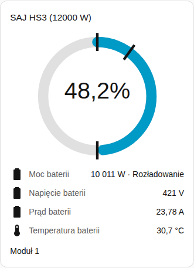
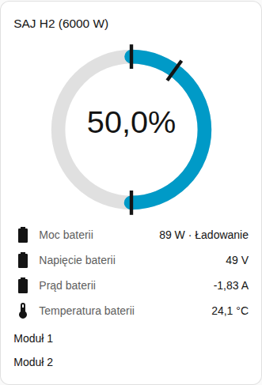

[en](../../../en-gb/user/cards/battery-card.md) | [de](../../../de/user/cards/battery-card.md) | [nl](../../../nl/user/cards/battery-card.md) | [fr](../../../fr/user/cards/battery-card.md) | [zh](../../../zh-hans/user/cards/battery-card.md) | [es](../../../es/user/cards/battery-card.md) | [it](../../../it/user/cards/battery-card.md) | pl | [sv](../../../sv/user/cards/battery-card.md)

# Karta baterii

Strona Karta baterii wyjaśnia kartę baterii, która pokazuje naładowanie, moc i odczyty baterii. Pełna lista jest w sekcji [Karta baterii](../../../../frontend/docs/features.md#battery-card) listy funkcji kart. [Dodaj element](README.md#dodaj-element) wyjaśnia, jak dodać kartę i wybrać system.

## Co pokazuje karta

- Pierścień pokazuje stan naładowania. Znaczniki na pierścieniu pokazują rezerwę awaryjną, limit ładowania i limit rozładowania przy sieci.
- Moc baterii pokazuje się z informacją, czy bateria się ładuje, czy rozładowuje, a pod mocą napięcie, prąd, temperatura i pojemność użytkowa. Kierunki zgadzają się ze [znakiem mocy](../entities-and-prefix.md#znak-mocy).
- Przy włączonym Pokaż moduły baterii, co jest domyślne, każdy moduł dostaje grupę wierszy ze stanem naładowania, kondycją, napięciem, prądem, temperaturą, cyklami, usterką i ostrzeżeniem. Odczyt modułu pojawia się tylko wtedy, gdy encja odczytu jest włączona. Większość odczytów modułów jest tworzona jako wyłączona, dlatego zrzut ekranu pokazuje tylko nazwę modułu. Włącz w Home Assistancie encje, które chcesz. [Encje modułów baterii](../entities/battery-packs.md) są w opisie encji.
- System bez baterii mówi o tym.

## Różnice między modelami

- **HS3:** jeden moduł.
- **H2:** jedna grupa wierszy dla każdego modułu zgłaszanego przez falownik, do pięciu. Zrzut ekranu pokazuje H2 z dwoma modułami. Zobacz [wyposażenie opcjonalne](../optional-equipment.md#moduły-baterii).

[Karta usterek](faults-card.md) wymienia aktywną usterkę i ostrzeżenie każdego modułu. Encje usterki i ostrzeżenia są domyślnie włączone.

## Opcje

| Opcja w edytorze | Klucz YAML | Domyślnie |
| --- | --- | --- |
| System | `device` | Pierwszy system |
| Pokaż moduły baterii | `show_packs` | Włączone |

## Jeszcze nieobsługiwane

- Zmiana ustawienia baterii z karty. Karta baterii pokazuje tylko odczyty. Użyj [karty sterowania](controls-card.md) dla limitów baterii.
