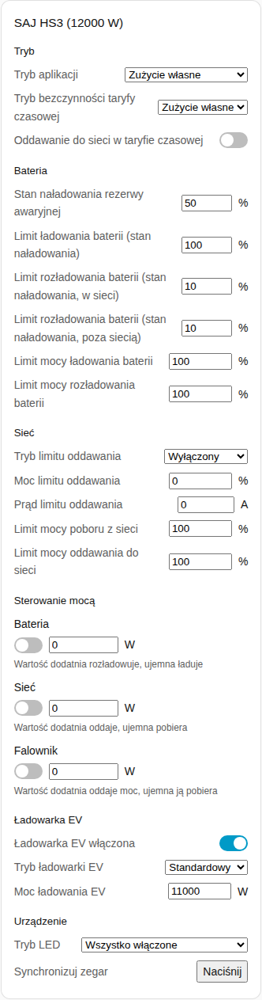
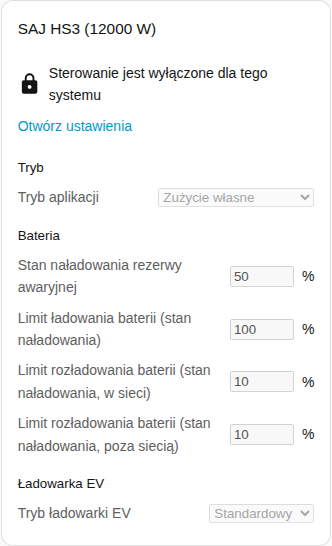
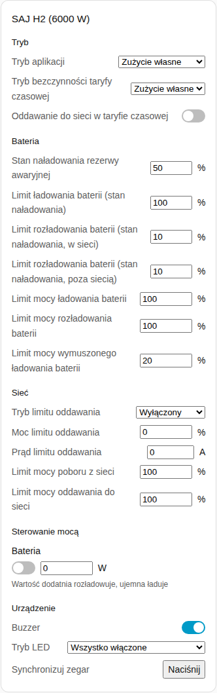

[en](../../../en-gb/user/cards/controls-card.md) | [de](../../../de/user/cards/controls-card.md) | [nl](../../../nl/user/cards/controls-card.md) | [fr](../../../fr/user/cards/controls-card.md) | [zh](../../../zh-hans/user/cards/controls-card.md) | [es](../../../es/user/cards/controls-card.md) | [it](../../../it/user/cards/controls-card.md) | pl | [sv](../../../sv/user/cards/controls-card.md)

# Karta sterowania

Strona Karta sterowania wyjaśnia kartę sterowania, która zbiera ustawienia systemu w sekcje, abyś mógł zmieniać ustawienia z pulpitu. Pełna lista jest w sekcji [Karta sterowania](../../../../frontend/docs/features.md#controls-card) listy funkcji kart. [Dodaj element](README.md#dodaj-element) wyjaśnia, jak dodać kartę i wybrać system. Ustawienia za elementami sterowania opisuje [zmiana ustawień](../changing-settings.md).

## Co pokazuje karta

- Sekcje to Tryb, Bateria, Sieć, Sterowanie mocą, Ładowarka EV i Urządzenie. Sekcja bez niczego do pokazania jest pomijana.
- **Tryb:** tryb aplikacji i ustawienia taryfy czasowej.
- **Bateria:** rezerwa awaryjna oraz limity ładowania i rozładowania.
- **Sieć:** ustawienia limitu oddawania i limity mocy sieci.
- **Sterowanie mocą:** każda funkcja [sterowania mocą](../power-control.md), którą ma system, z przełącznikiem, wartością zadaną mocy i podpowiedzią, co robi moc dodatnia i ujemna.
- **Ładowarka EV:** przełącznik, tryb i moc ładowania ładowarki.
- **Urządzenie:** buzzer, tryb LED i synchronizacja zegara.
- Każde ustawienie używa elementu sterowania, który do niego pasuje: suwaka lub pola liczbowego, listy, przełącznika, pola czasu albo przycisku.
- Element sterowania zmienia falownik raz na decyzję, a potem pokazuje wartość, którą przechowuje falownik. Odrzucona zmiana pojawia się pod elementem sterowania.
- Karta nie ma przycisku Uruchom falownik ponownie, więc dotknięcie na pulpicie nie może uruchomić falownika ponownie. Ponowne uruchomienie pozostaje encją.

## Gdy sterowanie nie jest dozwolone

Gdy [Zezwól na sterowanie](../changing-settings.md#zezwól-na-sterowanie) jest wyłączone dla systemu, każdy element sterowania jest wyłączony. Kłódka nad elementami sterowania prowadzi do ustawień integracji, gdzie włączasz Zezwól na sterowanie.

## Różnice między modelami

- **Tylko HS3:** sekcja ładowarki EV oraz funkcje sterowania mocą Sieci i Falownika.
- **Tylko H2:** buzzer i limit mocy wymuszonego ładowania baterii. H2 ma tylko funkcję sterowania mocą Baterii.

## Opcje

| Opcja w edytorze | Klucz YAML | Domyślnie |
| --- | --- | --- |
| System | `device` | Pierwszy system |
| Sekcje | `sections`, lista `mode`, `battery`, `grid`, `power_control`, `ev_charger` i `device` | Wszystkie sekcje |

## Jeszcze nieobsługiwane

- Przycisk Uruchom falownik ponownie. Ponowne uruchomienie pozostaje encją.
- Harmonogramy sterowania mocą. Skonfiguruj harmonogramy na stronie integracji, zobacz [sterowanie mocą](../power-control.md#podążaj-za-harmonogramem).
