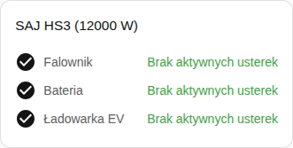

[en](../../../en-gb/user/cards/faults-card.md) | [de](../../../de/user/cards/faults-card.md) | [nl](../../../nl/user/cards/faults-card.md) | [fr](../../../fr/user/cards/faults-card.md) | [zh](../../../zh-hans/user/cards/faults-card.md) | [es](../../../es/user/cards/faults-card.md) | [it](../../../it/user/cards/faults-card.md) | pl | [sv](../../../sv/user/cards/faults-card.md)

# Karta usterek

Strona Karta usterek wyjaśnia kartę usterek, która wymienia aktywne usterki każdego elementu wyposażenia. Pełna lista jest w sekcji [Karta usterek](../../../../frontend/docs/features.md#faults-card) listy funkcji kart. [Dodaj element](README.md#dodaj-element) wyjaśnia, jak dodać kartę i wybrać system. Usterki pochodzą z [encji usterek urządzeń](../faults-and-repairs.md#usterki-urządzeń).

## Co pokazuje karta

- Usterki są pogrupowane według falownika, baterii i ładowarki EV, a każda aktywna usterka pokazuje, jak dawno się zaczęła. Usterki i ostrzeżenia modułów baterii są w grupie baterii.
- Nierozpoznana usterka mówi, by szukać rejestru i bitu w [pobranej diagnostyce](../troubleshooting.md#pobierz-diagnostykę).
- Przycisk Wyczyść usterkę leży pod aktywnymi usterkami falownika. Przycisk wysyła polecenie Wyczyść bieżącą usterkę. Gdy sterowanie nie jest dozwolone dla systemu, przycisk jest wyłączony, a kłódka prowadzi do ustawień integracji. Zobacz [Zezwól na sterowanie](../changing-settings.md#zezwól-na-sterowanie).
- Przy włączonym Pokaż grupy bez usterek, co jest domyślne, grupa bez aktywnej usterki pokazuje się jako czysta, jak na zrzucie ekranu. Przy wyłączonej opcji karta pokazuje tylko grupy z aktywną usterką.

System bez baterii lub ładowarki EV nie ma usterek do pokazania dla brakującego wyposażenia, więc karta nie rysuje grupy tego wyposażenia.

## Opcje

| Opcja w edytorze | Klucz YAML | Domyślnie |
| --- | --- | --- |
| System | `device` | Pierwszy system |
| Pokaż grupy bez usterek | `show_groups_without_faults` | Włączone |

## Jeszcze nieobsługiwane

- Czyszczenie usterek baterii lub ładowarki EV z karty. Przycisk Wyczyść usterkę leży tylko pod aktywnymi usterkami falownika.
