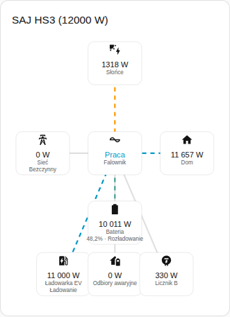
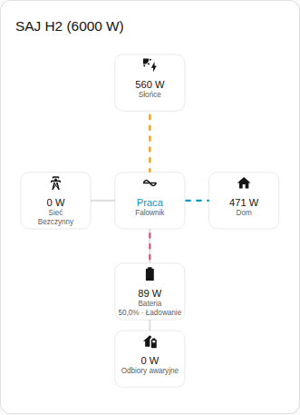

[en](../../../en-gb/user/cards/power-flow-card.md) | [de](../../../de/user/cards/power-flow-card.md) | [nl](../../../nl/user/cards/power-flow-card.md) | [fr](../../../fr/user/cards/power-flow-card.md) | [zh](../../../zh-hans/user/cards/power-flow-card.md) | [es](../../../es/user/cards/power-flow-card.md) | [it](../../../it/user/cards/power-flow-card.md) | pl | [sv](../../../sv/user/cards/power-flow-card.md)

# Karta przepływu mocy

Strona Karta przepływu mocy wyjaśnia kartę przepływu mocy, która rysuje bieżącą moc między słońcem, baterią, siecią, domem i wyposażeniem opcjonalnym. Pełna lista jest w sekcji [Karta przepływu mocy](../../../../frontend/docs/features.md#power-flow-card) listy funkcji kart. [Dodaj element](README.md#dodaj-element) wyjaśnia, jak dodać kartę i wybrać system.



## Co pokazuje karta

- Słońce, bateria, sieć i dom są rysowane wokół falownika, który pokazuje stan pracy.
- Każda linia pokazuje kierunek przepływu i porusza się szybciej, gdy moc rośnie. Moc 10 W lub mniejsza jest rysowana jako bezczynna.
- Bateria pokazuje stan naładowania i informację, czy bateria się ładuje, czy rozładowuje. Sieć pokazuje, czy system pobiera, czy oddaje moc. Kierunki zgadzają się ze [znakiem mocy](../entities-and-prefix.md#znak-mocy).
- Przy włączonym Pokaż wyposażenie opcjonalne, co jest domyślne, karta rysuje też odbiory awaryjne, Licznik B i ładowarkę EV, gdy system ma to wyposażenie. Licznik B to odczyt bez kierunku.
- Przy włączonym Pokaż ciągi paneli wymieniana jest moc każdego ciągu paneli. Opcja jest domyślnie wyłączona.
- Zakres wybiera między odczytami systemu, co jest domyślne, a odczytami systemu równoległego. System bez odczytów równoległych pokazuje stan pusty przy zakresie równoległym.

## Różnice między modelami

- **Tylko HS3:** ładowarka EV, jak na zrzucie ekranu powyżej.
- **H2:** karta rysuje części karty HS3, z wyjątkiem ładowarki EV. Zrzut ekranu poniżej pokazuje H2, który ładuje baterię.



## Opcje

| Opcja w edytorze | Klucz YAML | Domyślnie |
| --- | --- | --- |
| System | `device` | Pierwszy system |
| Pokaż ciągi paneli | `show_strings` | Wyłączone |
| Pokaż wyposażenie opcjonalne | `show_optional_equipment` | Włączone |
| Zakres | `scope` (`system` lub `parallel`) | `system` |

<!-- jscpd:ignore-start -->
```yaml
type: custom:saj-local-power-flow-card
device: 0123456789abcdef0123456789abcdef
show_strings: false
show_optional_equipment: true
scope: system
```
<!-- jscpd:ignore-end -->

Wartość `device` to ID urządzenia w Home Assistancie. Edytor wizualny wypełnia wartość za Ciebie. Nazwy encji za każdą częścią są w [opisie encji](../entities/README.md).

## Jeszcze nieobsługiwane

- Kierunek dla Licznika B. Karta rysuje Licznik B jako odczyt bez kierunku.
