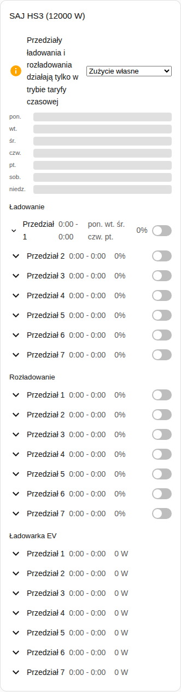
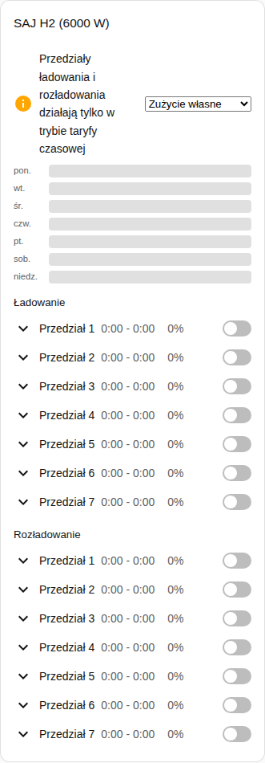

[en](../../../en-gb/user/cards/schedule-card.md) | [de](../../../de/user/cards/schedule-card.md) | [nl](../../../nl/user/cards/schedule-card.md) | [fr](../../../fr/user/cards/schedule-card.md) | [zh](../../../zh-hans/user/cards/schedule-card.md) | [es](../../../es/user/cards/schedule-card.md) | [it](../../../it/user/cards/schedule-card.md) | pl | [sv](../../../sv/user/cards/schedule-card.md)

# Karta harmonogramu

Strona Karta harmonogramu wyjaśnia kartę harmonogramu, która pokazuje i edytuje przedziały ładowania, rozładowania i ładowarki EV. Pełna lista jest w sekcji [Karta harmonogramu](../../../../frontend/docs/features.md#schedule-card) listy funkcji kart. [Dodaj element](README.md#dodaj-element) wyjaśnia, jak dodać kartę i wybrać system.

## Co pokazuje karta

- Przedziały ładowania, rozładowania i ładowarki EV, każdy z godzinami, mocą, dniami i informacją, czy przedział jest włączony. Opcja Rodzaje przedziałów wybiera, które rodzaje pokazuje karta.
- Przy włączonym Pokaż oś czasu tygodnia, co jest domyślne, oś czasu tygodnia rysuje każdy przedział jako pasek. Dotknij paska, aby otworzyć przedział.
- Otwarty przedział ma edytor początku, końca, mocy, dni i pozostałych ustawień przedziału.
- Przedział pojawia się tylko wtedy, gdy każda encja przedziału jest włączona, a karta liczy przedziały, które pomija. Włączenie [Zezwól na sterowanie](../changing-settings.md#zestaw-sterowania) włącza encje przedziałów.
- Przedziały ładowania i rozładowania działają tylko w trybie aplikacji taryfy czasowej. Gdy tryb aplikacji jest innym trybem, uwaga mówi o tym i pokazuje obok listę trybów. Liczą się zarówno Taryfa czasowa, jak i Taryfa czasowa (BMS).
- Gdy sterowanie nie jest dozwolone dla systemu, każdy element sterowania na karcie jest wyłączony, a kłódka prowadzi do ustawień integracji. Zobacz [Zezwól na sterowanie](../changing-settings.md#zezwól-na-sterowanie).

## Różnice między modelami

- **Tylko HS3:** przedziały ładowarki EV.
- **H2:** tylko przedziały ładowania i rozładowania, jak pokazuje zrzut ekranu poniżej.

Przyciski dni przedziału to przyciski [funkcji kafelka dni tygodnia](weekdays-feature.md).

## Opcje

| Opcja w edytorze | Klucz YAML | Domyślnie |
| --- | --- | --- |
| System | `device` | Pierwszy system |
| Rodzaje przedziałów | `slot_kinds`, lista `charge`, `discharge` i `ev_charger` | Wszystkie rodzaje |
| Pokaż oś czasu tygodnia | `show_timeline` | Włączone |

## Jeszcze nieobsługiwane

- Harmonogramy sterowania mocą. Harmonogram sterowania mocą podąża za pomocnikiem harmonogramu Home Assistanta, zobacz [sterowanie mocą](../power-control.md#podążaj-za-harmonogramem).
