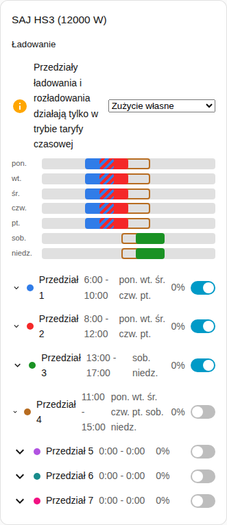
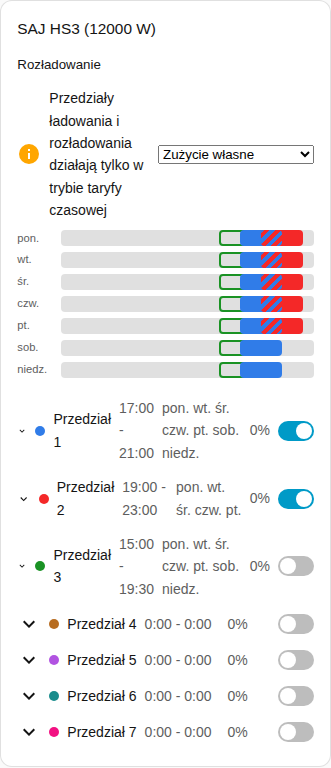
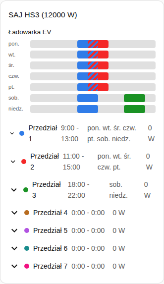

[en](../../../en-gb/user/cards/schedule-cards.md) | [de](../../../de/user/cards/schedule-cards.md) | [nl](../../../nl/user/cards/schedule-cards.md) | [fr](../../../fr/user/cards/schedule-cards.md) | [zh](../../../zh-hans/user/cards/schedule-cards.md) | [es](../../../es/user/cards/schedule-cards.md) | [it](../../../it/user/cards/schedule-cards.md) | pl | [sv](../../../sv/user/cards/schedule-cards.md)

# Karty harmonogramu

Strona Karty harmonogramu wyjaśnia trzy karty harmonogramu. Każda karta pokazuje i edytuje przedziały jednego rodzaju: ładowania, rozładowania lub ładowarki EV. Pełna lista jest w sekcji [Schedule cards](../../../../frontend/docs/features.md#schedule-cards) listy funkcji kart. [Dodaj element](README.md#dodaj-element) wyjaśnia, jak dodać kartę i wybrać system.

## Co pokazuje każda karta harmonogramu

- Tytuł karty, a pod tytułem nagłówek z rodzajem karty.
- Przedziały tego rodzaju, każdy z godzinami, mocą, dniami i informacją, czy przedział jest włączony.
- Kolor dla każdego numeru przedziału. Przedział 1 ma ten sam kolor na wszystkich trzech kartach. Każdy wiersz przedziału zaczyna się znacznikiem w kolorze przedziału.
- Przy włączonym Pokaż oś czasu tygodnia, co jest domyślne, oś czasu tygodnia rysuje każdy przedział jako pasek w kolorze przedziału. Dotknij paska, aby otworzyć przedział.
- Przedział, który jest wyłączony, to sam obrys w kolorze przedziału, bez wypełnienia. Pasek przedziału, który jest włączony, zasłania część obrysu, którą przecina. Tam, gdzie dwa lub więcej włączonych przedziałów nakłada się w danym dniu, oś czasu rysuje nakładanie jako paski w kolorach nakładających się przedziałów. Wyłączony przedział nie tworzy nakładania. Dotknij nakładania, aby otworzyć nakładający się przedział z najniższym numerem.
- Otwarty przedział ma edytor początku, końca, mocy, dni i pozostałych ustawień przedziału.
- Przedział pojawia się tylko wtedy, gdy każda encja przedziału jest włączona, a karta liczy przedziały, które pomija. Włączenie [Zezwól na sterowanie](../changing-settings.md#zestaw-sterowania) włącza encje przedziałów.
- Gdy sterowanie nie jest dozwolone dla systemu, każdy element sterowania na karcie jest wyłączony, a kłódka prowadzi do ustawień integracji. Zobacz [Zezwól na sterowanie](../changing-settings.md#zezwól-na-sterowanie).

Przyciski dni przedziału to przyciski [funkcji kafelka dni tygodnia](weekdays-feature.md).

## Opcje

Wszystkie trzy karty mają te same opcje.

| Opcja w edytorze | Klucz YAML | Domyślnie |
| --- | --- | --- |
| System | `device` | Pierwszy system |
| Pokaż oś czasu tygodnia | `show_timeline` | Włączone |

## Karta harmonogramu ładowania

Karta harmonogramu ładowania pokazuje przedziały ładowania.

Przedziały ładowania działają tylko w trybie aplikacji taryfy czasowej. Gdy tryb aplikacji jest innym trybem, uwaga mówi o tym i pokazuje obok listę trybów. Liczą się zarówno Taryfa czasowa, jak i Taryfa czasowa (BMS).

## Karta harmonogramu rozładowania

Karta harmonogramu rozładowania pokazuje przedziały rozładowania.

Przedziały rozładowania działają tylko w trybie aplikacji taryfy czasowej, więc karta pokazuje tę samą uwagę co Karta harmonogramu ładowania.

## Karta harmonogramu ładowarki EV

Karta harmonogramu ładowarki EV pokazuje przedziały ładowarki EV. Karta nie pokazuje uwagi o trybie taryfy czasowej.

## Różnice między modelami

- **Tylko HS3:** przedziały ładowarki EV. W H2 Karta harmonogramu ładowarki EV pokazuje stan pusty, który mówi, jaki rodzaj encji włączyć.
- **H2:** tylko przedziały ładowania i rozładowania.

## Jeszcze nieobsługiwane

- Harmonogramy sterowania mocą. Harmonogram sterowania mocą podąża za pomocnikiem harmonogramu Home Assistanta, zobacz [sterowanie mocą](../power-control.md#podążaj-za-harmonogramem).
