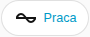

[en](../../../en-gb/user/cards/status-badge.md) | [de](../../../de/user/cards/status-badge.md) | [nl](../../../nl/user/cards/status-badge.md) | [fr](../../../fr/user/cards/status-badge.md) | [zh](../../../zh-hans/user/cards/status-badge.md) | [es](../../../es/user/cards/status-badge.md) | [it](../../../it/user/cards/status-badge.md) | pl | [sv](../../../sv/user/cards/status-badge.md)

# Odznaka stanu

Strona Odznaka stanu wyjaśnia odznakę stanu, która pokazuje stan systemu w rzędzie odznak pulpitu. Pełna lista jest w sekcji [Odznaka stanu](../../../../frontend/docs/features.md#status-badge) listy funkcji kart. [Dodaj element](README.md#dodaj-element) wyjaśnia, jak dodać odznakę i wybrać system.



## Co pokazuje odznaka

- Stan pracy, zabarwiony według tego, jak dobry jest stan, oraz liczbę elementów wyposażenia z aktywną usterką. Odznaka pokazuje liczbę tylko wtedy, gdy usterka jest aktywna, więc zrzut ekranu pokazuje sam stan.
- Odznaka mówi Nie odpowiada, gdy system nie odpowiada.
- Dotknięcie odznaki otwiera szczegóły stanu pracy.

## Opcje

| Opcja w edytorze | Klucz YAML | Domyślnie |
| --- | --- | --- |
| System | `device` | Pierwszy system |

```yaml
type: custom:saj-local-status-badge
device: 0123456789abcdef0123456789abcdef
```

Wartość `device` to ID urządzenia w Home Assistancie. Edytor wizualny wypełnia wartość za Ciebie.

## Jeszcze nieobsługiwane

- Opcje inne niż system.
