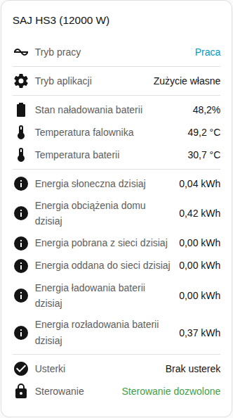

[en](../../../en-gb/user/cards/status-card.md) | [de](../../../de/user/cards/status-card.md) | [nl](../../../nl/user/cards/status-card.md) | [fr](../../../fr/user/cards/status-card.md) | [zh](../../../zh-hans/user/cards/status-card.md) | [es](../../../es/user/cards/status-card.md) | [it](../../../it/user/cards/status-card.md) | pl | [sv](../../../sv/user/cards/status-card.md)

# Karta stanu

Strona Karta stanu wyjaśnia kartę stanu, która podsumowuje system w jednym miejscu. Pełna lista jest w sekcji [Karta stanu](../../../../frontend/docs/features.md#status-card) listy funkcji kart. [Dodaj element](README.md#dodaj-element) wyjaśnia, jak dodać kartę i wybrać system.

## Co pokazuje karta

- Stan pracy, zabarwiony według tego, jak dobry jest stan, oraz tryb aplikacji.
- Stan naładowania baterii, temperatury falownika i baterii oraz tryb poza siecią.
- Przy włączonym Pokaż dzisiejszą energię, co jest domyślne, karta pokazuje dzisiejszą energię ze słońca, zużytą przez odbiory, pobraną z sieci, oddaną do sieci, ładowania baterii i rozładowania baterii.
- Liczbę elementów wyposażenia z aktywną usterką albo informację, że nie ma usterek. Zobacz [usterki urządzeń](../faults-and-repairs.md#usterki-urządzeń).
- Informację, czy sterowanie jest dozwolone dla systemu. Zobacz [Zezwól na sterowanie](../changing-settings.md#zezwól-na-sterowanie).

## Różnice między modelami

- **Tylko H2:** gdy tryb aplikacji, w którym pracuje falownik, różni się od trybu, który wybrałeś, karta pokazuje też tryb, który działa teraz. Wiersz pojawia się tylko wtedy, gdy encja Tryb aplikacji (obowiązujący) jest włączona. Ta encja jest tworzona jako wyłączona. Zobacz [opis encji](../entities/README.md).

## Opcje

| Opcja w edytorze | Klucz YAML | Domyślnie |
| --- | --- | --- |
| System | `device` | Pierwszy system |
| Pokaż dzisiejszą energię | `show_energy` | Włączone |

## Jeszcze nieobsługiwane

- Zmiana ustawienia z karty. Karta stanu tylko pokazuje. Użyj [karty sterowania](controls-card.md), aby zmieniać ustawienia.
