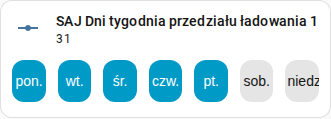

[en](../../../en-gb/user/cards/weekdays-feature.md) | [de](../../../de/user/cards/weekdays-feature.md) | [nl](../../../nl/user/cards/weekdays-feature.md) | [fr](../../../fr/user/cards/weekdays-feature.md) | [zh](../../../zh-hans/user/cards/weekdays-feature.md) | [es](../../../es/user/cards/weekdays-feature.md) | [it](../../../it/user/cards/weekdays-feature.md) | pl | [sv](../../../sv/user/cards/weekdays-feature.md)

# Funkcja kafelka dni tygodnia

Strona Funkcja kafelka dni tygodnia wyjaśnia funkcję dni tygodnia, która dodaje siedem przycisków dni do karty kafelka, aby ustawić dni przedziału. Pełna lista jest w sekcji [Funkcja kafelka dni tygodnia](../../../../frontend/docs/features.md#weekdays-tile-card-feature) listy funkcji kart. Dni przedziału to encje Dni tygodnia przedziałów ładowania, rozładowania i ładowarki EV, wymienione w obszarach [Bateria](../entities/battery.md) i [Ładowarka EV](../entities/ev-charger.md) opisu encji.



## Dodaj funkcję

1. Dodaj kartę kafelka do pulpitu i wybierz encję Dni tygodnia przedziału jako encję karty kafelka.
2. Otwórz funkcje karty kafelka, wybierz Dodaj funkcję i wybierz Dni tygodnia SAJ Local.

Funkcja jest oferowana tylko dla karty kafelka, której encją jest encja dni tygodnia przedziału. Funkcja nie ma opcji.

```yaml
type: tile
entity: number.saj_charge_slot_1_days
features:
  - type: custom:saj-local-weekdays-feature
```

ID encji w przykładzie nie ma prefiksu. Jeśli ustawisz [prefiks](../entities-and-prefix.md#prefiks), ID encji ma prefiks po `saj_`.

## Jak działają przyciski

- Siedem nazwanych przycisków dni zaczyna się od Twojego pierwszego dnia tygodnia, który pochodzi z ustawień Home Assistanta lub z Twojego języka.
- SAJ Local wysyła zmianę 1,5 sekundy po ostatnim naciśnięciu, więc możesz wybrać kilka dni w jednej zmianie.
- Falownik przechowuje dni jako jedną liczbę, która nie przesuwa się razem z Twoim pierwszym dniem tygodnia. Poniedziałek to najniższy bit, a niedziela najwyższy na każdym modelu, więc od poniedziałku do piątku to 31, jak na zrzucie ekranu, a poniedziałek, środa i piątek to 21.
- Przyciski są wyłączone, gdy [Zezwól na sterowanie](../changing-settings.md#zezwól-na-sterowanie) jest wyłączone dla systemu.

[Karta harmonogramu](schedule-card.md) używa przycisków w edytorze przedziału.

## Jeszcze nieobsługiwane

- Każda encja inna niż encja dni tygodnia przedziału. SAJ Local nie oferuje funkcji dla innych kart kafelka.
