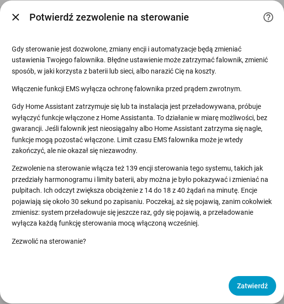

[en](../../en-gb/user/changing-settings.md) | [de](../../de/user/changing-settings.md) | [nl](../../nl/user/changing-settings.md) | [fr](../../fr/user/changing-settings.md) | [zh](../../zh-hans/user/changing-settings.md) | [es](../../es/user/changing-settings.md) | [it](../../it/user/changing-settings.md) | pl | [sv](../../sv/user/changing-settings.md)

# Zmiana ustawień

Strona Zmiana ustawień wyjaśnia, jak zezwolić SAJ Local na zmianę ustawień Twojego falownika, co dzieje się ze zmianą i które zmiany są zawsze odrzucane. Pełne listy są w sekcjach [Zmiana ustawień](../../../custom_components/saj_local/docs/features.md#changing-settings) i [EMS](../../../custom_components/saj_local/docs/features.md#ems) listy funkcji integracji. Ustawienia i polecenia są rozłożone na obszary [opisu encji](entities/README.md), głównie [Ustawienia](entities/settings.md) i [Bateria](entities/battery.md).

Zapis do falownika jest wyłączony, dopóki nie zezwolisz na sterowanie dla systemu. Gdy Zezwól na sterowanie jest wyłączone, ustawienia pokazują bieżącą wartość, ale odrzucają każdą zmianę, z komunikatem, gdzie włączyć sterowanie. Nic nie jest wysyłane do falownika.

## Zezwól na sterowanie

1. Otwórz Skonfiguruj, czyli koło zębate w wierszu systemu na stronie integracji SAJ Local. Zezwól na sterowanie możesz też włączyć podczas dodawania systemu.
2. Włącz Zezwól na sterowanie i wybierz Zatwierdź.
3. Przeczytaj potwierdzenie, a potem wybierz Zatwierdź jeszcze raz.

Potwierdzenie ostrzega, że błędne ustawienie może zatrzymać falownik, zmienić sposób, w jaki falownik korzysta z baterii lub sieci, albo narazić Cię na koszty. Potwierdzenie mówi też:

- Włączenie funkcji EMS wyłącza ochronę falownika przed prądem zwrotnym.
- Gdy Home Assistant się zatrzymuje albo system się przeładowuje, SAJ Local próbuje wyłączyć funkcje włączone z Home Assistanta. Wyłączenie jest działaniem w miarę możliwości, a nie gwarancją.
- Zezwolenie na sterowanie włącza encje sterowania, a ich odczyt zwiększa obciążenie żądaniami. Okno pokazuje liczbę encji oraz obciążenie przed i po.

Tylko HS3: potwierdzenie przy konfiguracji prosi też o sygnał życia EMS. W Skonfiguruj sygnał życia jest polem głównego formularza. Zobacz [EMS](#ems).

Wyłączenie Zezwól na sterowanie nie wymaga potwierdzenia. Każdy system ma sensor binarny Sterowanie dozwolone, w kategorii diagnostycznej, który jest włączony, gdy system przyjmuje zmiany. [Karty pulpitu](cards/README.md) odczytują ten sensor i blokują elementy sterowania, gdy sensor jest wyłączony. Sensor jest tylko do odczytu, bo przełącznik na pulpicie włączałby zapis bez ostrzeżenia.

## Zestaw sterowania

Większość przedziałów harmonogramu i wiele ustawień jest tworzonych jako wyłączone, więc karta pulpitu nie miałaby czego pokazać ani zmienić. Włączenie Zezwól na sterowanie włącza więc także zestaw sterowania systemu:

- przedziały ładowania, rozładowania i ładowarki EV (przedziały ładowarki EV tylko w HS3);
- tryb aplikacji i ustawienia taryfy czasowej;
- limity baterii i limity sieci;
- ustawienia ładowarki EV (tylko HS3);
- przełączniki i wartości zadane sterowania mocą, zobacz [sterowanie mocą](power-control.md);
- tryb LED, buzzer (tylko H2) oraz przyciski Synchronizuj zegar i Wyczyść bieżącą usterkę.

Odczyty modułów baterii i inne encje tylko do odczytu nie należą do zestawu.

- **Encje pojawiają się po około 30 sekundach.** Home Assistant przeładowuje system 30 sekund po włączeniu encji systemu. Poczekaj, aż encje się pojawią, zanim cokolwiek zmienisz, bo przeładowanie wyłącza każdą funkcję sterowania mocą włączoną w międzyczasie. Kolejne przeładowanie następuje, gdy później pojawi się nowy element zestawu, na przykład przedziały ładowarki EV po wykryciu ładowarki EV.
- **Wyłączenie Zezwól na sterowanie** wyłącza encje, które włączył SAJ Local, i żadne przeładowanie nie następuje.
- **Twój wybór wygrywa.** Encja, którą wyłączyłeś przed włączeniem sterowania, pozostaje wyłączona, a encja, którą sam włączyłeś, pozostaje włączona. Karta liczy przedział z wyłączoną encją jako pominięty.

## Co się dzieje ze zmianą

SAJ Local sprawdza zmianę, zanim cokolwiek wyśle. SAJ Local odrzuca zmianę, z osobnym komunikatem dla każdego przypadku, gdy:

- Zezwól na sterowanie jest wyłączone;
- model jest niezweryfikowany. System z modelem, którego nie dało się zweryfikować, nigdy nie jest zapisywany, zobacz [zaczynamy](getting-started.md#gdy-falownik-nie-jest-rozpoznany);
- ustawienie jest ustawieniem uruchomieniowym;
- wartość jest nieprawidłowa;
- falownik jest nieosiągalny;
- osiągnięto limit zapisów. Pod adres falownika trafia nie więcej niż 20 zmian w dowolnych 60 sekundach, a zmiana ponad limit jest odrzucana i nie trafia do kolejki.

Każdy komunikat mówi, że falownik nie został zmieniony. W przeciwnym razie SAJ Local zapisuje zmianę raz i odczytuje wartość z powrotem, a encja pokazuje wartość, którą przechowuje falownik.

| Co się stało | Co widzisz |
| --- | --- |
| Falownik odrzucił zmianę | Komunikat podaje kod wyjątku. |
| Falownik nie odpowiedział | Komunikat mówi, że zmiana mogła zostać zastosowana albo nie. SAJ Local niczego nie wysyła ponownie i odczytuje falownik ponownie po ponownym połączeniu. |
| Falownik przechowuje inną wartość | Encja pokazuje wartość, którą przechowuje falownik, a zmiana kończy się niepowodzeniem. |

Zmiana jednego ustawienia rejestru, który przechowuje kilka ustawień, pozostawia pozostałe ustawienia tego rejestru bez zmian.

## Co możesz zmienić

- Tryb aplikacji, siedem przedziałów ładowania i siedem przedziałów rozładowania (każdy z początkiem, końcem, mocą, dniami i włączeniem lub wyłączeniem), tryb bezczynności taryfy czasowej i oddawanie do sieci w taryfie czasowej oraz rezerwę awaryjną.
- Limity ładowania i rozładowania baterii, automatyczne wybudzanie baterii, limit oddawania, limity mocy poboru i oddawania sieci oraz moce w trybie pasywnym.
- Tylko HS3: ustawienia ładowarki EV i siedem przedziałów ładowarki EV.
- Tylko H2: buzzer i limit mocy wymuszonego ładowania baterii. Oba modele mają tryb LED.
- Polecenia, jako przyciski tworzone jako wyłączone: Wyczyść bieżącą usterkę, Uruchom falownik ponownie i Synchronizuj zegar, który wysyła czas lokalny Home Assistanta. Tylko HS3: Usuń limit mocy słonecznej EMS.

[Karty pulpitu](cards/controls-card.md) oferują wspólne ustawienia w jednym miejscu. Karta sterowania nie ma przycisku ponownego uruchomienia, więc dotknięcie na pulpicie nie może uruchomić falownika ponownie.

## Ustawienia uruchomieniowe

Ustawienia uruchomieniowe są pokazywane i nie można ich zmieniać z Home Assistanta: licznik, RS485, protokół baterii, sieć i połączenie ładowarki EV, a w H2 także typ sieci, konfiguracja systemu równoległego, tryby wejść, limity ochrony i inne ustawienia instalatora. Błędna wartość może odciąć falownik od licznika, baterii, ładowarki lub Home Assistanta. Ustawienia uruchomieniowe to sensory tylko do odczytu w kategorii diagnostycznej. Takie zmiany wprowadzaj w aplikacji SAJ elekeeper, zobacz [wymaganie](../../../custom_components/saj_local/docs/requirements.md#changing-settings).

## Jeszcze nieobsługiwane

- Reset do ustawień fabrycznych i czyszczenie historii energii. SAJ Local nie oferuje żadnego z nich.
- Zmiana ustawień uruchomieniowych.
- Zmiana ustawień w systemie z niezweryfikowanym modelem.

## EMS

Tylko HS3: EMS oddaje falownik pod zewnętrzne sterowanie. H2 nie ma encji EMS. SAJ Local oferuje limit czasu EMS i pięć limitów jako encje: prąd ładowania i rozładowania baterii, moc poboru i oddawania falownika oraz moc słoneczną. Limity można ustawiać, a SAJ Local ich nie odpytuje. Między sygnałami życia limity pokazują ostatnią wartość, którą wysłał SAJ Local, a przed pierwszą zmianą limity są nieznane. [Sterowanie mocą](power-control.md) włącza i wyłącza funkcje EMS.

- **Sygnał życia podtrzymuje funkcję.** SAJ Local odczytuje wartość zadaną każdej funkcji EMS, którą włączyłeś z Home Assistanta, oraz limity, co odstęp sygnału życia. Odczyt liczy się jako aktywność EMS, więc sygnał życia niczego nie zapisuje.
- **Odstęp domyślnie wynosi 60 sekund.** Możesz ustawić od 30 do 3600 sekund, w potwierdzeniu Zezwól na sterowanie przy konfiguracji i w Skonfiguruj.
- **Limit czasu musi być dłuższy niż sygnał życia.** Funkcji nie można włączyć, gdy limit czasu EMS falownika nie jest dłuższy niż sygnał życia, a limitu czasu nie można ustawić tak nisko.
- **Wyłączenie przy zatrzymaniu.** Gdy SAJ Local się wyładowuje albo Home Assistant się zatrzymuje, SAJ Local wyłącza funkcje EMS, które włączyłeś. Funkcja, która była już włączona, gdy SAJ Local się ładował, pozostaje bez zmian.
- **Wyłączenie jest działaniem w miarę możliwości.** Gdy falownika nie można osiągnąć albo Home Assistant zatrzyma się nagle, funkcje pozostają włączone. Limit czasu EMS falownika może zakończyć funkcje, ale SAJ Local nie polega na limicie czasu, zobacz [przetestowano na sprzęcie](#przetestowano-na-sprzęcie).

## Przetestowano na sprzęcie

Poniższe uwagi mówią, które ustawienia wypróbowano na prawdziwym falowniku, a które opierają się wyłącznie na zgłoszeniach z terenu lub dokumentach protokołu SAJ.

HS3, zapisane po jednym rejestrze na prawdziwym HS3 i odczytane z powrotem:

- Tryb aplikacji, Stan naładowania rezerwy awaryjnej, Moc ładowania baterii w trybie pasywnym, Limit czasu EMS, cztery bity włączenia EMS, które zapisuje [sterowanie mocą](power-control.md), oraz trzy wartości zadane EMS i pięć limitów EMS.
- W HS3 Moc ładowania baterii w trybie pasywnym ustawia moc trybu Zasilanie awaryjne.
- Sam tryb aplikacji EMS pozostawia falownik bezczynny, a dom zasilany z sieci, i falownik sam nie opuszcza EMS.
- Limit czasu EMS zakończył EMS po 5 sekundach, ale nie zakończył EMS po 20 ani 60 sekundach, gdy inny klient odpytywał falownik. SAJ Local nie polega na limicie czasu.
- Limit mocy słonecznej działa tylko wtedy, gdy funkcja EMS jest włączona.
- Gdy funkcja EMS się kończy, falownik wraca do trybu aplikacji, w którym pracował wcześniej.
- Taryfa czasowa (BMS) to tryb, który HS3 zgłasza, gdy aplikacja SAJ wybiera tryb TOU (BMS) aplikacji, który nie jest trybem taryfy czasowej aplikacji. SAJ Local nigdy nie zapisał Taryfy czasowej (BMS) do falownika.

H2, zbudowane ze zgłoszeń z terenu dotyczących jednostek H2 i dokumentu protokołu H2, i niewypróbowane przez ten projekt:

- Sterowanie mocą, które używa trybu pasywnego, przedziałów harmonogramu, trybu aplikacji, mocy w trybie pasywnym, limitów baterii, limitów mocy sieci i limitu oddawania.
- Ścinanie szczytów: zgłoszenia z terenu pokazują Ścinanie szczytów wybrane w aplikacji SAJ, odczytane i zapisane przez Modbus. Dokument protokołu H2 nie wymienia Ścinania szczytów.
- Oszczędzanie AI to tryb, który H2 zgłasza, gdy aplikacja SAJ wybiera Oszczędzanie AI. SAJ Local nigdy nie zapisał Oszczędzania AI do falownika.

Nigdy niewypróbowane na prawdziwym falowniku:

- tryb LED, buzzer H2 i limit mocy wymuszonego ładowania baterii H2;
- każde inne ustawienie niewymienione w tej sekcji;
- każda zmiana, która zapisuje więcej niż jeden rejestr;
- każde polecenie.
