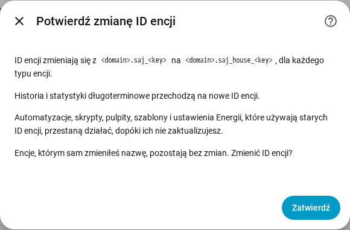

[en](../../en-gb/user/entities-and-prefix.md) | [de](../../de/user/entities-and-prefix.md) | [nl](../../nl/user/entities-and-prefix.md) | [fr](../../fr/user/entities-and-prefix.md) | [zh](../../zh-hans/user/entities-and-prefix.md) | [es](../../es/user/entities-and-prefix.md) | [it](../../it/user/entities-and-prefix.md) | pl | [sv](../../sv/user/entities-and-prefix.md)

# Encje i prefiks

Strona Encje i prefiks wyjaśnia, czym są encje systemu, jak powstają ID encji i jak dodać prefiks do ID encji. Pełne listy są w sekcjach [Urządzenia i encje](../../../custom_components/saj_local/docs/features.md#devices-and-entities) i [Identyfikatory encji i prefiks](../../../custom_components/saj_local/docs/features.md#entity-ids-and-prefix) listy funkcji integracji. Każda nazwa encji, ID, model i ustawienie domyślne są w [opisie encji](entities/README.md).

## Encje systemu

Każdy odczyt, ustawienie i polecenie, które SAJ Local zna dla Twojego modelu, jest encją urządzenia systemu. Każda encja ma typ, jakiego użytkownicy Home Assistanta oczekują dla odczytu lub ustawienia: sensor, sensor binarny, liczba, selektor, przełącznik, czas albo przycisk. Ustawienie pokazuje się jako rzeczywisty typ elementu sterującego ustawienia, więc limit jest liczbą, a ustawienie włączone lub wyłączone jest przełącznikiem.

- **Włączony jest tylko podstawowy zestaw.** Włączone są odczyty mocy, napięcia, temperatury i stanu naładowania, liczniki energii, główne limity baterii i każda usterka. Wszystko inne jest tworzone jako wyłączone.
- **Wyłączona encja nie jest odczytywana.** Włączenie encji dodaje ją do następnego odczytu. Wyłączenie encji zatrzymuje odczyt rejestru. [Odpytywanie](polling.md) pokazuje, ile wybór kosztuje falownik.
- **System dostaje tylko pasujące encje.** H2 z jednym ciągiem paneli nie ma encji drugiego ciągu. Wyposażenie, które nie jest zainstalowane, nie tworzy encji, zobacz [wyposażenie opcjonalne](optional-equipment.md).
- **Ustawienia i diagnostyka są pogrupowane.** Ustawienia są w kategorii konfiguracji. Wersje, ustawienia uruchomieniowe i ustawienia sieci są w kategorii diagnostycznej.
- **Nieznana opcja pokazuje się jako nieznana.** Kod opcji jest w [pobranej diagnostyce](troubleshooting.md#pobierz-diagnostykę), więc opcję można zgłosić.

Gdy ustawisz model ręcznie dla nierozpoznanego falownika, system dostaje każdą encję wybranego modelu, z wyłączonymi encjami ponad jedną fazę i dwa ciągi paneli. Zobacz [zaczynamy](getting-started.md#gdy-falownik-nie-jest-rozpoznany).

## Znak mocy

Moc baterii i moc sieci używają jednego znaku na każdym modelu, więc odczyt ma to samo znaczenie na HS3 i na H2.

- **Moc baterii** jest dodatnia, gdy bateria się rozładowuje, i ujemna, gdy bateria się ładuje.
- **Moc sieci** jest dodatnia, gdy system oddaje moc, i ujemna, gdy system pobiera moc. Licznik A stosuje znak sieci.
- **Licznik B** jest dodatni, gdy falownik solarny, który mierzy Licznik B, wytwarza moc.

W HS3 moc sieci to suma Licznika A, a moc fazowa sieci, moc pozorna, prąd i współczynnik mocy pochodzą z odpowiedniej fazy Licznika A, ponieważ rejestry sieci w HS3 zawierają wartości falownika. HS3 bez Licznika A nie ma tych encji. Moc obciążenia domu to suma trzech mocy fazowych wyjścia sieciowego.

Wartości zadane [sterowania mocą](power-control.md) stosują znaki odczytów.

## Czujniki obliczane

Osiem czujników jest obliczanych z odczytów samego systemu. Istnieją w każdym modelu.

- **Czas do pełnego naładowania baterii** i **czas do rozładowania baterii** to czasy trwania w minutach. Każda wartość dzieli pozostałą energię baterii przez moc baterii uśrednioną z ostatnich 10 minut, więc krótka zmiana obciążenia domu nie powoduje skoku wartości. Czas do pełnego naładowania ma wartość tylko wtedy, gdy średnia moc ładuje baterię, a czas do rozładowania tylko wtedy, gdy średnia moc rozładowuje baterię. Wartość jest nieznana przy zerowej średniej mocy i gdy wynik jest dłuższy niż 48 godzin. Średnia zaczyna się od nowa po ponownym wczytaniu lub restarcie.
- **Energia zmagazynowana w baterii** i **energia dostępna w baterii** są w kWh. Energia zmagazynowana to stan naładowania razy energia baterii. Energia dostępna to energia powyżej limitu pustej baterii, nigdy mniejsza niż 0.
- **Pełna i pusta.** Pełna to limit ładowania. Pusta to rezerwa awaryjna w trybie awaryjnym i limit rozładowania przy sieci w pozostałych trybach aplikacji. Bez sieci pusta to limit rozładowania bez sieci w modelu, który go ma.
- **Energia baterii.** H2 podaje pojemność użyteczną, a SAJ Local mnoży ją przez napięcie baterii. HS3 nie podaje pojemności użytecznej, więc SAJ Local uczy się pojemności z mocy baterii i zmiany stanu naładowania. W HS3 cztery czujniki energii baterii pozostają nieznane, dopóki stan naładowania nie zmieni się między dwoma odpytaniami. Nauczona pojemność staje się dokładniejsza, im więcej bateria się ładuje i rozładowuje. SAJ Local zachowuje nauczoną pojemność po restartach.
- **Samowystarczalność dzisiaj** to udział dzisiejszej energii obciążenia, który nie pochodził z sieci. **Autokonsumpcja dzisiaj** to udział dzisiejszej energii słonecznej, który nie został wyeksportowany. **Sprawność cyklu ładowania i rozładowania baterii** to całkowita energia rozładowania baterii podzielona przez całkowitą energię ładowania baterii. Każda wartość jest procentem od 0 do 100 i jest nieznana, gdy dzielnik wynosi 0.
- **Nadwyżka mocy z fotowoltaiki** to moc słoneczna minus obciążenie domu, w watach. Wartość jest ujemna, gdy obciążenie jest większe niż moc słoneczna.
- **Ustawienia domyślne.** Cztery czujniki baterii powyżej są domyślnie włączone. Pozostałe cztery są tworzone jako wyłączone. Czujniki czasu, energii i sprawności cyklu istnieją tylko wtedy, gdy zamontowano baterię.
- **Odczyty.** Włączenie czujnika obliczanego odczytuje każdy odczyt, którego czujnik potrzebuje, także gdy encje tych odczytów są wyłączone. [Odpytywanie](polling.md) wlicza te odczyty do obciążenia.

## Prefiks

Każde ID encji ma postać `<type>.saj_<key>`, na przykład `sensor.saj_pv_power`. Zmiana wyświetlanej nazwy encji nie zmienia ID.

Prefiks dodaje słowo po `saj_` w każdym ID encji jednego systemu, na przykład `sensor.saj_house_pv_power`. Użyj prefiksu, gdy masz więcej niż jeden system SAJ, aby żadne ID encji nie wymagało dopisania numeru.

- Używaj tylko małych liter i cyfr, do 32 znaków.
- Dwa systemy nie mogą mieć tego samego prefiksu, a tylko jeden system może go nie mieć.
- Prefiks, który kolidowałby z nazwą encji, taki jak `battery`, jest odrzucany.
- Konfiguracja jest odrzucana, gdy ID encji, które system by utworzył, jest już zajęte.

### Dodaj, zmień lub usuń prefiks

1. Otwórz Skonfiguruj, czyli koło zębate w wierszu systemu na stronie integracji SAJ Local.
2. Zmień pole Prefiks i wybierz Zatwierdź.
3. Przeczytaj potwierdzenie, a potem wybierz Zatwierdź jeszcze raz.

Potwierdzenie pokazuje stary i nowy wzorzec. Automatyzacje, skrypty, pulpity, szablony i ustawienia Energii, które używają starych ID encji, przestają działać, dopóki nie zaktualizujesz odwołań.

Po potwierdzeniu:

- SAJ Local zmienia nazwę każdej encji systemu, włączonej lub wyłączonej, a Home Assistant przenosi historię i statystyki długoterminowe na nowe ID.
- Encja, której nazwę zmieniłeś sam, pozostaje bez zmian.
- [Karty pulpitu](cards/README.md) nadal działają, bo karty znajdują encje przez rejestr encji, a nie po ID.

SAJ Local odrzuca zmianę i niczego nie zmienia, gdy nowe ID jest już zajęte albo gdy Home Assistant przechowuje już statystyki długoterminowe pod nowym ID, na przykład z usuniętego systemu, który miał ten prefiks.

Jeśli późniejsza wersja doda encję, a jej ID jest już zajęte, Home Assistant dopisuje numer do ID, a ostrzeżenie w dzienniku podaje rodzaj i klucz encji.

## Jeszcze nieobsługiwane

- Wybór części klucza w ID encji. SAJ Local ustala klucz, więc pulpity i automatyzacje działają tak samo na każdym modelu.
