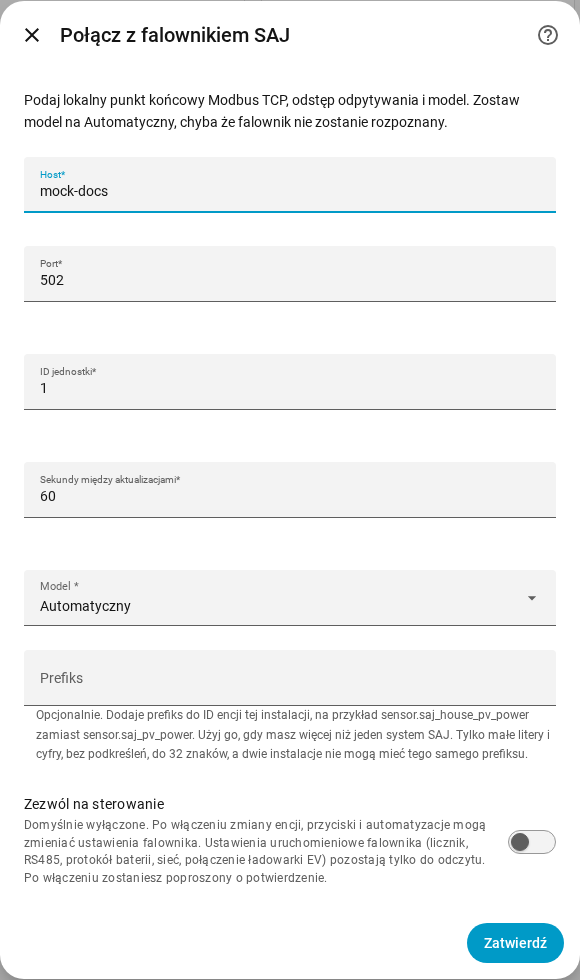
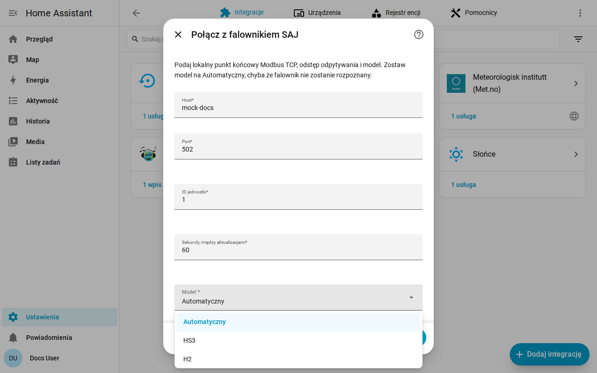

[en](../../en-gb/user/getting-started.md) | [de](../../de/user/getting-started.md) | [nl](../../nl/user/getting-started.md) | [fr](../../fr/user/getting-started.md) | [zh](../../zh-hans/user/getting-started.md) | [es](../../es/user/getting-started.md) | [it](../../it/user/getting-started.md) | pl | [sv](../../sv/user/getting-started.md)

# Zaczynamy

Strona Zaczynamy dodaje Twój system SAJ do Home Assistanta i mówi, co dostajesz potem. Pełna lista tego, co robi konfiguracja, jest w sekcji [Konfiguracja i wykrywanie](../../../custom_components/saj_local/docs/features.md#setup-and-detection) listy funkcji integracji. Najpierw [zainstaluj SAJ Local](installation.md) i sprawdź, czy Twój falownik jest na liście [obsługiwanego wyposażenia](supported-equipment.md).

## Dodaj system

1. W Home Assistancie otwórz Ustawienia, a potem Urządzenia i usługi.
2. Wybierz Dodaj integrację i wyszukaj SAJ Local.
3. Wypełnij formularz i wybierz Zatwierdź.

| Pole | Co wpisać |
| --- | --- |
| Host | Nazwa hosta lub adres IP falownika. |
| Port | Port Modbus TCP. Domyślnie 502. |
| ID jednostki | ID jednostki Modbus, od 1 do 247. Domyślnie 1. |
| Sekundy między aktualizacjami | Jak często odczytywana jest każda włączona encja. Domyślnie 60, a najmniej 10. Zobacz [odpytywanie](polling.md). |
| Model | Zostaw Automatyczny. SAJ Local rozpoznaje HS3 i jednofazowy H2 po typie urządzenia zgłaszanym przez falownik. |
| Prefiks | Opcjonalnie. Dla pierwszego systemu zostaw puste. Zobacz [encje i prefiks](entities-and-prefix.md#prefiks). |
| Zezwól na sterowanie | Domyślnie wyłączone, więc nic nie może zmienić ustawienia. Zobacz [zmianę ustawień](changing-settings.md). |

SAJ Local łączy się z falownikiem, odczytuje tożsamość falownika i sześć podstawowych odczytów (tryb pracy, stan naładowania baterii, moc odbiorów, moc ze słońca, moc baterii i moc sieci) i tworzy system. Rejestr, którego brakuje w jednej jednostce, nie zatrzymuje konfiguracji. System nosi tytuł SAJ i numer seryjny falownika.

Gdy konfiguracja się nie powiedzie, formularz mówi, co poszło nie tak: brak połączenia, brak odpowiedzi na czas, odrzucony odczyt, nieprawidłowe dane, nierozpoznane urządzenie albo model niezgodny z falownikiem. Nic nie jest zapisywane, dopóki sprawdzenie nie przejdzie.

## Co dostajesz

- Jedno urządzenie Home Assistanta o nazwie SAJ. Model urządzenia pokazuje model i moc znamionową, na przykład HS3 (12000 W).
- Encje pasujące do Twojego modelu i wyposażenia. SAJ Local wykrywa za Ciebie baterię, liczniki i pozostałe wyposażenie, zobacz [wyposażenie opcjonalne](optional-equipment.md).
- Włączony jest tylko podstawowy zestaw encji. Wszystko inne jest tworzone jako wyłączone, więc falownik nie jest odczytywany dla wartości, o które nie prosiłeś. Włącz encję w Home Assistancie, a następny odczyt obejmie tę encję. Zobacz [encje i prefiks](entities-and-prefix.md).
- [Karty pulpitu](cards/README.md), bez niczego do instalowania.

## Dodaj drugi system

Dodaj SAJ Local ponownie w Urządzenia i usługi. SAJ Local odrzuca punkt końcowy lub numer seryjny falownika, który jest już skonfigurowany. Nadaj każdemu systemowi osobny [prefiks](entities-and-prefix.md#prefiks), aby żadne ID encji nie wymagało dopisania numeru.

## Gdy falownik nie jest rozpoznany

Gdy falownik zgłasza typ urządzenia, którego SAJ Local nie rozpoznaje, Automatyczny kończy się błędem, który prosi o ręczny wybór modelu. Wybierz HS3 lub H2 w polu Model.

- Wybór sprzeczny z rozpoznanym falownikiem jest odrzucany. Wybierz model wskazany w błędzie albo Automatyczny.
- Dla nierozpoznanego falownika SAJ Local odczytuje wymagane rejestry i prosi o potwierdzenie modelu. Rejestry muszą najpierw odpowiedzieć.
- Urządzenie pokazuje wtedy model jako niezweryfikowany. Odczyty mogą być błędne, bo SAJ Local nie może porównać odczytów z typem urządzenia, a każda próba zmiany ustawienia jest odrzucana.

## Zmień system później

Otwórz Skonfiguruj, czyli koło zębate w wierszu systemu na stronie integracji SAJ Local. Możesz zmienić host, port, ID jednostki, odstęp aktualizacji, model, prefiks i Zezwól na sterowanie oraz ustawić każdy element wyposażenia. SAJ Local zapisuje zmianę dopiero po tym, jak falownik odpowie pod nowym punktem końcowym. [Wymiana falownika](replacing-the-inverter.md) dotyczy nowego falownika.

## Jeszcze nieobsługiwane

- Produkty inne niż HS3 i jednofazowy H2. Zobacz [obsługiwane wyposażenie](supported-equipment.md).
- Wyszukiwanie falownika w sieci. Adres falownika wpisujesz sam.
