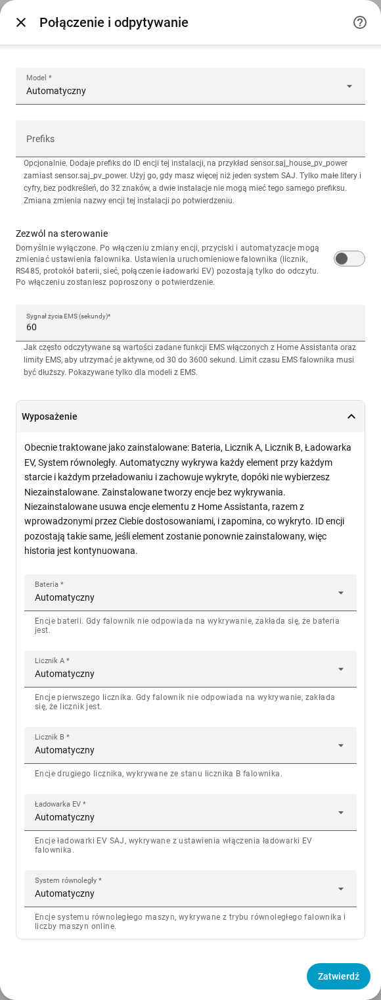

[en](../../en-gb/user/optional-equipment.md) | [de](../../de/user/optional-equipment.md) | [nl](../../nl/user/optional-equipment.md) | [fr](../../fr/user/optional-equipment.md) | [zh](../../zh-hans/user/optional-equipment.md) | [es](../../es/user/optional-equipment.md) | [it](../../it/user/optional-equipment.md) | pl | [sv](../../sv/user/optional-equipment.md)

# Wyposażenie opcjonalne

Strona Wyposażenie opcjonalne wyjaśnia, jak SAJ Local sprawdza, jakie wyposażenie opcjonalne ma Twój falownik, i jak zastąpić wynik. Pełna lista jest w sekcji [Wyposażenie opcjonalne](../../../custom_components/saj_local/docs/features.md#optional-equipment) listy funkcji integracji. Strona [obsługiwane wyposażenie](supported-equipment.md) mówi, jaki model może mieć co, a [opis encji](entities/README.md) mówi, jakie encje dodaje każdy element wyposażenia.

## Co wykrywa SAJ Local

Konfiguracja o nic nie pyta w sprawie wyposażenia. Za każdym razem, gdy SAJ Local się ładuje, co obejmuje każdy start Home Assistanta i każde przeładowanie, SAJ Local pyta falownik, co jest zainstalowane, i tworzy encje tylko dla tego wyposażenia.

| Wyposażenie | Modele |
| --- | --- |
| Bateria | HS3 i H2 |
| Licznik A, licznik sieci | HS3 i H2 |
| Licznik B, drugi licznik | HS3 i H2 |
| System równoległy | HS3 i H2 |
| Ładowarka EV | tylko HS3 |

- **Falownik nie odpowiada na sprawdzenie:** SAJ Local zakłada baterię i Licznik A, a pozostałego wyposażenia nie zakłada.
- **Licznik jest offline podczas restartu:** wykryte wyposażenie jest zapamiętywane, więc wyposażenie zachowuje swoje encje.
- **Wyposażenie zainstalowane później:** SAJ Local wykrywa wyposażenie przy następnym restarcie lub przeładowaniu.

## Gdy zapamiętane wyposażenie nie jest już wykrywane

SAJ Local zachowuje encje wyposażenia, więc historia i pulpity zostają bez zmian, i zgłasza w Home Assistancie problem do naprawy. Problem podaje wyposażenie i system. Sprawdź wyposażenie albo ustaw je na Niezainstalowane, jak opisano poniżej. Problem znika przy następnym ładowaniu, które znów wykryje wyposażenie, albo gdy zmienisz ustawienie.

## Zastąp wykrywanie

1. Otwórz Skonfiguruj, czyli koło zębate w wierszu systemu na stronie integracji SAJ Local.
2. Rozwiń sekcję Wyposażenie.
3. Ustaw każdy element wyposażenia na Automatyczny, Zainstalowane lub Niezainstalowane, a potem wybierz Zatwierdź.

Sekcja wymienia też to, co SAJ Local traktuje teraz jako zainstalowane.

| Ustawienie | Co robi ustawienie |
| --- | --- |
| Automatyczny | Wykrywa wyposażenie przy każdym starcie i każdym przeładowaniu i zachowuje wykryte, dopóki nie wybierzesz Niezainstalowane. Automatyczny jest domyślny. |
| Zainstalowane | Tworzy encje wyposażenia bez wykrywania wyposażenia. |
| Niezainstalowane | Usuwa encje wyposażenia z Home Assistanta, razem ze zmianami, które w nich wprowadziłeś, takimi jak nowa nazwa. SAJ Local zapomina, co wykryto. |

ID encji pozostają bez zmian, więc historia jest kontynuowana, jeśli ustawisz wyposażenie z powrotem na Zainstalowane lub Automatyczny. Encji niezainstalowanego wyposażenia nie można odczytać, odpytywać ani zapisywać.

Sekcja wymienia tylko wyposażenie, które może mieć Twój model. Tylko HS3: ładowarka EV.

## Moduły baterii

- **H2:** H2 zgłasza, ile modułów baterii ma, do pięciu. SAJ Local tworzy encje modułów dla tylu modułów. Liczba 0 zachowuje encje każdego modułu. SAJ Local zapamiętuje najwyższą liczbę, jaką widział. Każdy moduł ma encje tożsamości, tworzone jako wyłączone.
- **HS3:** HS3 ma encje dla jednego modułu baterii.

## Ładowarka EV

Tylko HS3: HS3 z ładowarką EV dostaje też odczyty, ustawienia, przedziały ładowania i elementy sterowania ładowaniem EMS tej ładowarki. Większość jest tworzona jako wyłączona. Włączenie Zezwól na sterowanie włącza ustawienia i przedziały, zobacz [zmianę ustawień](changing-settings.md#zestaw-sterowania).

## Jeszcze nieobsługiwane

- Wyposażenie, którego SAJ Local nie wykrywa. Wyposażenie z tabeli to pełna lista.
- Wykrywanie ładowarki EV w H2.
