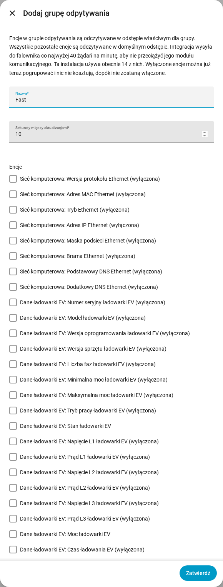

[en](../../en-gb/user/polling.md) | [de](../../de/user/polling.md) | [nl](../../nl/user/polling.md) | [fr](../../fr/user/polling.md) | [zh](../../zh-hans/user/polling.md) | [es](../../es/user/polling.md) | [it](../../it/user/polling.md) | pl | [sv](../../sv/user/polling.md)

# Odpytywanie

Strona Odpytywanie wyjaśnia, jak często SAJ Local odczytuje falownik i jak odczytywać niektóre encje szybciej lub wolniej. Pełna lista jest w sekcji [Odpytywanie](../../../custom_components/saj_local/docs/features.md#polling) listy funkcji integracji. Limity, które dotyczą każdego żądania, są na stronie [ochrona falownika](protecting-the-inverter.md).

SAJ Local odczytuje falownik przez Modbus TCP w Twojej sieci lokalnej, według harmonogramu, który kontrolujesz. Nic nie opuszcza Twojej sieci.

## Domyślny odstęp

Każda włączona encja jest domyślnie odczytywana co 60 sekund. Zmień pole Sekundy między aktualizacjami w Skonfiguruj, czyli kole zębatym w wierszu systemu na stronie integracji SAJ Local. Odstęp nigdy nie jest krótszy niż 10 sekund.

Odczytywane są tylko włączone encje. Wyłącz encję w Home Assistancie, a rejestr encji przestanie być odczytywany.

## Grupy odpytywania

Grupa odpytywania odczytuje wybrane encje szybciej lub wolniej niż domyślnie. Użyj grupy na przykład po to, aby odczytywać moc odbiorów, słońca, baterii i sieci co 10 sekund, podczas gdy wszystko inne zostaje na 60.

1. Otwórz menu w wierszu systemu na stronie integracji SAJ Local i wybierz Dodaj grupę odpytywania. Przycisk Dodaj grupę odpytywania u góry strony też otwiera formularz Dodaj grupę odpytywania.
2. Wpisz nazwę, sekundy między aktualizacjami (co najmniej 10) i encje grupy.
3. Wybierz Zatwierdź, przeczytaj podsumowanie, a potem wybierz Zapisz grupę.

- **Dowolna encja:** grupa może zawierać encje dowolnego typu. Można też wybrać wyłączoną encję, która nic nie kosztuje, dopóki jej nie włączysz.
- **Najwyżej jedna grupa:** encja należy najwyżej do jednej grupy. Każda encja bez grupy zostaje na domyślnym odstępie.
- **Kolejność rejestrów:** formularz wymienia encje w kolejności rejestrów, każdą z oznaczeniem bloku rejestrów, z którego jest odczytywana, więc encje, które mogą dzielić żądanie, leżą obok siebie.
- **Edycja lub usunięcie:** otwórz grupę odpytywania na stronie integracji. Zmiana lub usunięcie grupy zachowuje encje, nazwy encji i historię encji.

Wszystkie odstępy systemu dzielą jeden zegar, więc encje, na które przychodzi czas razem, są odczytywane razem. Odczyt, który się przeciąga, nie jest nadrabiany. Pominięte takty są odrzucane, a odpytywanie toczy się dalej od następnego taktu.

## Obciążenie żądaniami

SAJ Local wysyła do falownika najwyżej 40 żądań w dowolnych 60 sekundach. Formularz pokazuje, ile kosztuje Twój wybór, jako żądania na minutę wobec tego limitu. Formularz powyżej pokazuje jako przykład bieżące obciążenie 14 żądań na minutę.

- **Przed zapisaniem grupy:** krok podsumowania pokazuje, ile żądań zajmuje jeden odczyt grupy oraz obciążenie przed zapisaniem grupy i po nim.
- **Ponad limitem:** grupę nadal możesz zapisać. Podsumowanie ostrzega, że odczyty są wolniejsze, niż skonfigurowano, bo SAJ Local nigdy nie wysyła więcej niż limit.
- **Nowy domyślny odstęp:** Skonfiguruj prosi o potwierdzenie, gdy nowy odstęp przekracza limit obciążenia.
- **Mniej żądań:** encje leżące razem w jednym bloku rejestrów kosztują jedno żądanie. Encje w różnych blokach kosztują po jednym żądaniu.

Włączenia encji w Home Assistancie nie da się przechwycić w formularzu. W tym przypadku [pobrana diagnostyka](troubleshooting.md#pobierz-diagnostykę) podaje planowane obciążenie wobec limitu.

## Jeszcze nieobsługiwane

- Grupa odpytywania z odstępem poniżej 10 sekund.
