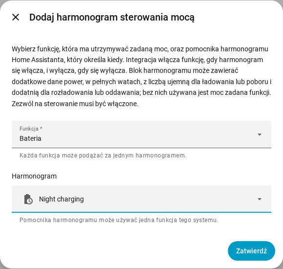

[en](../../en-gb/user/power-control.md) | [de](../../de/user/power-control.md) | [nl](../../nl/user/power-control.md) | [fr](../../fr/user/power-control.md) | [zh](../../zh-hans/user/power-control.md) | [es](../../es/user/power-control.md) | [it](../../it/user/power-control.md) | pl | [sv](../../sv/user/power-control.md)

# Sterowanie mocą

Strona Sterowanie mocą wyjaśnia, jak utrzymywać baterię, punkt przyłączenia do sieci albo falownik na zadanej mocy, ręcznie lub według harmonogramu Home Assistanta. Pełna lista jest w sekcji [Sterowanie mocą](../../../custom_components/saj_local/docs/features.md#power-control) listy funkcji integracji. Przełączniki i wartości zadane są w [encjach dodawanych przez integrację](entities/added-by-the-integration.md) w opisie encji.

Sterowanie mocą działa w jeden sposób na każdym modelu, który oferuje funkcję. Sterowanie mocą nic nie robi, gdy [Zezwól na sterowanie](changing-settings.md#zezwól-na-sterowanie) jest wyłączone albo model jest niezweryfikowany.

| Funkcja | Co funkcja utrzymuje na zadanej mocy | HS3 | H2 |
| --- | --- | --- | --- |
| Bateria | Bateria ładuje się lub rozładowuje. | Tak | Tak |
| Sieć | Punkt przyłączenia do sieci pobiera lub oddaje moc. Wymaga Licznika A. | Tak | Nie |
| Falownik | Falownik przyjmuje lub oddaje moc. | Tak | Nie |

Moc dodatnia rozładowuje, oddaje do sieci lub oddaje moc. Moc ujemna ładuje, pobiera z sieci lub przyjmuje moc. Znaki zgadzają się ze [znakiem mocy](entities-and-prefix.md#znak-mocy) odczytów.

## Utrzymuj funkcję na zadanej mocy

Każda funkcja ma przełącznik i wartość zadaną mocy w pełnych watach. Oba są tworzone jako wyłączone i należą do kategorii konfiguracji. Włączenie Zezwól na sterowanie włącza przełączniki i wartości zadane, zobacz [zestaw sterowania](changing-settings.md#zestaw-sterowania).

1. Ustaw wartość zadaną mocy funkcji. Wartość zadana jest zaokrąglana do najbliższego kroku, który obsługuje falownik, i pokazuje moc, którą utrzymuje falownik.
2. Włącz funkcję. Funkcja potrzebuje wartości zadanej mocy, zanim będzie można ją włączyć.
3. Aby zatrzymać, wyłącz funkcję.

- Wartość zadana jest zachowywana między restartami i wysyłana przy starcie funkcji. Zmiana wartości zadanej, gdy funkcja działa, od razu wysyła nową moc.
- Naraz działa tylko jedna funkcja. Włączenie funkcji, gdy działa inna, jest odrzucane, a komunikat podaje działającą funkcję.
- Przełącznik jest włączony, gdy falownik zgłasza, że funkcja działa, nawet jeśli funkcję uruchomiono poza Home Assistantem.
- Start, który się nie powiódł, jest cofany. Zatrzymanie, które się nie powiodło, jest wysyłane ponownie co odstęp sygnału życia, aż falownik zgłosi, że funkcja się zatrzymała.
- [Karta sterowania na pulpicie](cards/controls-card.md) pokazuje każdą funkcję z przełącznikiem, wartością zadaną i podpowiedzią o znaku.

### Gdy Home Assistant się zatrzymuje

Funkcja, którą włączyłeś z Home Assistanta, jest wyłączana, gdy SAJ Local się wyładowuje i gdy Home Assistant się zatrzymuje. Funkcja, która już działała, gdy SAJ Local się ładował, pozostaje uruchomiona.

- Tylko HS3: sygnał życia EMS podtrzymuje funkcję. Po nagłym zatrzymaniu limit czasu EMS falownika może zakończyć funkcję, ale SAJ Local nie polega na limicie czasu. Zobacz [EMS](changing-settings.md#ems).
- Tylko H2: funkcja pozostawiona uruchomioną po nagłym zatrzymaniu działa dalej, dopóki jej nie wyłączysz.

## Podążaj za harmonogramem

Harmonogram sterowania mocą sprawia, że funkcja podąża za pomocnikiem harmonogramu Home Assistanta. Funkcja jest włączona, gdy harmonogram jest włączony, i wyłączona, gdy harmonogram się wyłącza.

1. Utwórz pomocnika harmonogramu w Home Assistancie: Ustawienia, Urządzenia i usługi, Pomocnicy, Utwórz pomocnika, Harmonogram. Ustaw godziny i dni tygodnia harmonogramu.
2. Otwórz menu w wierszu systemu na stronie integracji SAJ Local i wybierz Dodaj harmonogram sterowania mocą.
3. Wybierz funkcję i pomocnika harmonogramu, a potem wybierz Zatwierdź.

Blok pomocnika harmonogramu może zawierać dodatkowe dane `power`, w pełnych watach ze znakiem opisanym powyżej, na przykład `power: -600`, aby ładować baterię mocą 600 W. Bez `power` SAJ Local używa wartości zadanej mocy funkcji.

- Każda funkcja podąża za jednym harmonogramem, a pomocnik harmonogramu steruje jedną funkcją systemu.
- Harmonogram podąża za zmianą nazwy pomocnika. Pomocnik, którego nie ma w rejestrze encji, jest odrzucany, więc wybierz pomocnika utworzonego w interfejsie.
- SAJ Local odrzuca harmonogram, gdy Zezwól na sterowanie jest wyłączone.
- Zmień lub usuń harmonogram na stronie integracji. System przeładowuje się, gdy to robisz.

### Co robi harmonogram

| Sytuacja | Co się dzieje |
| --- | --- |
| Harmonogram się włącza i żadna funkcja nie działa | SAJ Local ustawia moc z bloku albo używa wartości zadanej, a potem uruchamia funkcję. |
| Blok nie ma `power`, a funkcja nie ma wartości zadanej mocy | Nic się nie uruchamia. Akcja pozostaje oczekująca, z ostrzeżeniem. |
| Funkcja już działa | SAJ Local zmienia moc, gdy blok ją ma, i przejmuje funkcję. |
| Działa inna funkcja | Nic nie jest zapisywane. Akcja pozostaje oczekująca. |
| Start jest odrzucony lub się nie powiódł | Akcja pozostaje oczekująca. SAJ Local próbuje ponownie co odstęp sygnału życia. |
| `power` bloku nie jest liczbą całkowitą z zakresu wartości zadanej | Nic się nie uruchamia. Akcja pozostaje oczekująca, z ostrzeżeniem. |
| Harmonogram przechodzi do bloku z inną `power` | SAJ Local zmienia moc. |
| Wyłączasz funkcję ręcznie, gdy harmonogram jest włączony | Funkcja pozostaje wyłączona do następnego włączenia harmonogramu. |
| Harmonogram się wyłącza, a funkcję uruchomił SAJ Local | SAJ Local zatrzymuje funkcję. |

Gdy nic nie jest chciane i nic nie jest oczekujące, SAJ Local niczego nie wysyła. [Pobrana diagnostyka](troubleshooting.md#pobierz-diagnostykę) wymienia każdą funkcję, każdy harmonogram i oczekującą akcję.

## Jeszcze nieobsługiwane

- Sterowanie mocą Sieci i Falownika w H2.
- Więcej niż jedna funkcja naraz.
- Więcej niż jeden harmonogram dla jednej funkcji.
