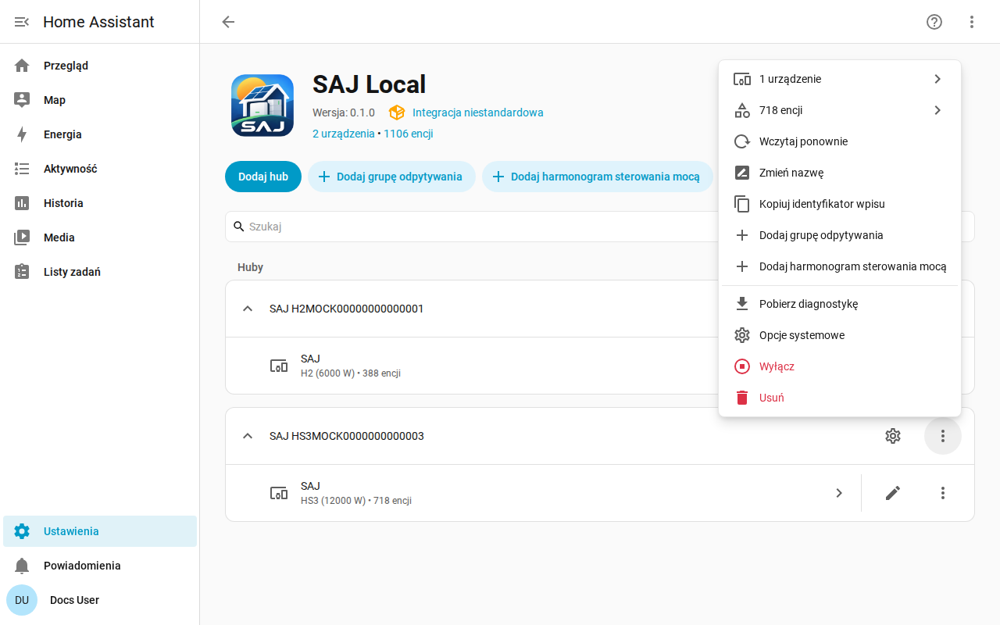

[en](../../en-gb/user/troubleshooting.md) | [de](../../de/user/troubleshooting.md) | [nl](../../nl/user/troubleshooting.md) | [fr](../../fr/user/troubleshooting.md) | [zh](../../zh-hans/user/troubleshooting.md) | [es](../../es/user/troubleshooting.md) | [it](../../it/user/troubleshooting.md) | pl | [sv](../../sv/user/troubleshooting.md)

# Rozwiązywanie problemów

Strona Rozwiązywanie problemów pokazuje, jak pobrać diagnostykę, włączyć rejestrowanie debugowania i odczytać typowe problemy. Pełna lista jest w sekcji [Diagnostyka i rejestrowanie debugowania](../../../custom_components/saj_local/docs/features.md#diagnostics-and-debug-logging) listy funkcji integracji.

Pobrana diagnostyka i dziennik debugowania pokazują, co zwraca falownik i co SAJ Local zrobił z odczytami, nie zdradzając, kim jesteś ani gdzie. Oba korzystają z narzędzi Home Assistanta, więc nic nie trzeba instalować i nic nie jest nigdzie wysyłane.

## Zacznij od encji i napraw

- Sprawdź [Ustawienia i Naprawy](faults-and-repairs.md#zgłoszenia-napraw), czy system ma problem do naprawy. Każdy problem mówi, co jest nie tak i co zrobić.
- Sprawdź [usterki urządzeń](faults-and-repairs.md#usterki-urządzeń), gdy falownik zgłasza problem.
- Encje, które po odmowie pokazują się jako niedostępne, opisuje [ochrona falownika](protecting-the-inverter.md#gdy-falownik-odmawia-odczytu).

## Pobierz diagnostykę

1. Otwórz Ustawienia, potem Urządzenia i usługi, potem SAJ Local.
2. Otwórz menu w wierszu systemu i wybierz Pobierz diagnostykę.

Plik zawiera:

- włączone encje, odstępy z liczbą żądań, które każdy zajmuje, i planowane obciążenie wobec limitu 40 żądań na minutę;
- odrzucone i zawieszone encje;
- aktywne usterki z surowymi słowami usterek oraz nierozpoznane bity usterek jako rejestr i bit;
- otwarte problemy do naprawy i to, jak długo falownik zawodzi;
- funkcje sterowania mocą, informację, która z nich działa, którą posiada SAJ Local, i akcję oczekującą dla każdego harmonogramu;
- migawkę surowych słów każdego rejestru, który SAJ Local odczytał od załadowania systemu, z wiekiem każdego, aby opiekun mógł sprawdzić odczyt względem prawdziwego urządzenia;
- każde żądanie, które nie dostało użytecznej odpowiedzi, wraz z przyczyną. Żądanie, które przekroczyło limit czasu, wygląda inaczej niż żądanie odrzucone przez falownik, a różnica ma znaczenie, gdy inny klient zajmuje połączenie falownika. Każda odrzucona encja, każde nieudane żądanie i każdy wiersz dziennika debugowania podaje funkcję Modbus żądania.

Migawka nie dodaje żadnego żądania do falownika. Migawka zaczyna od pustej przy każdym załadowaniu systemu.

## Włącz rejestrowanie debugowania

1. Otwórz stronę integracji SAJ Local.
2. Otwórz menu z trzema kropkami na stronie integracji i wybierz Włącz rejestrowanie debugowania.
3. Gdy konfiguracja systemu się nie powiodła, przeładuj system z menu systemu, aby dziennik obejmował konfigurację.
4. Odtwórz problem.
5. Wybierz Wyłącz rejestrowanie debugowania. Home Assistant pobiera dziennik.

Rejestrowanie debugowania zapisuje każde połączenie, odpytanie, żądanie, zapis, sygnał życia i zmianę harmonogramu, po jednym wierszu na zdarzenie. Każdy wiersz dziennika zaczyna się od tytułu systemu i numeru seryjnego zamaskowanego do ostatnich trzech znaków, więc wiersze z dwóch systemów można odróżnić. Tytuł zawierający numer seryjny ma numer zamaskowany w miejscu, na przykład `SAJ xxxxx123`.

## Czego plik i dziennik nie zawierają

Diagnostyka i dzienniki nigdy nie zawierają hosta, portu, ID jednostki, pełnego numeru seryjnego, adresu MAC, adresów sieciowych, numeru seryjnego ładowarki EV, prefiksu ani nazw grup odpytywania. W migawce rejestrów słowa rejestrów, które przechowują adresy sieciowe i numery seryjne, są zastąpione znacznikiem redakcji Home Assistanta, więc widać, że rejestr odpowiedział, nie widząc, co powiedział.

## Typowe problemy

| Co widzisz | Co sprawdzić |
| --- | --- |
| Konfiguracja kończy się brakiem połączenia lub brakiem odpowiedzi | Host, port i ID jednostki. Upewnij się, że żaden inny klient Modbus nie zajmuje połączenia falownika. |
| Konfiguracja mówi, że urządzenie nie jest rozpoznane | Wybierz model ręcznie. Zobacz [zaczynamy](getting-started.md#gdy-falownik-nie-jest-rozpoznany). |
| Ustawienie odrzuca zmianę | Zezwól na sterowanie jest wyłączone, model jest niezweryfikowany albo ustawienie jest ustawieniem uruchomieniowym. Komunikat mówi, które. Zobacz [zmianę ustawień](changing-settings.md). |
| Odczyty są wolniejsze niż ustawiony odstęp | Obciążenie przekracza limit 40 żądań na minutę. Zobacz [odpytywanie](polling.md#obciążenie-żądaniami). |
| Włączona encja nie ma jeszcze wartości | Home Assistant przeładowuje system około 30 sekund po włączeniu encji, a encja jest odczytywana od następnego odczytu. |
| ID encji zyskały numer | ID, którego chciała encja, było zajęte. Zobacz [encje i prefiks](entities-and-prefix.md#prefiks). |
| Brakuje encji | Wyposażenie nie jest wykrywane albo jest ustawione na Niezainstalowane. Zobacz [wyposażenie opcjonalne](optional-equipment.md). |

## Pomoc i opinie

Pytania, zgłoszenia błędów i pomysły są mile widziane w [systemie zgłoszeń](https://github.com/Counterphase-Labs/ha-saj-local/issues). Otwórz formularz Bug report dla problemu z integracją i formularz Card bug report dla problemu z kartą pulpitu. Formularz Bug report wymaga pobranej diagnostyki. Problem z bezpieczeństwem zgłoś prywatnie, zobacz [politykę bezpieczeństwa](../../../SECURITY.md).
