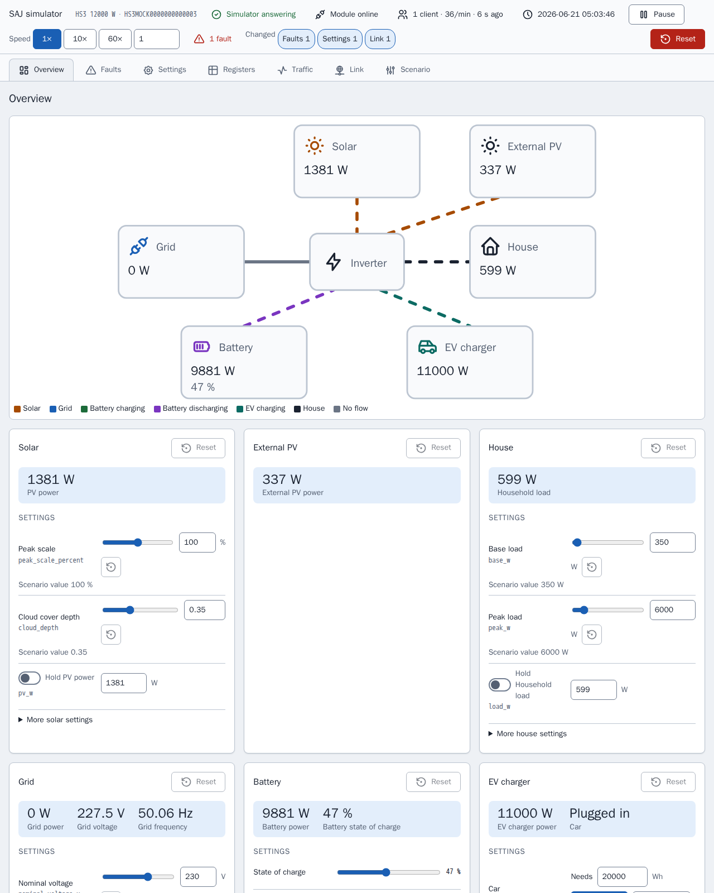

[en](../../en-gb/developer/README.md) | [de](../../de/developer/README.md) | [nl](../../nl/developer/README.md) | [fr](../../fr/developer/README.md) | [zh](../../zh-hans/developer/README.md) | [es](../../es/developer/README.md) | [it](../../it/developer/README.md) | [pl](../../pl/developer/README.md) | sv

# Utvecklardokumentation för SAJ Local

Hur SAJ Local byggs, kontrolleras och ges ut, och var sanningen om varje del finns. Dokumentationen förklarar varför projektet är byggt som det är och länkar till filen som håller varje faktum. Versioner, kommandolistor och registerkartor finns i koden och konfigurationen, inte här.

För att få en fungerande arbetskopia och skicka in en ändring, börja med [CONTRIBUTING.md](../../../CONTRIBUTING.md). SAJ Local är en lokal Home Assistant-integration: SAJ Local pratar med växelriktaren över det lokala nätverket och lägger inte till någon molntjänst eller något tillhörande SDK.

## Utveckla utan växelriktare

Simulatorn är en stand-in för en SAJ-enhet, så det mesta arbetet behöver ingen hårdvara. Varje simulator serverar en sida som visar vad det simulerade systemet gör och låter en utvecklare ändra systemet medan Home Assistant avfrågar det, utan att redigera ett scenario och starta om.

[Modbus-simulator](simulator.md) förklarar vad simulatorn är till för och hur du kör ett scenario. [Simulatorsida](simulator-page.md) visar varje vy på sidan.

## Sidor

- [Modbus-simulator](simulator.md): vad simulatorn är till för, scenarier och hur du kör ett annat system.
- [Simulatorsida](simulator-page.md): varje vy på sidan, registerinspektören, trafikloggen, länkfel, förinställningar och sparat tillstånd.
- [Miljö](environment.md): ställ in en arbetskopia och kör utvecklings-Home Assistant med simulatorerna.
- [Kontroller](checks.md): make-målen, täckningsgränsen och hur du avgränsar en körning.
- [Arkitektur](architecture.md): SAJ-biblioteket och integrationen, profiler, katalogen, avfrågning och stabila namn.
- [Frontend](frontend.md): kortens källkod, bygget och demoinstrumentpanelerna.
- [Dokumentation](documentation.md): hur dessa sidor, den genererade entitetsreferensen och skärmbilderna görs och kontrolleras.
- [Utgåvor](releasing.md): höjningen av Home Assistant-versionen och stegen före en utgåva.

Användardokumentationen finns i [användardokumentationen](../user/README.md).

## Var sanningen finns

| Fråga | Auktoritet |
| --- | --- |
| Vad måste projektet göra? | [Globala krav](../../../.github/work/requirements.md), [integrationens krav](../../../custom_components/saj_local/docs/requirements.md), [kortens krav](../../../frontend/docs/requirements.md), [simulatorns krav](../../../mock/docs/requirements.md) |
| Vad gör varje del i dag? | [Integrationens funktioner](../../../custom_components/saj_local/docs/features.md), [kortens funktioner](../../../frontend/docs/features.md), [simulatorns funktioner](../../../mock/docs/features.md) |
| Hur skrivs kod, tester och dokumentation? | [code-style.md](../../../.github/work/code-style.md) |
| Vilka regler binder alla som arbetar här? | [AGENTS.md](../../../AGENTS.md) |
| Vad byggdes, och varför? | [done/index.md](../../../.github/work/done/index.md) |
| Vad är planerat? | [.github/work/future/](../../../.github/work/future/) |
| Vilka kommandon finns? | [Makefile](../../../Makefile) |
| Vad kör CI? | [ci.yml](../../../.github/workflows/ci.yml) |
| Python-beroenden och verktygsinställningar | [pyproject.toml](../../../pyproject.toml) |
| Frontend-beroenden och skript | [frontend/package.json](../../../frontend/package.json) |
| Utvecklingstjänster | [compose.yaml](../../../compose.yaml) |

Befintlig kod har ingen auktoritet över kraven. Där de skiljer sig åt är koden fel, eller så ändrar ägaren kravet.

## Kodstil

[code-style.md](../../../.github/work/code-style.md) är auktoriteten. Dokumentationsregeln i code-style.md formar dessa sidor: förklara varför, inte hur, och låt namn och typer beskriva resten.
