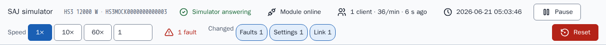
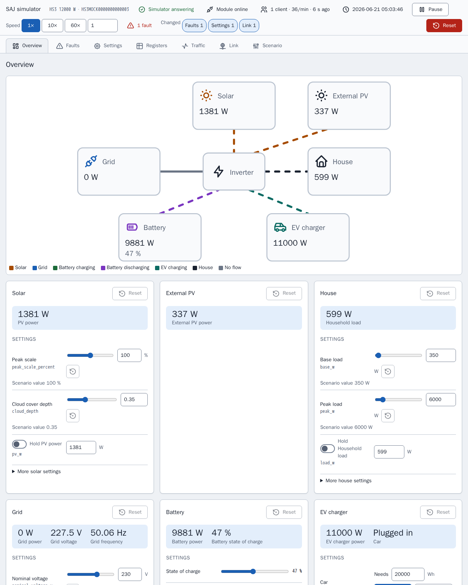
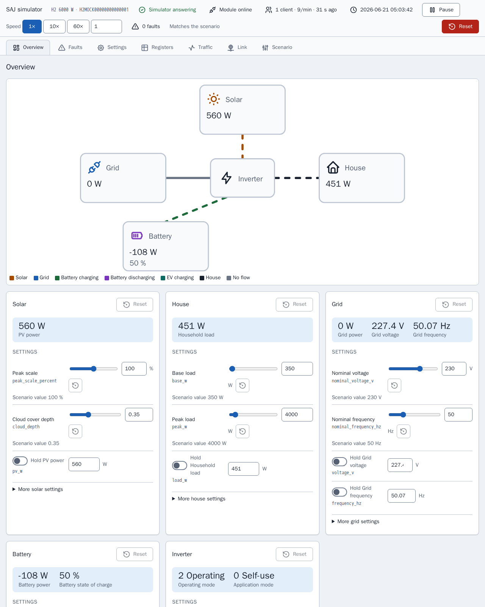
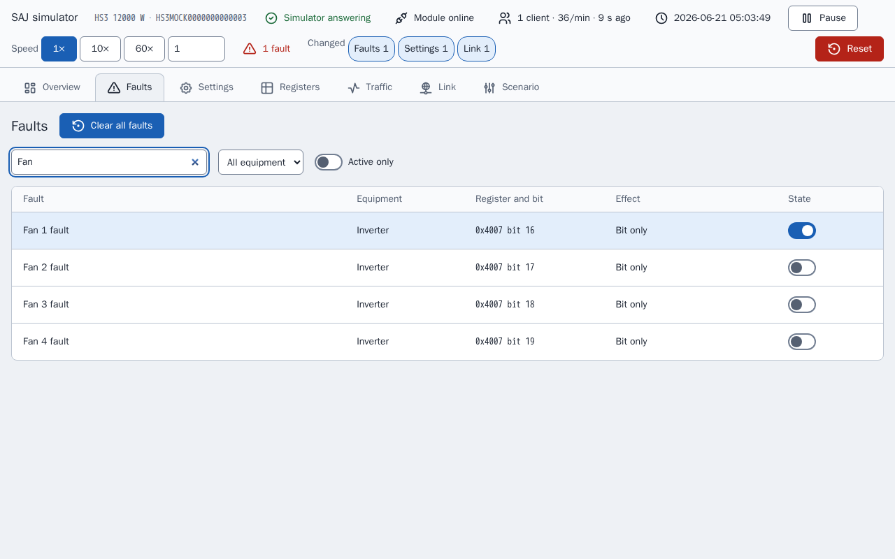
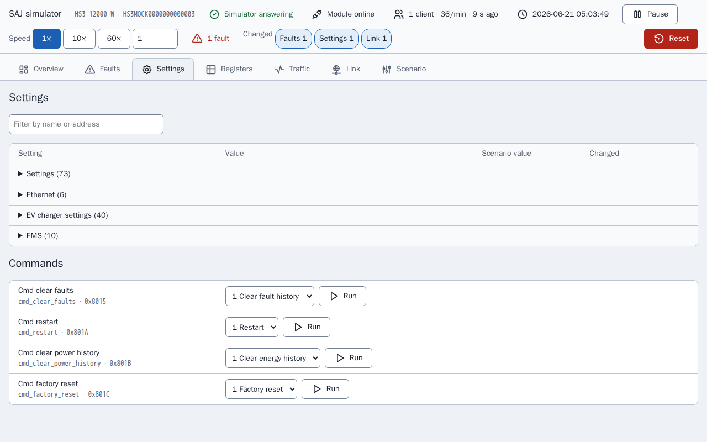
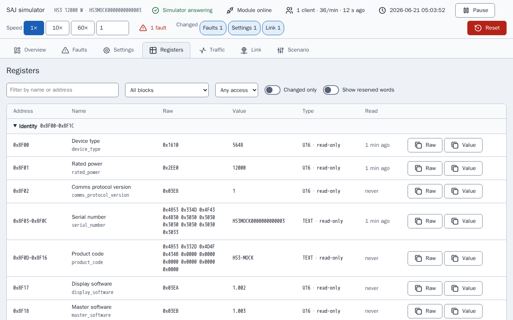
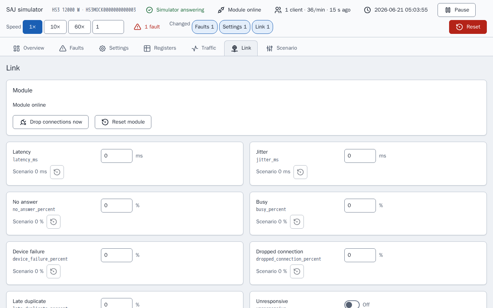
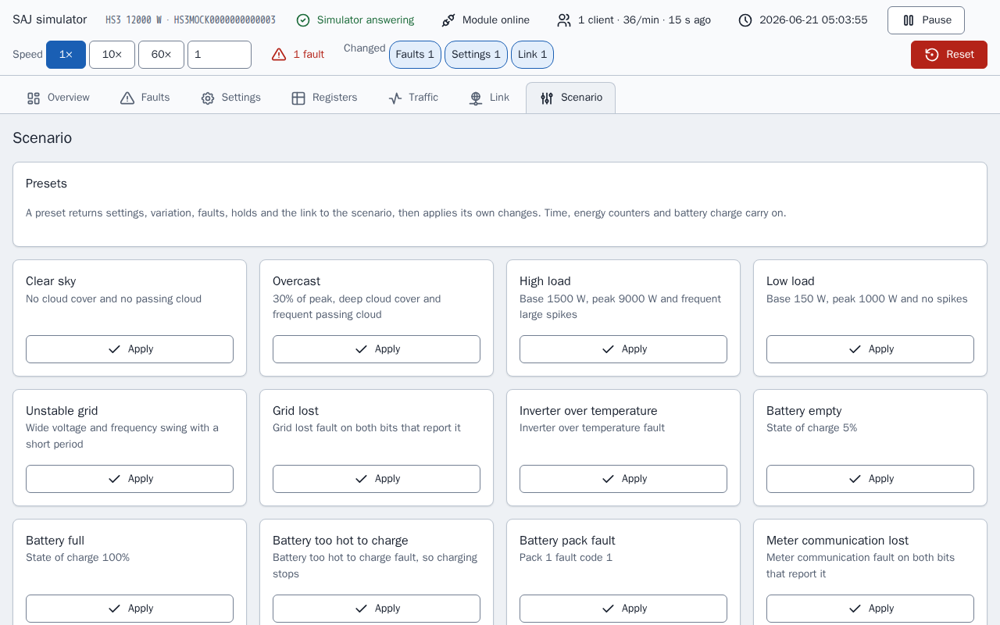
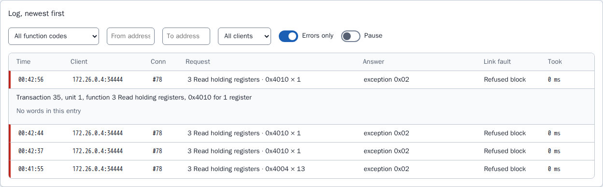

[en](../../en-gb/developer/simulator-page.md) | [de](../../de/developer/simulator-page.md) | [nl](../../nl/developer/simulator-page.md) | [fr](../../fr/developer/simulator-page.md) | [zh](../../zh-hans/developer/simulator-page.md) | [es](../../es/developer/simulator-page.md) | [it](../../it/developer/simulator-page.md) | [pl](../../pl/developer/simulator-page.md) | sv

# Simulatorsida

En simulators kontrollsida: vyer, registerinspektör, trafiklogg, länkfel, felens effekter, förinställningar och sparat tillstånd.

Den fullständiga listan över vad sidan omfattar finns i funktionslisteavsnitten [Kontrollsida](../../../mock/docs/features.md#control-page), [Tillstånd och förinställningar](../../../mock/docs/features.md#state-and-presets), [Registerinspektör och trafiklogg](../../../mock/docs/features.md#register-inspector-and-traffic-log), [Länkfel](../../../mock/docs/features.md#link-faults).

Varje simulator serverar en webbsida på `http://localhost:<panel port>/`: `5080` för HS3 och `5081` för H2 som startas av `make up` (`SAJ_MOCK_PANEL_HOST_PORT` och `SAJ_MOCK_H2_PANEL_HOST_PORT` ändrar dem). Inuti containern lyssnar sidan på `server.panel_port`, som standard 8080. Det finns ingen autentisering: simulatorn är ett utvecklingsverktyg.

Sidan finns så att en utvecklare kan se vad det simulerade systemet gör och försätta systemet i en situation utan att redigera ett scenario och starta om. Sidan bygger varje kontroll från beskrivningen av enheten, så sidan listar bara den utrustning som är installerad.
Sidan avfrågar tillståndet var 3:e sekund, så en ändring som görs från Home Assistant syns, och vyerna Registers och Traffic uppdateras dessutom varje sekund medan vyerna är öppna. En kontroll som har fokus skrivs inte över. Två klienter kan ändra saker samtidigt: den sista skrivningen vinner, som på en riktig enhet. Varje ändring visar en kort bekräftelse och varje nekande sin orsak.

Ett statusfält på varje vy svarar på om simulatorn körs som sitt scenario eller har ändrats: om modulen är online, de anslutna klienterna och deras förfrågningstakt, den simulerade tiden, kör och paus, hastigheten, de aktiva felen och en bricka för varje slags ändring från det scenario som gäller. Samma sammanfattning (`changes` i tillståndet) markerar de ändrade raderna och korten. Paus sätter hastigheten till 0 och play återställer den tidigare hastigheten, så paus förlorar inte hastigheten.



Den aktuella vyn finns i URL-fragmentet (`#registers`), så en omladdning behåller den. Ingenting lagras i webbläsaren. Skärmbilderna av vyerna nedan tas efter att ett fel, "Fan 1 fault", har satts och efter att simulatorn har nekat ett register, så varje vy visar en ändring från scenariot.

Sidan härleder läsbara namn från fältnamn och avrundar varje skalat värde till skalans antal decimaler, så ett rått 65535 vid skalan 0.0001 läses som 6.5535 i stället för att visa flyttalsbrus.

## Vyer

### Översikt (Overview)

Ett effektflödesdiagram över den installerade utrustningen, färgat och animerat efter riktning, ovanför ett kort per utrustning. Ett kort håller den aktuella avläsningen, kontrollerna som sätter avläsningen och utrustningens fel, med en återställning till scenariot för det kortet.



H2-sidan har färre kort än HS3-sidan ovan, eftersom H2-scenariot har mindre utrustning installerad.



Ett kort håller isär det en kontroll sätter och avläsningen som kontrollen ger, eftersom de två skiljer sig åt så fort ett hold, ett fel eller laddningsnivån är inblandade: en toppskala på 100 % betyder inte 100 % av PV-effekten. Återställningen av ett kort återställer kortets variation, hold och felbitar, och lämnar laddningsnivån, bilen, klockan och energiräknarna ifred, av samma skäl som förinställningar gör. Ett kort med ett aktivt fel är markerat, som i kortet nedan.


### Fel (Faults)

Varje felbit i den installerade utrustningen, sökbar, med vad simulatorn gör när biten är satt. Bitar som dokumentet inte namnger listas som reserverade, så integrationens väg för okända fel kan prövas.

Bilden visar sökningen "Fan", med de fyra fläktfelen och reglaget för det satta felet, "Fan 1 fault", påslaget.



### Inställningar (Settings)

De skrivbara inställningarna och kommandona, med namn på de råa värdena och scenariots värde för var och en.



### Register (Registers)

Registerinspektören, beskriven nedan.



### Trafik (Traffic)

Trafikloggen, beskriven nedan.


### Länk (Link)

Länkfelen och modulens tillstånd, beskrivna nedan.



### Scenario (Scenario)

Förinställningar, den simulerade tiden, energiräknarna, återställning och export.



## Registerinspektör

`GET /api/registers` listar varje block i enheten och, för varje fält i ett block som svarar, de råa orden, det avkodade värdet med dess etikett, åtkomsten (skrivskyddad, skrivbar eller kommando) och när en klient senast läste fältet. Vyn Registers visar listan som en tabell med ett filter, ett reglage "changed only" och en markering av ett värde som just har ändrats, så effekten av ett fel eller en skrivning på registren syns utan en Modbus-klient.

Inspektören visar bara. Inspektören läser enheten utan enhetens observatör, så att titta på ett register är inte en klientläsning: blicken räknas inte som ett hjärtslag, rör inte det fält som en läsning skulle röra och registreras inte i trafiken. Ett register skrivs bara genom de kontroller som går genom samma validering som en Modbus-skrivning.

## Trafiklogg

Modbus-servern rapporterar varje anslutningshändelse och varje förfrågan, med sitt svar, till en registrerare (`traffic.py`). `GET /api/traffic?after=<sequence>` returnerar posterna efter ett sekvensnummer, så sidan ber bara om det som är nytt, tillsammans med räknarna och en 30 minuters historik i 10 sekunders hinkar; `POST /api/traffic/reset` rensar dem. Vyn Traffic visar den aktuella förfrågningstakten, en graf över förfrågningar över tid, räknarna per klient och loggen, som kan filtreras och öppnas för att se de lästa eller skrivna orden. Bilden visar loggen med bara felen listade och en nekad förfrågan öppnad: en nekad förfrågan har inga ord, så posten säger det och namnger det länkfel som nekade förfrågan.



Räknarna räknar förfrågningar och register, eftersom det är så fältrapporter beskriver modulbelastning, och båda visas eftersom det inte är känt om förfrågans storlek också spelar roll. Registreraren behåller de senaste 2000 posterna i minnet och sparar dem inte: loggen beskriver vad som hände i den aktuella körningen av simulatorn, och en omstart är en ny körning.

## Länkfel

Vyn Link och avsnittet `link` i ett scenario ställer in hur den simulerade modulen beter sig illa. Varje inställning återskapar ett fel som fältrapporter beskriver hos SAJ:s kommunikationsmoduler, och ingen är satt om inte ett scenario eller sidan sätter den.

| Nyckel | Effekt |
| --- | --- |
| `latency_ms`, `jitter_ms` | Varje svar väntar latensen plus eller minus upp till jittret, 0 till 60000 ms |
| `no_answer_percent` | Förfrågan läses och besvaras aldrig, och anslutningen förblir öppen |
| `busy_percent`, `device_failure_percent` | Svaret är undantaget `0x06` eller `0x04` |
| `dropped_connection_percent` | Modulen stänger anslutningen i stället för att svara |
| `late_duplicate_percent` | Efter ett undantagssvar skickas samma ram igen strax före nästa svar på den anslutningen |
| `refused_blocks` | En lista med `start`, `end` och `code` (0 till 255). En förfrågan som rör blocket besvaras med den koden, så enheter som skickar icke-standardkoder, inklusive 0, kan betjänas |
| `unresponsive` | Anslutningar accepteras och ingenting besvaras någonsin |
| `offline` | Modulen slutar lyssna och stänger varje anslutning |
| `offline_seconds`, `offline_period_seconds` | Offline under de första `offline_seconds` av varje period, som måste vara minst lika lång |
| `lockout_requests`, `lockout_window_seconds`, `lockout_whole_port` | En klient som skickar fler än `lockout_requests` förfrågningar inom fönstret får sin anslutning stängd och sin adress nekad, eller varje klient när `lockout_whole_port` är satt, tills modulen återställs. Ett fönster krävs när ett tröskelvärde är satt |

<!-- jscpd:ignore-start -->
```yaml
link:
  latency_ms: 800
  jitter_ms: 400
  busy_percent: 10
  refused_blocks:
    - {start: 0x4000, end: 0x40FF, code: 0}
```
<!-- jscpd:ignore-end -->

Procenten är 0 till 100. Ett felaktigt värde, eller en kombination som inte kan fungera, stoppar simulatorn vid start och namnger nyckeln, till exempel `link.offline_seconds`.

Besluten fattas i `link.py` och genomförs av transporten, som frågar länken innan den accepterar en anslutning och innan den svarar. Den första kontroll som gäller avgör, i denna ordning: offline, unresponsive, lockout, dropped connection, no answer, refused block, device failure, busy. Latensen gäller för varje svar som skickas. Om en chans gäller lottas fram från simuleringens frö och förfrågans sekvensnummer, så samma frö och samma förfrågningar ger samma fel, och ett fel som hittas under felsökning kan återskapas. Latensen, offlineperioden och låsningsfönstret går på väggtid, inte simulerad tid, eftersom inställningarna beskriver länken så som klienten ser den och klockhastigheten inte får ändra dem.

Länkinställningar och en låsning behålls över omstarter och exporteras med scenariot. En låsning rensas bara av "Reset module", av Reset eller av en förinställning, eftersom fältrapporter beskriver en låsning som varade tills modulen fick en ny adress, och "Reset module" står för den nya adressen. "Drop connections now" stänger varje öppen anslutning en gång. Vägarna är `POST /api/link`, `/api/link/drop` och `/api/link/reset`.

Trafikregistreraren visar vilket fel som tillämpades på varje förfrågan, så effekten av en inställning på klienten kan läsas av i loggen.

## Felens effekter

Vissa fel gör mer än att sätta sin bit, där ett verkligt system skulle göra det. Ett fel som namnger ett nät-, PV-, DC-buss-, batteriport-, temperatur-, relä-, sensor- eller isolationsvillkor stoppar växelriktaren, förlorat nät kör växelriktaren fristående, förlorad mätarkommunikation tystar Mätare A, vissa batterifel stoppar laddning eller urladdning, varje packfelkod som inte är 0 stoppar båda, och ett fel i elbilsladdaren stoppar laddaren. Varje annat fel, och varje reserverad bit, sätter bara biten. Tabellerna finns i `mock/saj_local_mock/profiles/fault_tables.py` och effekterna tillämpas av `simulation/faults.py`.

## Förinställningar, sparat tillstånd och export

**Förinställningar** återställer först inställningarna, variationen, fröet, felen och holdsen till scenariot och tillämpar sedan sina ändringar, så varje förinställning ger samma villkor hur simulatorn än lämnades. Den simulerade tiden, klockhastigheten, energiräknarna och batteriets laddningsnivå fortsätter om inte förinställningen sätter värdena, så Home Assistant ser inte klockan hoppa tillbaka eller livstidssummorna falla. **Reset** är den som spolar tillbaka allt. Utrustning som inte är installerad har inga förinställningar, och det har inte heller en modell vars tabeller inte namnger felet. En förinställning återställer också länken till scenariot och sätter sedan sina egna länkändringar, och en låsning rensas. Länkförinställningarna erbjuds på varje modell: Slow link, Flaky link, Busy module, Module offline och Module locked out. Ingen fältrapport anger belastningen vid vilken en modul låser sig, så tröskeln för Module locked out är en startpunkt att ändra på sidan och är inte hämtad från någon gräns i integrationen.

**Sparat tillstånd.** Ändringar behålls över omstarter i `/data/state.json`, i en bind-monterad mapp per tjänst i [compose.yaml](../../../compose.yaml): `mock/state/hs3/` och `mock/state/h2/`, återställs genom att mappens innehåll raderas. Länkinställningar och en låsning sparas med tillståndet. Ett tillstånd som sparats för ett annat scenario ignoreras och loggas en gång, eftersom det vore fel att tillämpa det på ett annat system. Ett tillstånd som inte kan läsas ignoreras på samma sätt och filen behålls. Bara de inställningar som en klient kan skriva sparas, så en ändring av ett fast register i koden maskeras aldrig av en gammal fil, och energiräknarna sparas med var varje dag, månad och år började, så en omstart är inte en räknarnollställning. Utan en monterad mapp loggar simulatorn en rad om att ändringar inte kommer att behållas och kör vidare. **Reset** raderar filen och återgår till scenariot. Playwright-stacken monterar ingen mapp, så varje körning börjar från scenariot.

**Export** laddar ner det körande fröet, variationen, felen, länken och klockan som ett scenario, så ett inställt tillstånd kan checkas in och köras igen i en ny simulator med samma variation.

## Ikoner

Sidans ikoner är medlevererade från ikonuppsättningen Tabler under `mock/static/vendor/tabler/`, eftersom simulatorn måste vara fristående och inte ladda något utifrån. Bara de ikoner som sidan använder behålls, som de ursprungliga SVG-filerna, så uppsättningen kan kontrolleras mot källan. Mappen innehåller också uppsättningens `LICENSE` och en `README.md` som namnger ikonernas version. Sidan bäddar in ikonerna så att ikonerna tar textfärgen; ett ikontypsnitt eller en emoji används inte. Varje uppsättning under licensen MIT eller ISC får medlevereras på detta sätt, med sin licens bredvid.
