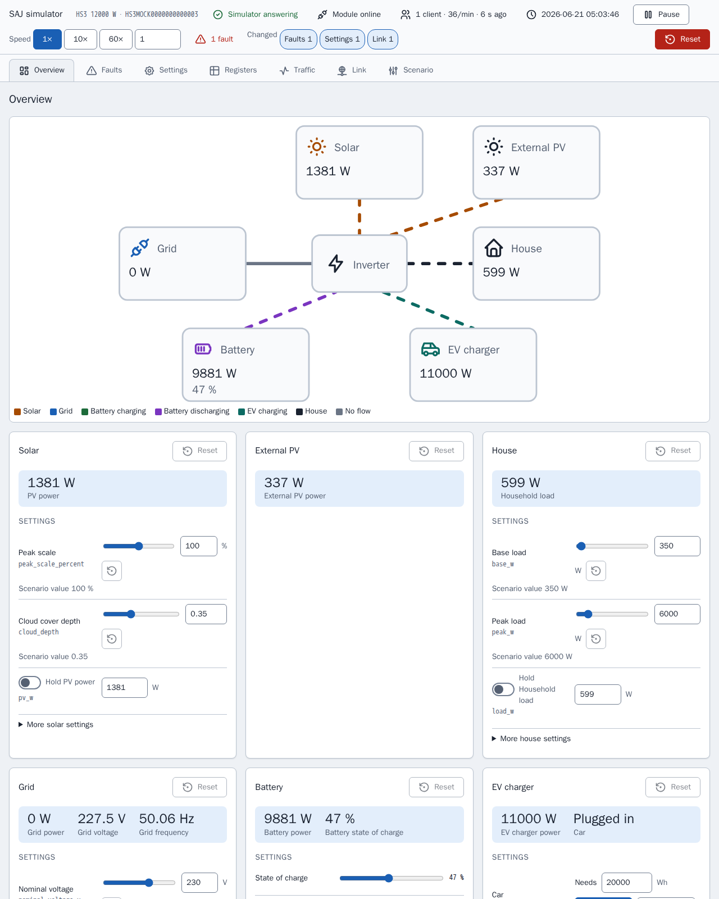

[en](../../en-gb/developer/simulator.md) | [de](../../de/developer/simulator.md) | [nl](../../nl/developer/simulator.md) | [fr](../../fr/developer/simulator.md) | [zh](../../zh-hans/developer/simulator.md) | [es](../../es/developer/simulator.md) | [it](../../it/developer/simulator.md) | [pl](../../pl/developer/simulator.md) | sv

# Modbus-simulator



Vad simulatorn är till för, hur du kör och konfigurerar ett scenario och hur du utökar simulatorn.

Den fullständiga listan över vad simulatorn omfattar finns i funktionslisteavsnitten [Simulerade modeller](../../../mock/docs/features.md#simulated-models), [Scenarier](../../../mock/docs/features.md#scenarios), [Variation](../../../mock/docs/features.md#variation).

Simulatorn är en stand-in för en SAJ-enhet som Home Assistant eller vilken Modbus-klient som helst kan ansluta till, så integrationen kan utvecklas utan att äga hårdvaran eller riskera hårdvaran. Simulatorn siktar på trovärdig smoke-testning, inte exakt emulering, och är inte en allmän Modbus-server. Paketet är `mock/saj_local_mock/`, och varje simulator körs i sin egen container.

## Designbeslut

- **Fristående.** Simulatorn delar ingen kod med integrationen, och ett import-linter-kontrakt förbjuder simulatorn att importera Home Assistant eller `custom_components`. Om båda sidor använde samma registerdefinitioner skulle ett fel i definitionerna vara osynligt.
- **Ett eget Modbus-lager.** Riktiga SAJ-enheter bryter mot standarden: udda undantagskoder, block som avvisar läsningar över sitt slut, en låg klientgräns. Integrationen måste klara sådana fel, så felen är inbyggda.
- **En container, en enhet.** Varje instans håller sitt eget tillstånd, i sin egen mapp under `mock/state/`, så instanser påverkar aldrig varandra.
- **Ändringsbar under körning.** Scenariot är utgångspunkten, inte den enda indatan. Simulatorsidan och inkommande förfrågningar ändrar det körande systemet, och scenariot förblir det kända tillstånd man återgår till.
- **Deterministisk.** Väder och last beror bara på fröet och den simulerade tiden. Samma scenario, ögonblick och skrivningar ger samma värden, hur ofta en klient än avfrågar.
- **En energibalans.** Bara instrålning och last genereras; allt annat härleds, så registren motsäger aldrig varandra.
- **Skrivningar får effekt.** Inställningar lagras, läses tillbaka och agerar man på. En skrivning från sidan går genom samma validering och hantering som en Modbus-skrivning, så integrationen kan inte skilja de två åt och sidan kan inte försätta enheten i ett tillstånd som en klient inte kunde.
- **Sidan vet inget om modeller.** Sidan bygger sig själv från den beskrivning som enheten ger, så en ny modell kräver ingen sidändring. Sidan är ett utvecklingsverktyg, så sidan är vanliga HTML-, CSS- och JavaScript-filer i `mock/static/` som serveras som de är, utan bibliotek, utan byggsteg och utan egna tester av sidan, medan Python bakom sidan testas som resten. Se [simulatorsidan](simulator-page.md).
- **Modulen är en del av simuleringen.** Modbus-servern står för den kommunikationsmodul som en klient ansluter till, så de fel som fältrapporter beskriver hos dessa moduler (långsamma eller uteblivna svar, udda undantagskoder, avbrutna anslutningar, en låsning) är inställningar i simulatorn och inte specialfall utspridda i enheten.
- **Skrivbeteendet kommer från SAJ:s dokument.** Skrivningar specificeras av SAJ:s protokolldokument och verkliga avläsningar, inte av simulatorn. Om simulatorn avviker från det dokumenterade beteendet för `0x06` och `0x10` är avvikelsen en simulatordefekt att ta upp, inte något att anpassa integrationen kring.

## Hitta rätt

| För | Titta i |
| --- | --- |
| Varför simulatorn är byggd som den är | Det utförda arbetet [Bygg SAJ Modbus-simulatorn](../../../.github/work/done/build-saj-modbus-mock-simulator.md), [Lägg till simulatorns kontrollpanel](../../../.github/work/done/add-simulator-control-panel.md) och [Ny utformning av simulatorpanelen med inspektör och länkfel](../../../.github/work/done/redesign-simulator-panel-with-inspector-and-link-faults.md) |
| Färdiga system | [mock/scenarios/](../../../mock/scenarios/) |
| Giltiga scenarionycklar och standardvärden | `mock/saj_local_mock/scenario.py` |
| Vad varje modell stöder | `mock/saj_local_mock/models.py` |
| Register | `mock/saj_local_mock/profiles/` |
| Hur värden utvecklas | `mock/saj_local_mock/simulation/` |
| Tjänster och portar | [compose.yaml](../../../compose.yaml) |
| Simulatorsida | `panel.py` (vägar), `description.py`, `presets.py` och sidan i [mock/static/](../../../mock/static/) |
| Länkfel | `mock/saj_local_mock/link.py` (inställningar, gränser, beslut) och `transport.py` (genomför besluten) |
| Trafikregister | `mock/saj_local_mock/traffic.py` |
| Felbitar per modell | `mock/saj_local_mock/profiles/fault_tables.py` |
| Sparat tillstånd | `mock/saj_local_mock/persistence.py` |

Transporten vet inget om SAJ, enheten äger adresser och åtkomstregler, en profil binder register till simulerade storheter, och simuleringen vet inte hur värden transporteras. Att hålla lagren isär är det som låter varje lager enhetstestas för sig.

## Prata med simulatorn från en terminal

`make up` startar simulatorerna. Home Assistant når var och en via dess Compose-tjänstnamn på simulatorns egen port; från din maskin, använd `localhost` och den publicerade porten från `compose.yaml`.

Exemplen använder [mbpoll](https://github.com/epsilonrt/mbpoll) mot HS3-simulatorns publicerade port. `-0` får adresserna att stämma med registerkartorna, `-1` läser en gång, `-t 4` väljer holding-register och `-a` är enhets-ID.

Läs enhetstypen och märkeffekten (registren `0x8F00` och `0x8F01`):

<!-- jscpd:ignore-start -->
```bash
mbpoll -m tcp -p 5020 -a 1 -0 -1 -t 4:hex -r 0x8F00 -c 2 localhost
```
<!-- jscpd:ignore-end -->

En HS3 och en H2 svarar med olika enhetstyper, vilket är det snabbaste sättet att bekräfta vilket system en port simulerar.

Skriv en inställning och läs tillbaka inställningen (här applikationsläget vid `0x3647`):

<!-- jscpd:ignore-start -->
```bash
mbpoll -m tcp -p 5020 -a 1 -0 -t 4 -r 0x3647 localhost 1
mbpoll -m tcp -p 5020 -a 1 -0 -1 -t 4 -r 0x3647 localhost
```
<!-- jscpd:ignore-end -->

Se hur simulatorn nekar en förfrågan, till exempel en adress utanför varje block:

<!-- jscpd:ignore-start -->
```bash
mbpoll -m tcp -p 5020 -a 1 -0 -1 -t 4 -r 0x0001 localhost
```
<!-- jscpd:ignore-end -->

Se ett värde ändras genom att utelämna `-1`; mbpoll avfrågar då en gång i sekunden tills du stoppar.

Kör simulatorns egen hälsokontroll, som inte behöver någon installerad klient:

<!-- jscpd:ignore-start -->
```bash
docker compose exec mock python -m saj_local_mock healthcheck; echo $?
```
<!-- jscpd:ignore-end -->

Skrivningar behålls över omstarter i `mock/state/`, som Git ignorerar, och återställs från simulatorsidan eller genom att mappens innehåll raderas, se [Sparat tillstånd](simulator-page.md#förinställningar-sparat-tillstånd-och-export). Adresser kommer från profilerna; de tre ovan är bara startpunkter.

## Konfigurera ett scenario

Ett scenario är en YAML-fil monterad på `/config/config.yaml`. Bara `device.model` krävs, så en fil anger bara det som skiljer sig från standardvärdena:

<!-- jscpd:ignore-start -->
```yaml
device:
  model: hs3
simulation:
  start: "2026-06-21T12:00:00"
  speed: 600
battery:
  modules: 4
```
<!-- jscpd:ignore-end -->

I exemplet är `simulation.speed` simulerade sekunder per verklig sekund, så detta kör tio simulerade minuter varje sekund från midsommardagens middag: användbart för att se ett helt dygns laddning och urladdning på några minuter. `simulation.seed` väljer väder och last.

Två avsnitt formar det slumpmässiga beteendet och felen vid start; ett tredje, `link`, beskrivs under [Länkfel](simulator-page.md#länkfel). `variation` anger gränser, djup och period för generatorerna för sol, last och nät (lastnivån stannar i `site.load`), och `faults` listar de aktiva felbitarna per utrustning med register och bit, plus batteripackens koder:

<!-- jscpd:ignore-start -->
```yaml
variation:
  cloud_depth: 0.9
faults:
  inverter:
    - {register: 0x4005, bit: 23}
  packs:
    - {pack: 1, fault: 1}
```
<!-- jscpd:ignore-end -->

En felaktig nyckel eller en omöjlig kombination stoppar simulatorn vid start och namnger nyckeln. Simulatorn skriver raden till felutdata och avslutas:

```text
invalid scenario: ev_charger.installed: not available on h2
```

## Köra ett annat eller extra system

**Prova ett scenario en gång**, utan att röra någon fil. Simulatorn körs i förgrunden på sin egen port tills du stoppar simulatorn:

<!-- jscpd:ignore-start -->
```bash
docker compose run --rm --no-deps -p 5030:502 \
  -v ./mock/scenarios/hs3-off-grid.yaml:/config/config.yaml:ro \
  -v ./mock/state/off-grid:/data \
  mock
```
<!-- jscpd:ignore-end -->

Det extra `-v` behövs eftersom tjänsten `mock` annars tar med monteringen av `/data` från `mock/state/hs3/`, och den första ändringen i off-grid-körningen skulle ersätta utvecklings-HS3:ans `state.json` med off-grid-tillstånd. Off-grid-körningen behåller sitt eget tillstånd i `mock/state/off-grid/` mellan körningar.

Peka det första `-v` på din egen fil för att köra ett scenario som du skrivit.

**Ändra vad `make up` startar** i `compose.override.yaml`. Att montera en annan fil över samma sökväg ersätter scenariot; en ny tjänst lägger till ett system:

<!-- jscpd:ignore-start -->
```yaml
services:
  mock:
    volumes:
      - ./mock/scenarios/hs3-ev.yaml:/config/config.yaml:ro

  mock-off-grid:
    build:
      context: ./mock
    volumes:
      - ./mock/scenarios/hs3-off-grid.yaml:/config/config.yaml:ro
    ports:
      - "5022:502"
```
<!-- jscpd:ignore-end -->

Varje tjänst är en oberoende enhet med eget tillstånd. Home Assistant når den nya tjänsten som `mock-off-grid`, så flera system kan läggas till i en Home Assistant sida vid sida.

## Utöka simulatorn

- **Nytt scenario:** en fil i `mock/scenarios/`. `make mock-smoke` tar med varje fil i mappen.
- **Ny modell:** en post i `models.py`, en profil i `profiles/` och godkännande av scenariovalideringen i `scenario.py`.
- **Ny egenhet:** i det lager som äger den. Ramning och anslutningar i transporten, adresser och åtkomst i enheten, modellens beteende i profilen.

Simulatorn klarar samma grindar som integrationen, se [kontrollsidan](checks.md).
