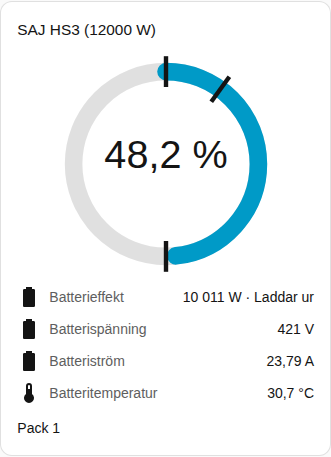
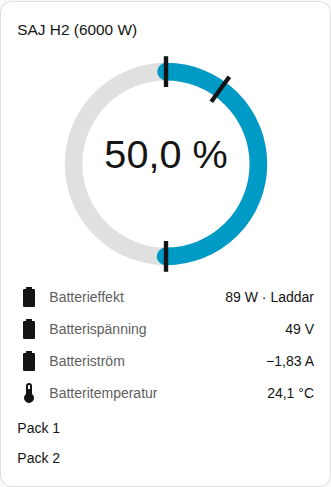

[en](../../../en-gb/user/cards/battery-card.md) | [de](../../../de/user/cards/battery-card.md) | [nl](../../../nl/user/cards/battery-card.md) | [fr](../../../fr/user/cards/battery-card.md) | [zh](../../../zh-hans/user/cards/battery-card.md) | [es](../../../es/user/cards/battery-card.md) | [it](../../../it/user/cards/battery-card.md) | [pl](../../../pl/user/cards/battery-card.md) | sv

# Batterikort

Sidan Batterikort förklarar batterikortet, som visar batteriets laddning, effekt och avläsningar. Den fullständiga listan finns i avsnittet [Batterikort](../../../../frontend/docs/features.md#battery-card) i kortens funktionslista. [Lägg till ett element](README.md#lägg-till-ett-element) förklarar hur du lägger till kortet och väljer ett system.

## Vad kortet visar

- En ring visar laddningsnivån. Markeringar på ringen visar reserven, laddningsgränsen och urladdningsgränsen när nätet är anslutet.
- Batteriets effekt visas med om batteriet laddar eller laddar ur, och under effekten spänningen, strömmen, temperaturen och den användbara kapaciteten. Riktningarna följer [effektens tecken](../entities-and-prefix.md#effektens-tecken).
- Med Visa batteripack på, vilket är standard, får varje pack en radgrupp med laddningsnivå, hälsa, spänning, ström, temperatur, cykler, fel och varning. En avläsning för ett pack visas bara när avläsningens entitet är aktiverad. De flesta packavläsningar skapas inaktiverade, vilket är anledningen till att skärmbilden bara visar packets namn. Aktivera de entiteter du vill ha i Home Assistant. [Batteripackentiteterna](../entities/battery-packs.md) finns i entitetsreferensen.
- Ett system utan batteri säger det.

## Skillnader mellan modellerna

- **HS3:** ett pack.
- **H2:** en radgrupp för varje pack som växelriktaren rapporterar, upp till fem. Skärmbilden visar en H2 med två pack. Se [valfri utrustning](../optional-equipment.md#batteripack).

[Felkortet](faults-card.md) listar det aktiva felet och den aktiva varningen för varje pack. Fel- och varningsentiteterna är aktiverade som standard.

## Alternativ

| Alternativ i redigeringsverktyget | YAML-nyckel | Standard |
| --- | --- | --- |
| System | `device` | Det första systemet |
| Visa batteripack | `show_packs` | På |

## Stöds inte ännu

- Att ändra en batteriinställning från kortet. Batterikortet visar bara avläsningar. Använd [styrkortet](controls-card.md) för batterigränserna.
