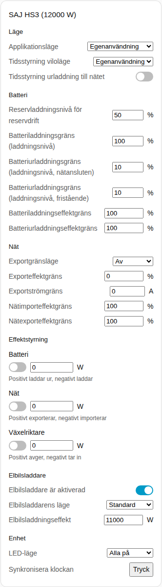
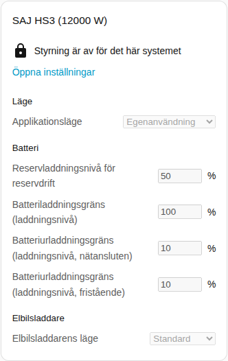
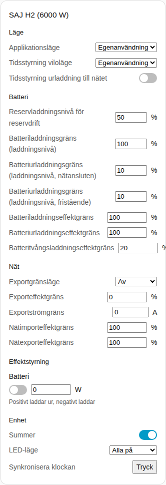

[en](../../../en-gb/user/cards/controls-card.md) | [de](../../../de/user/cards/controls-card.md) | [nl](../../../nl/user/cards/controls-card.md) | [fr](../../../fr/user/cards/controls-card.md) | [zh](../../../zh-hans/user/cards/controls-card.md) | [es](../../../es/user/cards/controls-card.md) | [it](../../../it/user/cards/controls-card.md) | [pl](../../../pl/user/cards/controls-card.md) | sv

# Styrkort

Sidan Styrkort förklarar styrkortet, som samlar ett systems inställningar i sektioner så att du kan ändra inställningarna från en instrumentpanel. Den fullständiga listan finns i avsnittet [Styrkort](../../../../frontend/docs/features.md#controls-card) i kortens funktionslista. [Lägg till ett element](README.md#lägg-till-ett-element) förklarar hur du lägger till kortet och väljer ett system. Inställningarna bakom styrningarna beskrivs i [ändra inställningar](../changing-settings.md).

## Vad kortet visar

- Sektionerna är Läge, Batteri, Nät, Effektstyrning, Elbilsladdare och Enhet. En sektion utan något att visa utelämnas.
- **Läge:** applikationsläget och tidsstyrningens inställningar.
- **Batteri:** reservladdningsnivån och gränserna för laddning och urladdning.
- **Nät:** inställningarna för exportgränsen och nätets effektgränser.
- **Effektstyrning:** varje funktion för [effektstyrning](../power-control.md) som systemet har, med en brytare, ett effektmål och en ledtråd om vad en positiv och en negativ effekt gör.
- **Elbilsladdare:** laddarens brytare, läge och laddningseffekt.
- **Enhet:** summern, LED-läget och klocksynkroniseringen.
- Varje inställning använder den styrning som passar inställningen: ett reglage eller ett nummerfält, en lista, en brytare, ett tidsfält eller en knapp.
- En styrning ändrar växelriktaren en gång per beslut och visar sedan det värde som växelriktaren håller. En nekad ändring visas under styrningen.
- Kortet har ingen knapp Starta om växelriktaren, så ett tryck på en instrumentpanel kan inte starta om växelriktaren. Omstart förblir en entitet.

## När styrning inte är tillåten

Medan [Tillåt styrning](../changing-settings.md#tillåt-styrning) är av för systemet är varje styrning inaktiverad. Ett lås ovanför styrningarna länkar till integrationens inställningar, där du slår på Tillåt styrning.

## Skillnader mellan modellerna

- **Endast HS3:** sektionen Elbilsladdare, samt effektstyrningsfunktionerna Nät och Växelriktare.
- **Endast H2:** summern och batteriets gräns för tvångsladdningseffekt. H2 har bara effektstyrningsfunktionen Batteri.

## Alternativ

| Alternativ i redigeringsverktyget | YAML-nyckel | Standard |
| --- | --- | --- |
| System | `device` | Det första systemet |
| Sektioner | `sections`, en lista med `mode`, `battery`, `grid`, `power_control`, `ev_charger` och `device` | Alla sektioner |

## Stöds inte ännu

- En knapp Starta om växelriktaren. Omstart förblir en entitet.
- Scheman för effektstyrning. Ställ in schemana på integrationssidan, se [effektstyrning](../power-control.md#följ-ett-schema).
