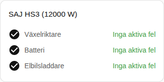

[en](../../../en-gb/user/cards/faults-card.md) | [de](../../../de/user/cards/faults-card.md) | [nl](../../../nl/user/cards/faults-card.md) | [fr](../../../fr/user/cards/faults-card.md) | [zh](../../../zh-hans/user/cards/faults-card.md) | [es](../../../es/user/cards/faults-card.md) | [it](../../../it/user/cards/faults-card.md) | [pl](../../../pl/user/cards/faults-card.md) | sv

# Felkort

Sidan Felkort förklarar felkortet, som listar de aktiva felen för varje del av utrustningen. Den fullständiga listan finns i avsnittet [Felkort](../../../../frontend/docs/features.md#faults-card) i kortens funktionslista. [Lägg till ett element](README.md#lägg-till-ett-element) förklarar hur du lägger till kortet och väljer ett system. Felen kommer från [enhetsfelsentiteterna](../faults-and-repairs.md#enhetsfel).

## Vad kortet visar

- Felen grupperas efter växelriktare, batteri och elbilsladdare, och varje aktivt fel visar hur länge sedan felet började. Batteripackens fel och varningar finns i batterigruppen.
- Ett okänt fel säger att du ska leta i [diagnostiknedladdningen](../troubleshooting.md#ladda-ner-diagnostik) efter registret och biten.
- En knapp Rensa fel sitter under växelriktarens aktiva fel. Knappen skickar kommandot Rensa aktuellt fel. Medan styrning inte är tillåten för systemet är knappen inaktiverad och ett lås länkar till integrationens inställningar. Se [Tillåt styrning](../changing-settings.md#tillåt-styrning).
- Med Visa grupper utan fel på, vilket är standard, visas en grupp utan aktivt fel som fri, som i skärmbilden. Med alternativet av visar kortet bara grupperna med ett aktivt fel.

Ett system utan batteri eller elbilsladdare har inga fel att visa för den utrustning som saknas, så kortet ritar inte utrustningens grupp.

## Alternativ

| Alternativ i redigeringsverktyget | YAML-nyckel | Standard |
| --- | --- | --- |
| System | `device` | Det första systemet |
| Visa grupper utan fel | `show_groups_without_faults` | På |

## Stöds inte ännu

- Att rensa batteriets eller elbilsladdarens fel från kortet. Knappen Rensa fel sitter bara under växelriktarens aktiva fel.
