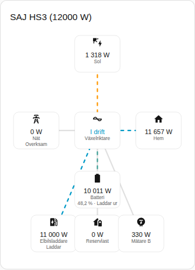
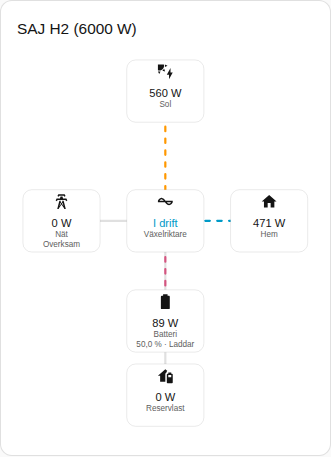

[en](../../../en-gb/user/cards/power-flow-card.md) | [de](../../../de/user/cards/power-flow-card.md) | [nl](../../../nl/user/cards/power-flow-card.md) | [fr](../../../fr/user/cards/power-flow-card.md) | [zh](../../../zh-hans/user/cards/power-flow-card.md) | [es](../../../es/user/cards/power-flow-card.md) | [it](../../../it/user/cards/power-flow-card.md) | [pl](../../../pl/user/cards/power-flow-card.md) | sv

# Effektflödeskort

Sidan Effektflödeskort förklarar effektflödeskortet, som ritar live-effekt mellan sol, batteri, nät, hem och den valfria utrustningen. Den fullständiga listan finns i avsnittet [Effektflödeskort](../../../../frontend/docs/features.md#power-flow-card) i kortens funktionslista. [Lägg till ett element](README.md#lägg-till-ett-element) förklarar hur du lägger till kortet och väljer ett system.



## Vad kortet visar

- Sol, batteri, nät och hem ritas runt växelriktaren, som visar driftläget.
- Varje linje visar flödets riktning och rör sig snabbare när effekten ökar. En effekt på 10 W eller lägre ritas som overksam.
- Batteriet visar laddningsnivån och om batteriet laddar eller laddar ur. Nätet visar om systemet importerar eller exporterar. Riktningarna följer [effektens tecken](../entities-and-prefix.md#effektens-tecken).
- Med Visa valfri utrustning på, vilket är standard, ritar kortet också reservlasten, Mätare B och elbilsladdaren när systemet har utrustningen. Mätare B är en avläsning utan riktning.
- Med Visa solcellssträngar på listas effekten för varje solcellssträng. Alternativet är av som standard.
- Omfång väljer mellan systemets avläsningar, vilket är standard, och parallellsystemets avläsningar. Ett system utan parallella avläsningar visar det tomma tillståndet med parallellomfånget.

## Skillnader mellan modellerna

- **Endast HS3:** elbilsladdaren, som i skärmbilden ovan.
- **H2:** kortet ritar delarna i HS3-kortet, utom elbilsladdaren. Skärmbilden nedan visar en H2 som laddar batteriet.



## Alternativ

| Alternativ i redigeringsverktyget | YAML-nyckel | Standard |
| --- | --- | --- |
| System | `device` | Det första systemet |
| Visa solcellssträngar | `show_strings` | Av |
| Visa valfri utrustning | `show_optional_equipment` | På |
| Omfång | `scope` (`system` eller `parallel`) | `system` |

<!-- jscpd:ignore-start -->
```yaml
type: custom:saj-local-power-flow-card
device: 0123456789abcdef0123456789abcdef
show_strings: false
show_optional_equipment: true
scope: system
```
<!-- jscpd:ignore-end -->

Värdet `device` är enhetens ID i Home Assistant. Det visuella redigeringsverktyget fyller i värdet åt dig. Namnen på entiteterna bakom varje del finns i [entitetsreferensen](../entities/README.md).

## Stöds inte ännu

- En riktning för Mätare B. Kortet ritar Mätare B som en avläsning utan riktning.
