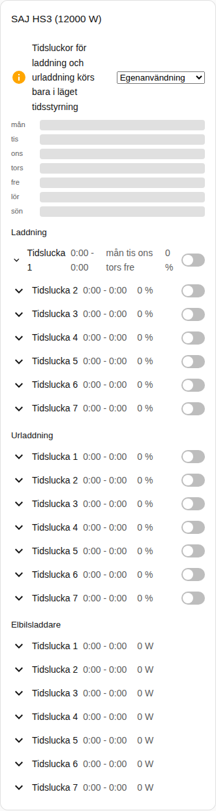
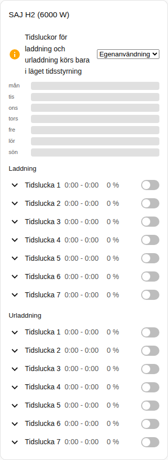

[en](../../../en-gb/user/cards/schedule-card.md) | [de](../../../de/user/cards/schedule-card.md) | [nl](../../../nl/user/cards/schedule-card.md) | [fr](../../../fr/user/cards/schedule-card.md) | [zh](../../../zh-hans/user/cards/schedule-card.md) | [es](../../../es/user/cards/schedule-card.md) | [it](../../../it/user/cards/schedule-card.md) | [pl](../../../pl/user/cards/schedule-card.md) | sv

# Schemakort

Sidan Schemakort förklarar schemakortet, som visar och redigerar tidsluckorna för laddning, urladdning och elbilsladdare. Den fullständiga listan finns i avsnittet [Schemakort](../../../../frontend/docs/features.md#schedule-card) i kortens funktionslista. [Lägg till ett element](README.md#lägg-till-ett-element) förklarar hur du lägger till kortet och väljer ett system.

## Vad kortet visar

- Tidsluckorna för laddning, urladdning och elbilsladdare, var och en med tiderna, effekten, dagarna och om tidsluckan är på. Alternativet Typer av tidsluckor väljer vilka typer kortet visar.
- Med Visa veckotidslinje på, vilket är standard, ritar en veckotidslinje varje tidslucka som ett fält. Tryck på ett fält för att öppna tidsluckan.
- En öppen tidslucka har ett redigeringsverktyg för start, slut, effekt, dagar och tidsluckans andra inställningar.
- En tidslucka visas bara när varje entitet i tidsluckan är aktiverad, och kortet räknar de tidsluckor som kortet utelämnar. Att slå på [Tillåt styrning](../changing-settings.md#styrningsuppsättningen) aktiverar tidsluckornas entiteter.
- Tidsluckor för laddning och urladdning körs bara i ett applikationsläge för tidsstyrning. När applikationsläget är ett annat läge säger ett meddelande det och visar lägeslistan bredvid meddelandet. Tidsstyrning och Tidsstyrning (BMS) räknas båda.
- Medan styrning inte är tillåten för systemet är varje styrning på kortet inaktiverad och ett lås länkar till integrationens inställningar. Se [Tillåt styrning](../changing-settings.md#tillåt-styrning).

## Skillnader mellan modellerna

- **Endast HS3:** tidsluckorna för elbilsladdare.
- **H2:** bara tidsluckor för laddning och urladdning, som skärmbilden nedan visar.

En tidsluckas dagknappar är knapparna i [funktionen veckodagar för brickkort](weekdays-feature.md).

## Alternativ

| Alternativ i redigeringsverktyget | YAML-nyckel | Standard |
| --- | --- | --- |
| System | `device` | Det första systemet |
| Typer av tidsluckor | `slot_kinds`, en lista med `charge`, `discharge` och `ev_charger` | Alla typer |
| Visa veckotidslinje | `show_timeline` | På |

## Stöds inte ännu

- Scheman för effektstyrning. Ett schema för effektstyrning följer en Home Assistant-schemahjälpare, se [effektstyrning](../power-control.md#följ-ett-schema).
