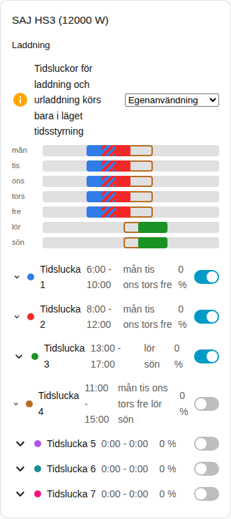
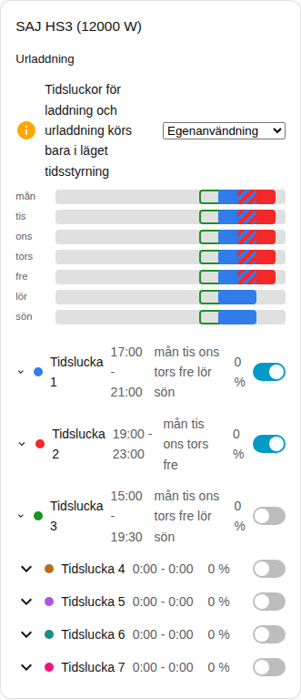
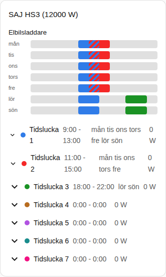

[en](../../../en-gb/user/cards/schedule-cards.md) | [de](../../../de/user/cards/schedule-cards.md) | [nl](../../../nl/user/cards/schedule-cards.md) | [fr](../../../fr/user/cards/schedule-cards.md) | [zh](../../../zh-hans/user/cards/schedule-cards.md) | [es](../../../es/user/cards/schedule-cards.md) | [it](../../../it/user/cards/schedule-cards.md) | [pl](../../../pl/user/cards/schedule-cards.md) | sv

# Schemakort

Sidan Schemakort förklarar de tre schemakorten. Varje kort visar och redigerar tidsluckorna av en typ: laddning, urladdning eller elbilsladdare. Den fullständiga listan finns i avsnittet [Schedule cards](../../../../frontend/docs/features.md#schedule-cards) i kortens funktionslista. [Lägg till ett element](README.md#lägg-till-ett-element) förklarar hur du lägger till ett kort och väljer ett system.

## Vad varje schemakort visar

- Kortets titel och under titeln en rubrik med kortets typ.
- Tidsluckorna av typen, var och en med tiderna, effekten, dagarna och om tidsluckan är på.
- En färg för varje tidsluckenummer. Tidslucka 1 har samma färg på alla tre korten. Varje rad för en tidslucka börjar med en färgmarkering i tidsluckans färg.
- Med Visa veckotidslinje på, vilket är standard, ritar en veckotidslinje varje tidslucka som ett fält i tidsluckans färg. Tryck på ett fält för att öppna tidsluckan.
- En tidslucka som är av är en kontur i tidsluckans färg, utan fyllning. Fältet för en tidslucka som är på döljer den del av en kontur som fältet korsar. Där två eller fler tidsluckor som är på överlappar en dag ritar tidslinjen överlappningen som ränder i de överlappande tidsluckornas färger. En tidslucka som är av skapar ingen överlappning. Tryck på en överlappning för att öppna den överlappande tidsluckan med lägst nummer.
- En öppen tidslucka har ett redigeringsverktyg för start, slut, effekt, dagar och tidsluckans andra inställningar.
- En tidslucka visas bara när varje entitet i tidsluckan är aktiverad, och kortet räknar de tidsluckor som kortet utelämnar. Att slå på [Tillåt styrning](../changing-settings.md#styrningsuppsättningen) aktiverar tidsluckornas entiteter.
- Medan styrning inte är tillåten för systemet är varje styrning på kortet inaktiverad och ett lås länkar till integrationens inställningar. Se [Tillåt styrning](../changing-settings.md#tillåt-styrning).

En tidsluckas dagknappar är knapparna i [funktionen veckodagar för brickkort](weekdays-feature.md).

## Alternativ

Alla tre korten har samma alternativ.

| Alternativ i redigeringsverktyget | YAML-nyckel | Standard |
| --- | --- | --- |
| System | `device` | Det första systemet |
| Visa veckotidslinje | `show_timeline` | På |

## Schemakort för laddning

Schemakortet för laddning visar tidsluckorna för laddning.

Tidsluckor för laddning körs bara i ett applikationsläge för tidsstyrning. När applikationsläget är ett annat läge säger ett meddelande det och visar lägeslistan bredvid meddelandet. Tidsstyrning och Tidsstyrning (BMS) räknas båda.

## Schemakort för urladdning

Schemakortet för urladdning visar tidsluckorna för urladdning.

Tidsluckor för urladdning körs bara i ett applikationsläge för tidsstyrning, så kortet visar samma meddelande som Schemakortet för laddning.

## Schemakort för elbilsladdare

Schemakortet för elbilsladdare visar tidsluckorna för elbilsladdare. Kortet visar inget meddelande om läget tidsstyrning.

## Skillnader mellan modellerna

- **Endast HS3:** tidsluckorna för elbilsladdare. På en H2 visar Schemakortet för elbilsladdare det tomma tillståndet, som säger vilken typ av entitet som ska aktiveras.
- **H2:** bara tidsluckor för laddning och urladdning.

## Stöds inte ännu

- Scheman för effektstyrning. Ett schema för effektstyrning följer en Home Assistant-schemahjälpare, se [effektstyrning](../power-control.md#följ-ett-schema).
