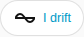

[en](../../../en-gb/user/cards/status-badge.md) | [de](../../../de/user/cards/status-badge.md) | [nl](../../../nl/user/cards/status-badge.md) | [fr](../../../fr/user/cards/status-badge.md) | [zh](../../../zh-hans/user/cards/status-badge.md) | [es](../../../es/user/cards/status-badge.md) | [it](../../../it/user/cards/status-badge.md) | [pl](../../../pl/user/cards/status-badge.md) | sv

# Statusmärke

Sidan Statusmärke förklarar statusmärket, som visar ett systems tillstånd i märkesraden på en instrumentpanel. Den fullständiga listan finns i avsnittet [Statusmärke](../../../../frontend/docs/features.md#status-badge) i kortens funktionslista. [Lägg till ett element](README.md#lägg-till-ett-element) förklarar hur du lägger till märket och väljer ett system.



## Vad märket visar

- Driftläget, färgat efter hur friskt tillståndet är, och antalet delar av utrustningen med ett aktivt fel. Märket visar antalet bara när ett fel är aktivt, så skärmbilden visar bara tillståndet.
- Märket säger Svarar inte när systemet inte svarar.
- Ett tryck på märket öppnar driftlägets detaljer.

## Alternativ

| Alternativ i redigeringsverktyget | YAML-nyckel | Standard |
| --- | --- | --- |
| System | `device` | Det första systemet |

```yaml
type: custom:saj-local-status-badge
device: 0123456789abcdef0123456789abcdef
```

Värdet `device` är enhetens ID i Home Assistant. Det visuella redigeringsverktyget fyller i värdet åt dig.

## Stöds inte ännu

- Andra alternativ än systemet.
