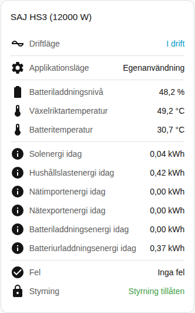

[en](../../../en-gb/user/cards/status-card.md) | [de](../../../de/user/cards/status-card.md) | [nl](../../../nl/user/cards/status-card.md) | [fr](../../../fr/user/cards/status-card.md) | [zh](../../../zh-hans/user/cards/status-card.md) | [es](../../../es/user/cards/status-card.md) | [it](../../../it/user/cards/status-card.md) | [pl](../../../pl/user/cards/status-card.md) | sv

# Statuskort

Sidan Statuskort förklarar statuskortet, som sammanfattar ett system på ett ställe. Den fullständiga listan finns i avsnittet [Statuskort](../../../../frontend/docs/features.md#status-card) i kortens funktionslista. [Lägg till ett element](README.md#lägg-till-ett-element) förklarar hur du lägger till kortet och väljer ett system.

## Vad kortet visar

- Driftläget, färgat efter hur friskt tillståndet är, och applikationsläget.
- Batteriets laddningsnivå, växelriktarens och batteriets temperaturer och fristående läge.
- Med Visa dagens energi på, vilket är standard, visar kortet dagens energi för sol, last, nätimport, nätexport, batteriladdning och batteriurladdning.
- Antalet delar av utrustningen med ett aktivt fel, eller att det inte finns några fel. Se [enhetsfel](../faults-and-repairs.md#enhetsfel).
- Om styrning är tillåten för systemet. Se [Tillåt styrning](../changing-settings.md#tillåt-styrning).

## Skillnader mellan modellerna

- **Endast H2:** när det applikationsläge som växelriktaren kör skiljer sig från det läge du valde visar kortet också det läge som körs nu. Raden visas bara när entiteten Applikationsläge (gällande) är aktiverad. Den entiteten skapas inaktiverad. Se [entitetsreferensen](../entities/README.md).

## Alternativ

| Alternativ i redigeringsverktyget | YAML-nyckel | Standard |
| --- | --- | --- |
| System | `device` | Det första systemet |
| Visa dagens energi | `show_energy` | På |

## Stöds inte ännu

- Att ändra en inställning från kortet. Statuskortet visar bara. Använd [styrkortet](controls-card.md) för att ändra inställningar.
