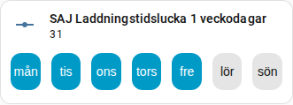

[en](../../../en-gb/user/cards/weekdays-feature.md) | [de](../../../de/user/cards/weekdays-feature.md) | [nl](../../../nl/user/cards/weekdays-feature.md) | [fr](../../../fr/user/cards/weekdays-feature.md) | [zh](../../../zh-hans/user/cards/weekdays-feature.md) | [es](../../../es/user/cards/weekdays-feature.md) | [it](../../../it/user/cards/weekdays-feature.md) | [pl](../../../pl/user/cards/weekdays-feature.md) | sv

# Veckodagar som funktion för bricka

Sidan Veckodagar som funktion för bricka förklarar funktionen veckodagar, som sätter sju dagknappar på ett brickkort för att ställa in en tidsluckas dagar. Den fullständiga listan finns i avsnittet [Veckodagar som funktion för bricka](../../../../frontend/docs/features.md#weekdays-tile-card-feature) i kortens funktionslista. En tidsluckas dagar är entiteterna Veckodagar för tidsluckorna för laddning, urladdning och elbilsladdare, listade i områdena [Batteri](../entities/battery.md) och [Elbilsladdare](../entities/ev-charger.md) i entitetsreferensen.



## Lägg till funktionen

1. Lägg till ett brickkort på en instrumentpanel och välj entiteten Veckodagar för en tidslucka som brickkortets entitet.
2. Öppna brickkortets funktioner, välj Lägg till funktion och välj SAJ Local-veckodagar.

Funktionen erbjuds bara för ett brickkort vars entitet är entiteten Veckodagar för en tidslucka. Funktionen har inga alternativ.

```yaml
type: tile
entity: number.saj_charge_slot_1_days
features:
  - type: custom:saj-local-weekdays-feature
```

Entitets-ID:t i exemplet har inget prefix. Om du anger ett [prefix](../entities-and-prefix.md#prefixet) har entitetens ID prefixet efter `saj_`.

## Hur knapparna fungerar

- Sju namngivna dagknappar börjar på din första dag i veckan, som kommer från Home Assistants inställningar eller ditt språk.
- SAJ Local skickar ändringen 1,5 sekunder efter det sista trycket, så att du kan välja flera dagar i en ändring.
- Växelriktaren lagrar dagarna som ett tal som inte flyttar sig med din första dag i veckan. Måndag är den lägsta biten och söndag den högsta på varje modell, så måndag till fredag är 31, som i skärmbilden, och måndag, onsdag och fredag är 21.
- Knapparna är inaktiverade medan [Tillåt styrning](../changing-settings.md#tillåt-styrning) är av för systemet.

[Schemakortet](schedule-card.md) använder knapparna i tidsluckeditorn.

## Stöds inte ännu

- Någon annan entitet än entiteten Veckodagar för en tidslucka. SAJ Local erbjuder inte funktionen för andra brickkort.
