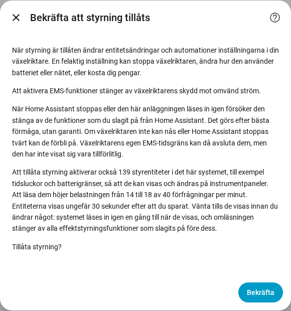

[en](../../en-gb/user/changing-settings.md) | [de](../../de/user/changing-settings.md) | [nl](../../nl/user/changing-settings.md) | [fr](../../fr/user/changing-settings.md) | [zh](../../zh-hans/user/changing-settings.md) | [es](../../es/user/changing-settings.md) | [it](../../it/user/changing-settings.md) | [pl](../../pl/user/changing-settings.md) | sv

# Ändra inställningar

Sidan Ändra inställningar förklarar hur du låter SAJ Local ändra inställningarna i din växelriktare, vad som händer med en ändring och vilka ändringar som alltid nekas. De fullständiga listorna finns i avsnitten [Ändra inställningar](../../../custom_components/saj_local/docs/features.md#changing-settings) och [EMS](../../../custom_components/saj_local/docs/features.md#ems) i integrationens funktionslista. Inställningarna och kommandona är fördelade över områdena i [entitetsreferensen](entities/README.md), främst [Inställningar](entities/settings.md) och [Batteri](entities/battery.md).

Att skriva till växelriktaren är av tills du tillåter styrning för ett system. Medan Tillåt styrning är av visar inställningarna det aktuella värdet men nekar varje ändring, med ett meddelande som säger var du slår på styrning. Ingenting skickas till växelriktaren.

## Tillåt styrning

1. Öppna Konfigurera, kugghjulet på systemets rad på sidan för SAJ Local-integrationen. Du kan också slå på Tillåt styrning när du lägger till systemet.
2. Slå på Tillåt styrning och välj Skicka.
3. Läs bekräftelsen och välj sedan Skicka igen.

Bekräftelsen varnar för att en felaktig inställning kan stoppa växelriktaren, ändra hur växelriktaren använder batteriet eller nätet, eller kosta dig pengar. Bekräftelsen säger också:

- Att aktivera EMS-funktioner stänger av växelriktarens skydd mot omvänd ström.
- När Home Assistant stoppas, eller systemet läses in igen, försöker SAJ Local stänga av de funktioner som du slagit på från Home Assistant. Avstängningen görs efter bästa förmåga och är ingen garanti.
- Att tillåta styrning aktiverar styrentiteter, och att läsa entiteterna höjer förfrågningsbelastningen. Dialogen visar antalet entiteter och belastningen före och efter.

Endast HS3: bekräftelsen vid installationen frågar också efter EMS-hjärtslaget. I Konfigurera är hjärtslaget ett fält i huvudformuläret. Se [EMS](#ems).

Att slå av Tillåt styrning kräver ingen bekräftelse. Varje system har en binär sensor Styrning tillåten, i kategorin diagnostik, som är på medan systemet tar emot ändringar. [Instrumentpanelskorten](cards/README.md) läser sensorn och låser styrningarna medan sensorn är av. Sensorn är skrivskyddad, eftersom en brytare på en instrumentpanel skulle slå på skrivning utan varningen.

## Styrningsuppsättningen

De flesta tidsluckor och många inställningar skapas inaktiverade, så ett instrumentpanelskort skulle inte ha något att visa eller ändra. Att slå på Tillåt styrning aktiverar därför också systemets styrningsuppsättning:

- tidsluckorna för laddning, urladdning och elbilsladdare (tidsluckorna för elbilsladdare gäller bara HS3);
- applikationsläget och tidsstyrningens inställningar;
- batterigränserna och nätgränserna;
- elbilsladdarens inställningar (endast HS3);
- brytarna och målen för effektstyrning, se [effektstyrning](power-control.md);
- LED-läget, summern (endast H2) samt knapparna Synkronisera klockan och Rensa aktuellt fel.

Avläsningar av batteripack och andra skrivskyddade entiteter ingår inte i uppsättningen.

- **Entiteterna visas efter ungefär 30 sekunder.** Home Assistant läser in ett system igen 30 sekunder efter att en entitet i systemet aktiverats. Vänta tills entiteterna visas innan du ändrar något, eftersom omläsningen stänger av alla effektstyrningsfunktioner som du slagit på under tiden. En ny omläsning följer när en ny medlem i uppsättningen visas senare, till exempel tidsluckorna för elbilsladdare efter att en elbilsladdare identifierats.
- **Att slå av Tillåt styrning** inaktiverar de entiteter som SAJ Local aktiverade, och ingen omläsning följer.
- **Ditt val gäller.** En entitet som du inaktiverade innan du slog på styrning förblir inaktiverad, och en entitet som du själv aktiverade förblir aktiverad. Ett kort räknar en tidslucka med en inaktiverad entitet som utelämnad.

## Vad som händer med en ändring

SAJ Local kontrollerar en ändring innan SAJ Local skickar något. SAJ Local nekar ändringen, med ett separat meddelande för varje fall, när:

- Tillåt styrning är av;
- modellen är overifierad. Ett system med en modell som inte kunde verifieras skrivs aldrig till, se [kom igång](getting-started.md#när-växelriktaren-inte-känns-igen);
- inställningen är en driftsättningsinställning;
- värdet är ogiltigt;
- växelriktaren inte går att nå;
- skrivgränsen är nådd. Högst 20 ändringar går till en växelriktaradress under valfria 60 sekunder, och en ändring över gränsen nekas och köas inte.

Varje meddelande säger att växelriktaren inte ändrades. Annars skriver SAJ Local ändringen en gång och läser tillbaka värdet, och entiteten visar det värde som växelriktaren håller.

| Vad som hände | Vad du ser |
| --- | --- |
| Växelriktaren nekade ändringen | Meddelandet anger undantagskoden. |
| Växelriktaren svarade inte | Meddelandet säger att ändringen kan ha tillämpats eller inte. SAJ Local skickar ingenting igen och läser av växelriktaren igen efter återanslutningen. |
| Växelriktaren håller ett annat värde | Entiteten visar det värde som växelriktaren håller, och ändringen misslyckas. |

En ändring av en inställning i ett register som håller flera inställningar lämnar registrets andra inställningar oförändrade.

## Vad du kan ändra

- Applikationsläget, sju laddningstidsluckor och sju urladdningstidsluckor (var och en med start, slut, effekt, dagar och på eller av), tidsstyrningens viloläge och urladdning till nätet, samt reservladdningsnivån för reservdrift.
- Batteriets gränser för laddning och urladdning, batteriets automatiska väckning, exportgränsen, nätets gränser för import- och exporteffekt och effekterna för passivt läge.
- Endast HS3: elbilsladdarens inställningar och sju elbilsladdartidsluckor.
- Endast H2: summern och batteriets gräns för tvångsladdningseffekt. Båda modellerna har LED-läget.
- Kommandon, som knappar som skapas inaktiverade: Rensa aktuellt fel, Starta om växelriktaren och Synkronisera klockan, som skickar Home Assistants lokala tid. Endast HS3: Ta bort EMS-soleffektgräns.

[Instrumentpanelskorten](cards/controls-card.md) erbjuder de gemensamma inställningarna på ett ställe. Styrkortet har ingen omstartsknapp, så ett tryck på en instrumentpanel kan inte starta om växelriktaren.

## Driftsättningsinställningar

Driftsättningsinställningar visas och kan inte ändras från Home Assistant: mätaren, RS485, batteriprotokollet, nätverket och länken till elbilsladdaren, och på H2 även nättypen, parallellinställningen, ingångslägena, skyddsgränserna och andra installatörsinställningar. Ett felaktigt värde kan skära av växelriktaren från mätaren, batteriet, laddaren eller Home Assistant. Driftsättningsinställningar är skrivskyddade sensorer i kategorin diagnostik. Gör sådana ändringar i appen SAJ elekeeper, se [kravet](../../../custom_components/saj_local/docs/requirements.md#changing-settings).

## Stöds inte ännu

- Fabriksåterställning och rensning av energihistoriken. SAJ Local erbjuder ingen av dem.
- Att ändra driftsättningsinställningar.
- Att ändra inställningar i ett system vars modell är overifierad.

## EMS

Endast HS3: EMS ställer växelriktaren under extern styrning. H2 har inga EMS-entiteter. SAJ Local erbjuder EMS-tidsgränsen och fem gränser som entiteter: batteriets laddnings- och urladdningsström, växelriktarens import- och exporteffekt samt soleffekten. Gränserna kan ställas in, och SAJ Local avfrågar inte gränserna. Mellan hjärtslagen visar gränserna det senaste värde som SAJ Local skickade, och gränserna är okända före den första ändringen. [Effektstyrning](power-control.md) slår på och av EMS-funktionerna.

- **Hjärtslaget håller en funktion vid liv.** SAJ Local läser målet för varje EMS-funktion som du slagit på från Home Assistant, och gränserna, varje hjärtslagsintervall. Avläsning räknas som EMS-aktivitet, så hjärtslaget skriver ingenting.
- **Intervallet är 60 sekunder som standard.** Du kan ställa in 30 till 3600 sekunder, i bekräftelsen av Tillåt styrning vid installationen och i Konfigurera.
- **Tidsgränsen måste vara längre än hjärtslaget.** En funktion kan inte slås på medan växelriktarens EMS-tidsgräns inte är längre än hjärtslaget, och tidsgränsen kan inte ställas in så lågt.
- **Avstängning vid stopp.** När SAJ Local läses ur eller Home Assistant stoppas stänger SAJ Local av de EMS-funktioner som du slagit på. En funktion som redan var på när SAJ Local lästes in lämnas orörd.
- **Avstängningen görs efter bästa förmåga.** När växelriktaren inte kan nås, eller Home Assistant stoppas tvärt, förblir funktionerna på. Växelriktarens EMS-tidsgräns kan avsluta funktionerna, men SAJ Local förlitar sig inte på tidsgränsen, se [testat på hårdvara](#testat-på-hårdvara).

## Testat på hårdvara

Anteckningarna nedan anger vilka inställningar som har prövats på en riktig växelriktare, och vilka som vilar på fältrapporter eller enbart på SAJ:s protokolldokument.

HS3, skrivet ett register i taget på en riktig HS3 och inläst igen:

- Applikationsläget, Reservladdningsnivå för reservdrift, Passiv batteriladdningseffekt, EMS-tidsgränsen, de fyra EMS-aktiveringsbitar som [effektstyrning](power-control.md) skriver, samt de tre EMS-målen och fem EMS-gränserna.
- På HS3 ställer Passiv batteriladdningseffekt in effekten i läget Reservdrift.
- Applikationsläget EMS ensamt lämnar växelriktaren overksam, med huset drivet från nätet, och växelriktaren lämnar inte EMS av sig själv.
- EMS-tidsgränsen avslutade EMS efter 5 sekunder, men avslutade inte EMS vid 20 eller 60 sekunder medan en annan klient avfrågade växelriktaren. SAJ Local förlitar sig inte på tidsgränsen.
- Soleffektgränsen har effekt bara medan en EMS-funktion är på.
- När en EMS-funktion stoppar går växelriktaren tillbaka till det applikationsläge som den körde innan.
- Tidsstyrning (BMS) är det läge som HS3 rapporterar när SAJ-appen väljer appens TOU (BMS)-läge, vilket inte är appens läge för tidsstyrning. SAJ Local har aldrig skrivit Tidsstyrning (BMS) till en växelriktare.

H2, byggt på fältrapporter från H2-enheter och H2-protokolldokumentet, och inte prövat av det här projektet:

- Effektstyrning, som använder passivt läge, tidsluckorna, applikationsläget, effekterna för passivt läge, batterigränserna, nätets effektgränser och exportgränsen.
- Toppkapning: fältrapporter visar att Toppkapning väljs i SAJ-appen och läses tillbaka och skrivs över Modbus. H2-protokolldokumentet listar inte Toppkapning.
- AI-besparing är det läge som H2 rapporterar när SAJ-appen väljer AI-besparing. SAJ Local har aldrig skrivit AI-besparing till en växelriktare.

Aldrig prövat på en riktig växelriktare:

- LED-läget, H2-summern och H2-batteriets gräns för tvångsladdningseffekt;
- varje annan inställning som inte nämns i det här avsnittet;
- varje ändring som skriver mer än ett register;
- varje kommando.
