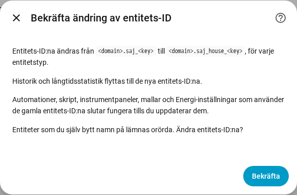

[en](../../en-gb/user/entities-and-prefix.md) | [de](../../de/user/entities-and-prefix.md) | [nl](../../nl/user/entities-and-prefix.md) | [fr](../../fr/user/entities-and-prefix.md) | [zh](../../zh-hans/user/entities-and-prefix.md) | [es](../../es/user/entities-and-prefix.md) | [it](../../it/user/entities-and-prefix.md) | [pl](../../pl/user/entities-and-prefix.md) | sv

# Entiteter och prefixet

Sidan Entiteter och prefixet förklarar vad ett systems entiteter är, hur entitets-ID:na bildas och hur du lägger till ett prefix i entitets-ID:na. De fullständiga listorna finns i avsnitten [Enheter och entiteter](../../../custom_components/saj_local/docs/features.md#devices-and-entities) och [Entitets-ID och prefix](../../../custom_components/saj_local/docs/features.md#entity-ids-and-prefix) i integrationens funktionslista. Varje entitets namn, ID, modell och standardvärde finns i [entitetsreferensen](entities/README.md).

## Ett systems entiteter

Varje avläsning, inställning och kommando som SAJ Local känner till för din modell är en entitet på systemets enhet. Varje entitet har den typ som Home Assistant-användare förväntar sig för avläsningen eller inställningen: en sensor, en binär sensor, ett nummer, ett val, en brytare, en tid eller en knapp. En inställning visas som inställningens verkliga kontrolltyp, så en gräns är ett nummer och en inställning som är på eller av är en brytare.

- **Bara en grunduppsättning är aktiverad.** Avläsningar av effekt, spänning, temperatur och laddningsnivå, energiräknarna, de viktigaste batterigränserna och varje fel är aktiverade. Allt annat skapas inaktiverat.
- **En inaktiverad entitet läses inte av.** Att aktivera en entitet lägger till entiteten i nästa avläsning. Att inaktivera en entitet gör att registret inte längre läses. [Avfrågning](polling.md) visar vad ett val kostar växelriktaren.
- **Ett system får bara de entiteter som passar.** En H2 med en solcellssträng har inga entiteter för en andra sträng. Utrustning som inte är installerad skapar inga entiteter, se [valfri utrustning](optional-equipment.md).
- **Inställningar och diagnostik är grupperade.** Inställningar ligger i kategorin konfiguration. Versioner, driftsättningsinställningar och nätverksinställningar ligger i kategorin diagnostik.
- **Ett okänt alternativ visas som okänt.** Alternativets kod finns i [diagnostiknedladdningen](troubleshooting.md#ladda-ner-diagnostik), så att alternativet kan rapporteras.

När du ställer in modellen för hand för en växelriktare som inte känns igen får systemet varje entitet för den valda modellen, med de entiteter som ligger utöver en fas och två solcellssträngar inaktiverade. Se [kom igång](getting-started.md#när-växelriktaren-inte-känns-igen).

## Effektens tecken

Batteriets effekt och nätets effekt använder ett tecken på varje modell, så en avläsning har en betydelse på en HS3 och på en H2.

- **Batteriets effekt** är positiv medan batteriet laddar ur och negativ medan batteriet laddar.
- **Nätets effekt** är positiv medan systemet exporterar och negativ medan systemet importerar. Mätare A följer nätets tecken.
- **Mätare B** är positiv medan den solcellsväxelriktare som Mätare B mäter producerar.

Målen för [effektstyrning](power-control.md) följer avläsningarnas tecken.

## Prefixet

Varje entitets-ID har formen `<type>.saj_<key>`, till exempel `sensor.saj_pv_power`. Att byta namn på en entitets visningsnamn ändrar inte ID:t.

Ett prefix lägger till ett ord efter `saj_` i varje entitets-ID i ett system, till exempel `sensor.saj_house_pv_power`. Använd ett prefix när du har fler än ett SAJ-system, så att inget entitets-ID behöver få ett nummer tillagt.

- Använd bara gemener och siffror, högst 32 tecken.
- Två system kan inte dela ett prefix, och bara ett system kan sakna prefix.
- Ett prefix som skulle krocka med ett entitetsnamn, till exempel `battery`, nekas.
- Installationen nekas när ett entitets-ID som systemet skulle skapa redan är upptaget.

### Lägg till, ändra eller ta bort ett prefix

1. Öppna Konfigurera, kugghjulet på systemets rad på sidan för SAJ Local-integrationen.
2. Ändra fältet Prefix och välj Skicka.
3. Läs bekräftelsen och välj sedan Skicka igen.

Bekräftelsen visar det gamla och det nya mönstret. Automationer, skript, instrumentpaneler, mallar och Energi-inställningar som använder de gamla entitets-ID:na slutar fungera tills du uppdaterar referenserna.

Efter att du bekräftat:

- SAJ Local byter namn på varje entitet i systemet, aktiverad eller inaktiverad, och Home Assistant flyttar historiken och långtidsstatistiken till de nya ID:na.
- En entitet som du själv bytt namn på lämnas orörd.
- [Instrumentpanelskorten](cards/README.md) fortsätter fungera, eftersom korten hittar entiteter via entitetsregistret och inte via ID.

SAJ Local nekar ändringen och byter inte namn på något när ett nytt ID redan är upptaget, eller när Home Assistant redan har långtidsstatistik under ett nytt ID, till exempel från ett system som du tagit bort och som hade prefixet.

Om en senare version lägger till en entitet och entitetens ID redan är upptaget lägger Home Assistant till ett nummer i ID:t, och en varning i loggen anger entitetens slag och nyckel.

## Stöds inte ännu

- Att välja nyckeldelen i ett entitets-ID. SAJ Local fastställer nyckeln, så att instrumentpaneler och automationer fungerar likadant på varje modell.
