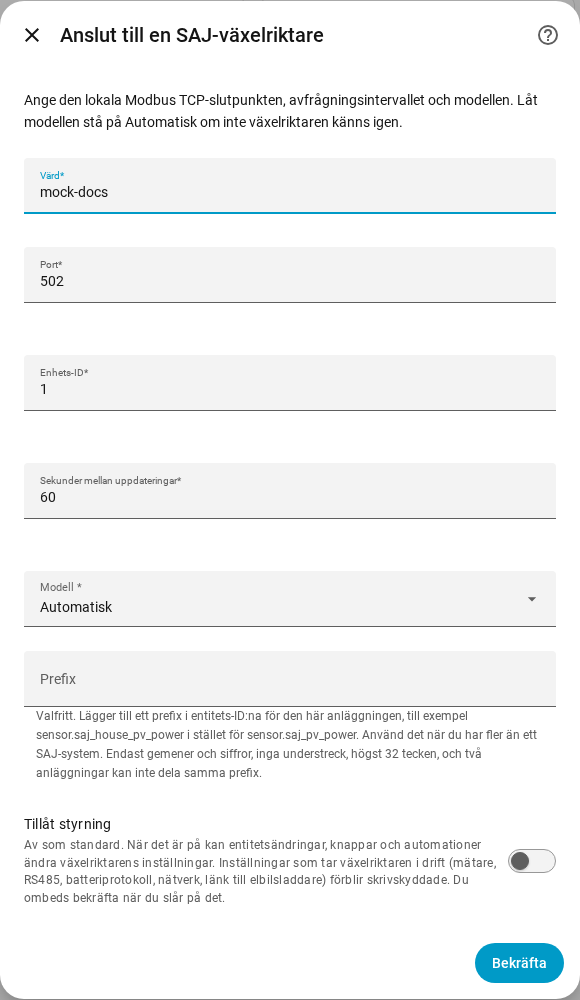
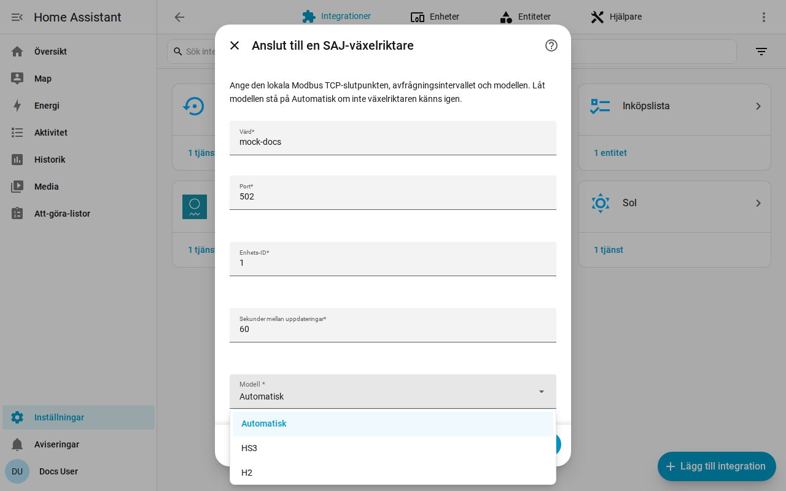

[en](../../en-gb/user/getting-started.md) | [de](../../de/user/getting-started.md) | [nl](../../nl/user/getting-started.md) | [fr](../../fr/user/getting-started.md) | [zh](../../zh-hans/user/getting-started.md) | [es](../../es/user/getting-started.md) | [it](../../it/user/getting-started.md) | [pl](../../pl/user/getting-started.md) | sv

# Kom igång

Sidan Kom igång lägger till ditt SAJ-system i Home Assistant och berättar vad du får efteråt. Den fullständiga listan över vad installationen gör finns i avsnittet [Installation och identifiering](../../../custom_components/saj_local/docs/features.md#setup-and-detection) i integrationens funktionslista. [Installera SAJ Local](installation.md) först och kontrollera att din växelriktare finns bland den [utrustning som stöds](supported-equipment.md).

## Lägg till ett system

1. Öppna Inställningar i Home Assistant och sedan Enheter och tjänster.
2. Välj Lägg till integration och sök efter SAJ Local.
3. Fyll i formuläret och välj Skicka.

| Fält | Vad du anger |
| --- | --- |
| Värd | Växelriktarens värdnamn eller IP-adress. |
| Port | Modbus TCP-porten. Standard är 502. |
| Enhets-ID | Modbus-enhets-ID:t, från 1 till 247. Standard är 1. |
| Sekunder mellan uppdateringar | Hur ofta varje aktiverad entitet läses av. Standard är 60 och lägsta värde är 10. Se [avfrågning](polling.md). |
| Modell | Låt stå på Automatisk. SAJ Local känner igen HS3 och H2 med en fas från den enhetstyp som växelriktaren rapporterar. |
| Prefix | Valfritt. Lämna tomt för det första systemet. Se [entiteter och prefixet](entities-and-prefix.md#prefixet). |
| Tillåt styrning | Av som standard, så att inget kan ändra en inställning. Se [ändra inställningar](changing-settings.md). |

SAJ Local ansluter till växelriktaren, läser växelriktarens identitet och sex centrala avläsningar (driftläge, batteriets laddningsnivå, lasteffekt, solcellseffekt, batterieffekt och nätets effekt) och skapar systemet. Ett register som en enhet saknar stoppar inte installationen. Systemet får titeln SAJ följt av växelriktarens serienummer.

När installationen misslyckas anger formuläret vad som gick fel: ingen anslutning, inget svar i tid, en nekad avläsning, ogiltiga data, en enhet som inte känns igen eller en modell som inte stämmer med växelriktaren. Ingenting sparas förrän kontrollen lyckas.

## Vad du får

- En Home Assistant-enhet som heter SAJ. Enhetens modell visar modellen och märkeffekten, till exempel HS3 (12000 W).
- De entiteter som passar din modell och utrustning. SAJ Local identifierar batteriet, mätarna och den andra utrustningen åt dig, se [valfri utrustning](optional-equipment.md).
- Bara en grunduppsättning entiteter är aktiverad. Alla andra skapas inaktiverade, så att växelriktaren inte läses av för värden du inte bett om. Aktivera en entitet i Home Assistant så ingår entiteten i nästa avläsning. Se [entiteter och prefixet](entities-and-prefix.md).
- [Instrumentpanelskorten](cards/README.md), utan något att installera.

## Lägg till ett andra system

Lägg till SAJ Local igen från Enheter och tjänster. SAJ Local nekar en slutpunkt eller ett växelriktarserienummer som redan är konfigurerat. Ge varje system ett eget [prefix](entities-and-prefix.md#prefixet), så att inget entitets-ID behöver få ett nummer tillagt.

## När växelriktaren inte känns igen

När växelriktaren rapporterar en enhetstyp som SAJ Local inte känner igen misslyckas Automatisk med ett fel som ber dig välja modell för hand. Välj HS3 eller H2 i fältet Modell.

- Ett val som motsäger en igenkänd växelriktare nekas. Välj den modell som felet anger, eller Automatisk.
- För en växelriktare som inte känns igen läser SAJ Local de nödvändiga registren och ber dig bekräfta modellen. Registren måste svara först.
- Enheten visar sedan modellen som overifierad. Avläsningarna kan vara felaktiga, eftersom SAJ Local inte kan kontrollera avläsningarna mot enhetstypen, och varje försök att ändra en inställning nekas.

## Ändra ett system senare

Öppna Konfigurera, kugghjulet på systemets rad på sidan för SAJ Local-integrationen. Du kan ändra värd, port, enhets-ID, uppdateringsintervall, modell, prefix och Tillåt styrning, och ställa in varje del av utrustningen. SAJ Local sparar ändringen först när växelriktaren svarar på den nya slutpunkten. [Byta växelriktare](replacing-the-inverter.md) tar upp en ny växelriktare.

## Stöds inte ännu

- Andra produkter än HS3 och H2 med en fas. Se [utrustning som stöds](supported-equipment.md).
- Att hitta växelriktaren i nätverket. Du anger växelriktarens adress.
