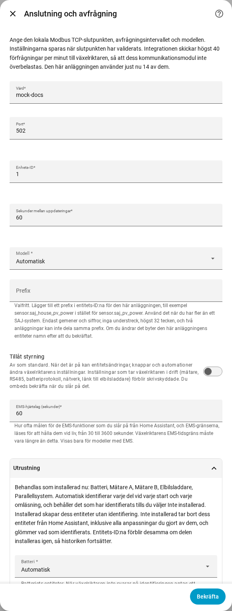

[en](../../en-gb/user/optional-equipment.md) | [de](../../de/user/optional-equipment.md) | [nl](../../nl/user/optional-equipment.md) | [fr](../../fr/user/optional-equipment.md) | [zh](../../zh-hans/user/optional-equipment.md) | [es](../../es/user/optional-equipment.md) | [it](../../it/user/optional-equipment.md) | [pl](../../pl/user/optional-equipment.md) | sv

# Valfri utrustning

Sidan Valfri utrustning förklarar hur SAJ Local tar reda på vilken valfri utrustning din växelriktare har och hur du åsidosätter resultatet. Den fullständiga listan finns i avsnittet [Valfri utrustning](../../../custom_components/saj_local/docs/features.md#optional-equipment) i integrationens funktionslista. Sidan [utrustning som stöds](supported-equipment.md) anger vilken modell som kan ha vad, och [entitetsreferensen](entities/README.md) anger vilka entiteter varje del av utrustningen lägger till.

## Vad SAJ Local identifierar

Installationen frågar inget om utrustning. Varje gång SAJ Local läses in, vilket gäller varje start av Home Assistant och varje omläsning, frågar SAJ Local växelriktaren vad som är monterat och skapar bara entiteter för den utrustningen.

| Utrustning | Modeller |
| --- | --- |
| Batteri | HS3 och H2 |
| Mätare A, nätmätaren | HS3 och H2 |
| Mätare B, den andra mätaren | HS3 och H2 |
| Parallellsystem | HS3 och H2 |
| Elbilsladdare | Endast HS3 |

- **Växelriktaren svarar inte på kontrollen:** SAJ Local antar ett batteri och Mätare A, och antar inte den andra utrustningen.
- **En mätare är offline under en omstart:** identifierad utrustning kommer ihåg, så utrustningen behåller sina entiteter.
- **Utrustning som monteras senare:** SAJ Local upptäcker utrustningen vid nästa omstart eller omläsning.

## När utrustning som kommer ihåg inte längre identifieras

SAJ Local behåller utrustningens entiteter, så att historik och instrumentpaneler förblir oförändrade, och skapar ett reparationsärende i Home Assistant. Reparationsärendet anger utrustningen och systemet. Kontrollera utrustningen, eller ställ in utrustningen som Inte installerad enligt beskrivningen nedan. Reparationsärendet försvinner vid nästa inläsning som identifierar utrustningen igen, eller när du ändrar inställningen.

## Åsidosätt identifieringen

1. Öppna Konfigurera, kugghjulet på systemets rad på sidan för SAJ Local-integrationen.
2. Expandera avsnittet Utrustning.
3. Ställ in varje del av utrustningen på Automatisk, Installerad eller Inte installerad och välj sedan Skicka.

Avsnittet listar också vad SAJ Local just nu behandlar som installerat.

| Inställning | Vad inställningen gör |
| --- | --- |
| Automatisk | Identifierar utrustningen vid varje start och varje omläsning, och behåller det som identifierades tills du väljer Inte installerad. Automatisk är standard. |
| Installerad | Skapar utrustningens entiteter utan att identifiera utrustningen. |
| Inte installerad | Tar bort utrustningens entiteter från Home Assistant, inklusive alla ändringar du gjort av entiteterna, till exempel ett nytt namn. SAJ Local glömmer vad som identifierades. |

Entitets-ID:na förblir oförändrade, så historiken fortsätter om du ställer tillbaka utrustningen på Installerad eller Automatisk. Entiteter för utrustning som inte är installerad kan inte läsas av, avfrågas eller skrivas.

Avsnittet listar bara den utrustning som din modell kan ha. Endast HS3: elbilsladdaren.

## Batteripack

- **H2:** en H2 rapporterar hur många batteripack H2 har, upp till fem. SAJ Local skapar packentiteter för så många pack. Ett antal på 0 behåller entiteterna för varje pack. SAJ Local kommer ihåg det högsta antal SAJ Local har sett. Varje pack har identitetsentiteter, skapade inaktiverade.
- **HS3:** en HS3 har entiteter för ett batteripack.

## Elbilsladdare

Endast HS3: en HS3 med en elbilsladdare får också laddarens avläsningar, inställningar, laddningstidsluckor och EMS-laddningsstyrningar. De flesta skapas inaktiverade. När Tillåt styrning slås på aktiveras inställningarna och tidsluckorna, se [ändra inställningar](changing-settings.md#styrningsuppsättningen).

## Stöds inte ännu

- Utrustning som SAJ Local inte identifierar. Utrustningen i tabellen är den fullständiga listan.
- Att identifiera en elbilsladdare på en H2.
