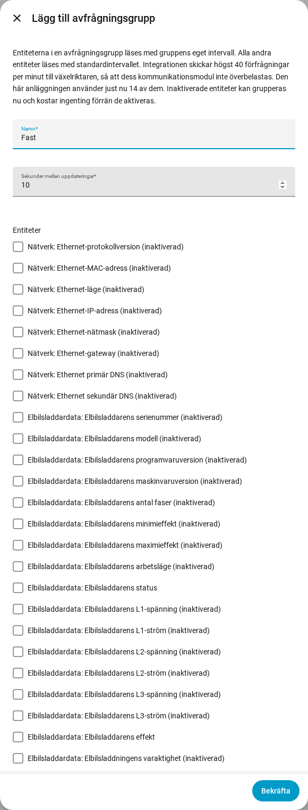

[en](../../en-gb/user/polling.md) | [de](../../de/user/polling.md) | [nl](../../nl/user/polling.md) | [fr](../../fr/user/polling.md) | [zh](../../zh-hans/user/polling.md) | [es](../../es/user/polling.md) | [it](../../it/user/polling.md) | [pl](../../pl/user/polling.md) | sv

# Avfrågning

Sidan Avfrågning förklarar hur ofta SAJ Local läser av växelriktaren och hur du läser av vissa entiteter snabbare eller långsammare. Den fullständiga listan finns i avsnittet [Avfrågning](../../../custom_components/saj_local/docs/features.md#polling) i integrationens funktionslista. De gränser som gäller för varje förfrågan finns under [skydda växelriktaren](protecting-the-inverter.md).

SAJ Local läser av växelriktaren över Modbus TCP i ditt lokala nätverk, enligt ett schema som du styr. Ingenting lämnar ditt nätverk.

## Standardintervallet

Varje aktiverad entitet läses av var 60:e sekund som standard. Ändra fältet Sekunder mellan uppdateringar i Konfigurera, kugghjulet på systemets rad på sidan för SAJ Local-integrationen. Intervallet är aldrig kortare än 10 sekunder.

Bara aktiverade entiteter läses av. Inaktivera en entitet i Home Assistant så läses entitetens register inte längre av.

## Avfrågningsgrupper

En avfrågningsgrupp läser av valda entiteter snabbare eller långsammare än standardvärdet. Använd en grupp till exempel för att läsa av effekten för hem, sol, batteri och nät var 10:e sekund medan allt annat ligger kvar på 60.

1. Öppna menyn på systemets rad på sidan för SAJ Local-integrationen och välj Lägg till avfrågningsgrupp. Knappen Lägg till avfrågningsgrupp högst upp på sidan öppnar också formuläret Lägg till avfrågningsgrupp.
2. Ange ett namn, sekunderna mellan uppdateringar (minst 10) och gruppens entiteter.
3. Välj Skicka, läs granskningen och välj sedan Spara gruppen.

- **Vilken entitet som helst:** en grupp kan innehålla entiteter av alla typer. En inaktiverad entitet kan också väljas, och kostar ingenting förrän du aktiverar entiteten.
- **Högst en grupp:** en entitet tillhör högst en grupp. Varje entitet som inte ingår i någon grupp ligger kvar på standardintervallet.
- **Registerordning:** formuläret listar entiteterna i registerordning, var och en märkt med det registerblock som entiteten läses från, så att entiteter som kan dela en förfrågan hamnar bredvid varandra.
- **Redigera eller ta bort:** öppna avfrågningsgruppen från integrationssidan. Att ändra eller ta bort en grupp behåller entiteterna, entiteternas namn och entiteternas historik.

Alla intervall i ett system delar en klocka, så entiteter som ska läsas samtidigt läses tillsammans. En avläsning som drar över tiden hämtas inte ikapp. De missade tickarna släpps och avfrågningen fortsätter från nästa tick.

## Förfrågningsbelastningen

SAJ Local skickar till en växelriktare högst 40 förfrågningar under valfria 60 sekunder. Formuläret visar vad ditt val kostar, som förfrågningar per minut mot den gränsen. Formuläret ovan visar en aktuell belastning på 14 förfrågningar per minut som exempel.

- **Innan du sparar en grupp:** granskningssteget visar hur många förfrågningar en avläsning av gruppen tar, samt belastningen före och efter att du sparar.
- **Över gränsen:** du kan ändå spara gruppen. Granskningen varnar för att avläsningarna går långsammare än du konfigurerat, eftersom SAJ Local aldrig skickar fler än gränsen.
- **Ett nytt standardintervall:** Konfigurera ber dig bekräfta när det nya intervallet gör att belastningen överskrider gränsen.
- **Färre förfrågningar:** entiteter som ligger tillsammans i ett registerblock kostar en förfrågan. Entiteter i olika block kostar en förfrågan var.

Att aktivera en entitet i Home Assistant kan inte fångas upp av ett formulär. [Diagnostiknedladdningen](troubleshooting.md#ladda-ner-diagnostik) listar den planerade belastningen mot gränsen för det fallet.

## Stöds inte ännu

- En avfrågningsgrupp med ett intervall under 10 sekunder.
