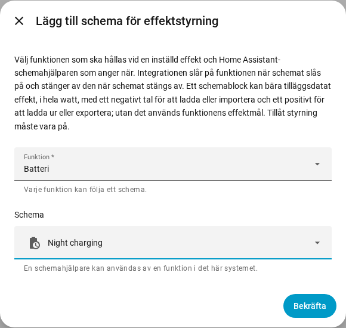

[en](../../en-gb/user/power-control.md) | [de](../../de/user/power-control.md) | [nl](../../nl/user/power-control.md) | [fr](../../fr/user/power-control.md) | [zh](../../zh-hans/user/power-control.md) | [es](../../es/user/power-control.md) | [it](../../it/user/power-control.md) | [pl](../../pl/user/power-control.md) | sv

# Effektstyrning

Sidan Effektstyrning förklarar hur du håller batteriet, nätanslutningspunkten eller växelriktaren vid en inställd effekt, för hand eller med ett Home Assistant-schema. Den fullständiga listan finns i avsnittet [Effektstyrning](../../../custom_components/saj_local/docs/features.md#power-control) i integrationens funktionslista. Brytarna och målen finns bland [entiteterna som integrationen lägger till](entities/added-by-the-integration.md) i entitetsreferensen.

Effektstyrning fungerar på ett sätt på varje modell som erbjuder en funktion. Effektstyrning gör ingenting medan [Tillåt styrning](changing-settings.md#tillåt-styrning) är av eller modellen är overifierad.

| Funktion | Vad funktionen håller vid den inställda effekten | HS3 | H2 |
| --- | --- | --- | --- |
| Batteri | Batteriet laddar eller laddar ur. | Ja | Ja |
| Nät | Nätanslutningspunkten importerar eller exporterar. Kräver Mätare A. | Ja | Nej |
| Växelriktare | Växelriktaren tar in eller ger ut effekt. | Ja | Nej |

En positiv effekt laddar ur, exporterar eller ger ut. En negativ effekt laddar, importerar eller tar in. Tecknen följer [effektens tecken](entities-and-prefix.md#effektens-tecken) i avläsningarna.

## Håll en funktion vid en effekt

Varje funktion har en brytare och ett effektmål i hela watt. Båda skapas inaktiverade och ligger i kategorin konfiguration. Att slå på Tillåt styrning aktiverar brytarna och målen, se [styrningsuppsättningen](changing-settings.md#styrningsuppsättningen).

1. Ställ in funktionens effektmål. Målet avrundas till närmaste steg som växelriktaren stöder och visar den effekt som växelriktaren håller.
2. Slå på funktionen. En funktion behöver ett effektmål innan funktionen kan slås på.
3. Slå av funktionen för att stoppa.

- Målet behålls över omstarter och skickas när funktionen startar. Att ändra målet medan funktionen körs skickar den nya effekten direkt.
- Bara en funktion körs åt gången. Att slå på en funktion medan en annan körs nekas, och meddelandet anger den funktion som körs.
- Brytaren är på medan växelriktaren rapporterar att funktionen körs, även när funktionen startades utanför Home Assistant.
- En start som misslyckas ångras. Ett stopp som misslyckas skickas igen varje hjärtslagsintervall, tills växelriktaren rapporterar att funktionen stoppats.
- [Styrkortet på instrumentpanelen](cards/controls-card.md) visar varje funktion med en brytare, ett mål och en ledtråd om tecknet.

### När Home Assistant stoppas

En funktion som du slagit på från Home Assistant slås av när SAJ Local läses ur och när Home Assistant stoppas. En funktion som redan körde när SAJ Local lästes in lämnas igång.

- Endast HS3: EMS-hjärtslaget håller funktionen vid liv. Efter ett tvärt stopp kan växelriktarens EMS-tidsgräns avsluta funktionen, men SAJ Local förlitar sig inte på tidsgränsen. Se [EMS](changing-settings.md#ems).
- Endast H2: en funktion som lämnats igång av ett tvärt stopp fortsätter köra tills du slår av funktionen.

## Följ ett schema

Ett schema för effektstyrning får en funktion att följa en Home Assistant-schemahjälpare. Funktionen är på medan schemat är på och av när schemat slås av.

1. Skapa en schemahjälpare i Home Assistant: Inställningar, Enheter och tjänster, Hjälpare, Skapa hjälpare, Schema. Ange schemats tider och veckodagar.
2. Öppna menyn på systemets rad på sidan för SAJ Local-integrationen och välj Lägg till schema för effektstyrning.
3. Välj funktionen och schemahjälparen och välj sedan Skicka.

Ett block i schemahjälparen kan bära tilläggsdatat `power`, i hela watt med tecknet ovan, till exempel `power: -600` för att ladda batteriet med 600 W. Utan `power` använder SAJ Local funktionens effektmål.

- Varje funktion följer ett schema, och en schemahjälpare styr en funktion i ett system.
- Schemat följer ett namnbyte av hjälparen. En hjälpare som saknas i entitetsregistret nekas, så välj en hjälpare som du skapat i gränssnittet.
- SAJ Local nekar ett schema medan Tillåt styrning är av.
- Ändra eller ta bort ett schema från integrationssidan. Systemet läses in igen när du gör det.

### Vad ett schema gör

| Situation | Vad som händer |
| --- | --- |
| Schemat slås på och ingen funktion körs | SAJ Local ställer in effekten från blocket, eller använder effektmålet, och startar sedan funktionen. |
| Blocket har ingen `power` och funktionen har inget effektmål | Ingenting startar. Åtgärden förblir utestående, med en varning. |
| Funktionen körs redan | SAJ Local ändrar effekten när blocket har en, och tar över funktionen. |
| En annan funktion körs | Ingenting skrivs. Åtgärden förblir utestående. |
| Starten nekas eller misslyckas | Åtgärden förblir utestående. SAJ Local försöker igen varje hjärtslagsintervall. |
| Blockets `power` är inte ett heltal inom målets intervall | Ingenting startar. Åtgärden förblir utestående, med en varning. |
| Schemat flyttar till ett block med en annan `power` | SAJ Local ändrar effekten. |
| Du slår av funktionen för hand medan schemat är på | Funktionen förblir av tills schemat nästa gång slås på. |
| Schemat slås av och SAJ Local startade funktionen | SAJ Local stoppar funktionen. |

När inget önskas och inget är utestående skickar SAJ Local ingenting. [Diagnostiknedladdningen](troubleshooting.md#ladda-ner-diagnostik) listar varje funktion, varje schema och den åtgärd som är utestående.

## Stöds inte ännu

- Effektstyrning av Nät och Växelriktare på H2.
- Mer än en funktion åt gången.
- Mer än ett schema för en funktion.
