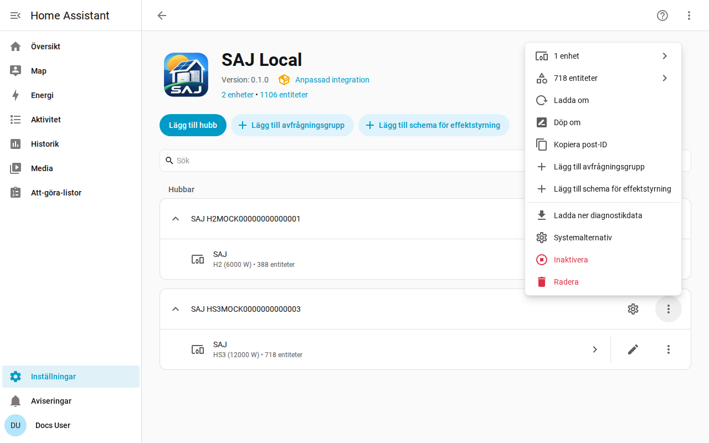

[en](../../en-gb/user/troubleshooting.md) | [de](../../de/user/troubleshooting.md) | [nl](../../nl/user/troubleshooting.md) | [fr](../../fr/user/troubleshooting.md) | [zh](../../zh-hans/user/troubleshooting.md) | [es](../../es/user/troubleshooting.md) | [it](../../it/user/troubleshooting.md) | [pl](../../pl/user/troubleshooting.md) | sv

# Felsökning

Sidan Felsökning visar hur du laddar ner diagnostik, slår på felsökningsloggning och läser de vanliga problemen. Den fullständiga listan finns i avsnittet [Diagnostik och felsökningsloggning](../../../custom_components/saj_local/docs/features.md#diagnostics-and-debug-logging) i integrationens funktionslista.

Diagnostiknedladdningen och felsökningsloggen visar vad växelriktaren returnerar och vad SAJ Local gjorde med avläsningarna, utan att avslöja vem eller var du är. Båda använder Home Assistants verktyg, så inget behöver installeras och inget skickas någonstans.

## Börja med entiteterna och reparationerna

- Kontrollera [Inställningar och Reparationer](faults-and-repairs.md#reparationsärenden) efter ett reparationsärende för systemet. Varje ärende anger vad som är fel och vad du ska göra.
- Kontrollera [enhetsfelen](faults-and-repairs.md#enhetsfel) när växelriktaren rapporterar ett problem.
- Entiteter som visas som otillgängliga efter en nekad avläsning beskrivs i [skydda växelriktaren](protecting-the-inverter.md#när-växelriktaren-nekar-en-avläsning).

## Ladda ner diagnostik

1. Öppna Inställningar, sedan Enheter och tjänster och sedan SAJ Local.
2. Öppna menyn på systemets rad och välj Ladda ner diagnostik.

Filen innehåller:

- de aktiverade entiteterna, intervallen med de förfrågningar som varje intervall tar, och den planerade belastningen mot gränsen på 40 förfrågningar per minut;
- nekade och tillfälligt avstängda entiteter;
- de aktiva felen med felens råa ord, och de okända felbitarna som register och bit;
- de öppna reparationsärendena, och hur länge växelriktaren har misslyckats;
- effektstyrningsfunktionerna, vilken som körs, vilken SAJ Local äger och den åtgärd som väntar för varje schema;
- en ögonblicksbild av de råa orden i varje register som SAJ Local har läst sedan systemet lästes in, med åldern för varje, så att en underhållare kan kontrollera en avläsning mot den verkliga enheten;
- varje förfrågan som inte fick något användbart svar, med orsaken. En förfrågan som fick tidsgränsen överskriden ser annorlunda ut än en förfrågan som växelriktaren nekade, och skillnaden spelar roll när en annan klient håller växelriktarens anslutning. Varje nekad entitet, varje misslyckad förfrågan och varje rad i felsökningsloggen anger Modbus-funktionen för förfrågan.

Ögonblicksbilden lägger inte till någon förfrågan till växelriktaren. Ögonblicksbilden börjar tom varje gång systemet läses in.

## Slå på felsökningsloggning

1. Öppna sidan för SAJ Local-integrationen.
2. Öppna trepunktsmenyn på integrationssidan och välj Aktivera felsökningsloggning.
3. När systemet inte kunde installeras läser du in systemet igen från systemets meny, så att loggen omfattar installationen.
4. Återskapa problemet.
5. Välj Inaktivera felsökningsloggning. Home Assistant laddar ner loggen.

Felsökningsloggningen registrerar varje anslutning, avfrågning, förfrågan, skrivning, hjärtslag och schemaändring, en rad per händelse. Varje loggrad börjar med systemets titel och serienumret maskerat till de tre sista tecknen, så att rader från två system kan skiljas åt. En titel som innehåller serienumret har serienumret maskerat på plats, till exempel `SAJ xxxxx123`.

## Vad filen och loggen utelämnar

Diagnostik och loggar innehåller aldrig värd, port, enhets-ID, fullständigt serienummer, MAC-adress, nätverksadresser, elbilsladdarens serienummer, prefix eller namn på avfrågningsgrupper. I registerögonblicksbilden ersätts orden i de register som innehåller nätverksadresserna och serienumren av Home Assistants maskeringsmarkör, så att du kan se att registret svarade utan att se vad registret sa.

## Vanliga problem

| Vad du ser | Vad du ska kontrollera |
| --- | --- |
| Installationen misslyckas utan anslutning eller utan svar | Värd, port och enhets-ID. Se till att ingen annan Modbus-klient håller växelriktarens anslutning. |
| Installationen säger att enheten inte känns igen | Välj modellen för hand. Se [kom igång](getting-started.md#när-växelriktaren-inte-känns-igen). |
| En inställning nekar en ändring | Tillåt styrning är av, modellen är overifierad eller inställningen är en driftsättningsinställning. Meddelandet anger vilket. Se [ändra inställningar](changing-settings.md). |
| Avläsningar går långsammare än intervallet du angav | Belastningen överskrider gränsen på 40 förfrågningar per minut. Se [avfrågning](polling.md#förfrågningsbelastningen). |
| En entitet som du aktiverade har inget värde ännu | Home Assistant läser in systemet igen ungefär 30 sekunder efter att du aktiverat en entitet, och entiteten läses av från nästa avläsning. |
| Entitets-ID:n fick ett nummer | ID:t som entiteten ville ha var upptaget. Se [entiteter och prefixet](entities-and-prefix.md#prefixet). |
| Entiteter saknas | Utrustningen identifieras inte eller är inställd på Inte installerad. Se [valfri utrustning](optional-equipment.md). |

## Hjälp och återkoppling

Frågor, buggrapporter och idéer är välkomna i [ärendehanteraren](https://github.com/Counterphase-Labs/ha-saj-local/issues). Öppna formuläret Bug report för ett problem med integrationen och formuläret Card bug report för ett problem med ett instrumentpanelskort. Formuläret Bug report kräver diagnostiknedladdningen. Rapportera ett säkerhetsproblem privat, se [säkerhetspolicyn](../../../SECURITY.md).
